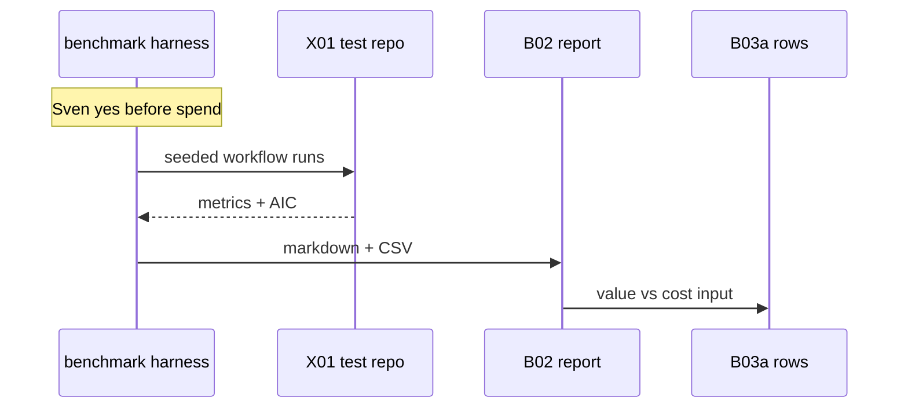

# X07: Workflow benchmark harness
- Status: todo
- Area: testing
- Wave: W3
- Block: 3
- Lane: Builder
- Depends on: X01, B02
- proof: test -f scripts/benchmark-workflows.sh; ./scripts/verify.sh; benchmark output paths documented in B02 report
- door: two-way
## Goal
Benchmark NOW workflows on the fixed [X01](X01-test-repo-trialops.md) test repo with seeded issues and PRs. Per workflow and per run, compare AIC cost, runtime, and outcomes (findings count, accepted comments, noop rate) run to run and version to version (before/after pin bump or prompt change). Emit one markdown table plus CSV embedded in the [B02](../observability/B02-weekly-spend-overview.md) report. Feeds [B03a](../observability/B03a-value-vs-cost.md) value columns.
## Context
Sven-requested benchmark track. Harness and docs are two-way; each benchmark execution spends AIC and needs Sven's yes per block (same bar as trial runs). Compares against [B03](../observability/B03-outcomes-impact.md) outcomes when Block 5 ships; until then B03a rows use benchmark + live trial data.
## Steps
1. Add `scripts/benchmark-workflows.sh` (or makefile target) with fixed seed data on X01.
2. Record per-run: workflow id, git SHA, gh-aw pin, AIC, duration, outcome metrics, noop flag.
3. Support before/after pairs for pin bump (`scripts/bump-pin.sh`) and prompt edits.
4. Write markdown table + CSV paths consumed by B02 weekly job.
5. Document Sven yes gate for any token-spending benchmark run in Named asks.
## Definition of Done
- [ ] Harness script exists and documents seed issues/PRs on X01
- [ ] Output schema documented (markdown + CSV) and linked from B02, B03a
- [ ] Run-to-run and version-to-version comparison documented with examples
- [ ] door two-way for harness; benchmark runs called out as one-way spend per block
- [ ] Mermaid flow present
## Evidence
(sample benchmark CSV row; verify log on SHA; optional audited run id when Sven approves spend)
## Flow

## Named asks for Sven
X01 test repo; per-block yes before any benchmark run that spends AIC
## Cost
Per workflow tier bands (unverified); benchmark multiplies spend (gated)
## Sources
- Plan v3.6 X07 benchmark
- [gist-review.md](../gist-review.md)
- Related: [B02-weekly-spend-overview.md](../observability/B02-weekly-spend-overview.md), [B03a-value-vs-cost.md](../observability/B03a-value-vs-cost.md)
