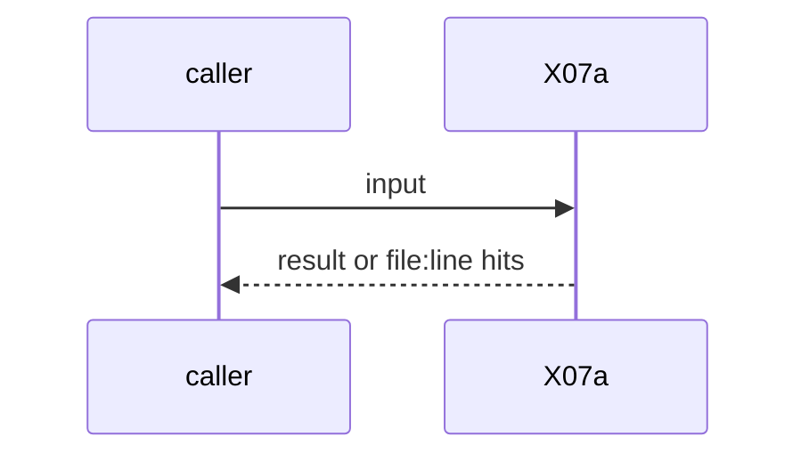
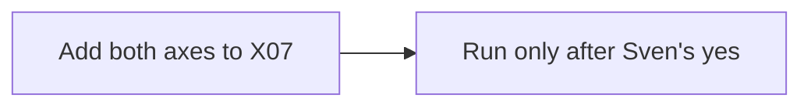

# X07a: X07 axes: engine swap and roles split vs one model
- Status: todo
- Area: testing
- Wave: W5
- Block: 5
- Lane: Builder
- Depends on: X07
- proof: X07 report has rows per engine and per roles setup (split triage and build vs one model) on the same cases
- door: one-way
- one-way gate: spend: Sven's exact yes before any benchmark run. Rollback: drop the axis rows
- triage: spec
- feedback: X07 report rows
- harness: gh-aw, engine copilot via shared/defaults.md (when built)
- review-input: diff + this PBI + DoD (+ linked spec) + PR description, never builder session logs (PA6)
- kind: script
- Source: D36 https://docs.warp.dev/factories/ https://www.warp.dev/blog/using-llm-as-a-judge-scoring-to-measure-your-software-factory https://www.warp.dev/blog/we-are-now-factory-engineers-not-product-engineers
## Goal
X07 gets two axes on the same fixed cases: engine A vs engine B, and split roles vs one model. Logs tokens, turns, pass. Absorbs HX06 and BH04.
## Context
Warp Factories: Benchmarks compare configurations on the same tasks. Ben Holmes: "benchmarking whether we need separate agents for steps like triage vs. implementation, or if a single high-intelligence model can do most of it". Warp memo: eval different harnesses and prompts. Not built in PR #4: docs only, nothing enabled (PA9).
## Steps
1. Add both axes to X07.
2. Run only after Sven's yes.
## Definition of Done
- [ ] Report has both axes
- [ ] Cost measured
- [ ] Every Bar H line from [README.md](../README.md#bar-h-every-workflow-pbi) when the workflow ships
## Technical design
- Components and files: X07 benchmark docs
- Module boundary: axis rows
- Interfaces: X07 report
- Sequence:

- Failure modes: One engine unavailable: row marked n/a
- Security: Secrets per engine set by Sven
- Observability: report
- Cost: benchmark spend, Sven's yes
- Rollback: Drop the rows
- Proof: same as proof: above
- Door: one-way (spend or autonomy, Sven's yes)
## Evidence
(todo)
## Flow

## Named asks for Sven
Sven's exact yes before the one-way step: spend: Sven's exact yes before any benchmark run
## Cost
benchmark spend, Sven's yes
## Sources
- [Warp Factories overview](https://docs.warp.dev/factories/)
- [Warp blog, LLM-as-a-judge scoring](https://www.warp.dev/blog/using-llm-as-a-judge-scoring-to-measure-your-software-factory)
- [Warp blog, factory engineers memo](https://www.warp.dev/blog/we-are-now-factory-engineers-not-product-engineers)
- Strategy id list v3.12 (aw-final-ids.md), url-learnings.md D36
