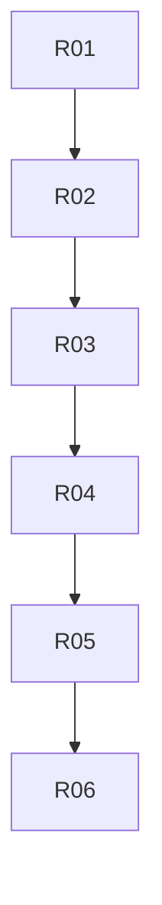

# triggers: overview

**Purpose:** Dispatch, schedules, slash commands, workflow_run.

## PBIs

- [R01: R01-dispatch-fuzzy-schedule-cooldown](R01-dispatch-fuzzy-schedule-cooldown.md)
- [R02: R02-issue-label-skip-if-match-filters](R02-issue-label-skip-if-match-filters.md)
- [R03: R03-slash-commands-reactions](R03-slash-commands-reactions.md)
- [R04: R04-workflow-run-deployment-status](R04-workflow-run-deployment-status.md)
- [R05: R05-webhook-triggers](R05-webhook-triggers.md)
- [R06: R06-provider-triggers](R06-provider-triggers.md)

## Dependency sketch

