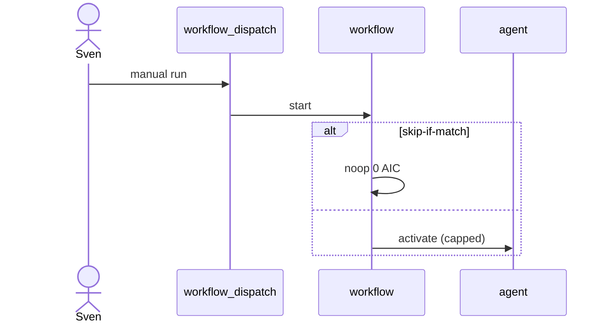

# R01: Dispatch, fuzzy schedule, cooldown
- Status: todo
- Area: triggers
- Wave: PR 0
- Block: 2
- Lane: Cursor CLI
- Depends on: C03, POL09
- proof: ./scripts/verify.sh
- door: two-way
## Goal
Standardize workflow_dispatch as the first trigger for every workflow, then document fuzzy schedules and cooldown only after explicit Sven approval.
## Context
M03 hourly cron stays off until Sven yes and measured cost. Fuzzy schedule spreads load. Cooldown and concurrency come from shared/defaults.md and POL09.
## Steps
1. Require workflow_dispatch on all catalog workflows with safe inputs.
2. Document fuzzy schedule syntax for future M03/F03 schedules.
3. Define cooldown defaults per workflow class (review vs daily report).
4. Link cost admission: noop and skip-if-match before agent activation.
## Definition of Done
- [ ] Every workflow PBI lists primary trigger: dispatch first.
- [ ] Schedule additions require Sven yes recorded in Evidence.
- [ ] POL09 rate limits documented with examples.
## Evidence
(commands, logs, verify log on SHA, run links)
## Flow

## Named asks for Sven
(none (M03 schedule needs separate yes))
## Cost
n/a
## Sources
- https://github.github.com/gh-aw/reference/triggers/
- https://github.github.com/gh-aw/reference/schedule-syntax/
- https://github.github.com/gh-aw/specs/fuzzy-schedule-specification/
- https://github.github.com/gh-aw/patterns/dispatch-ops/
