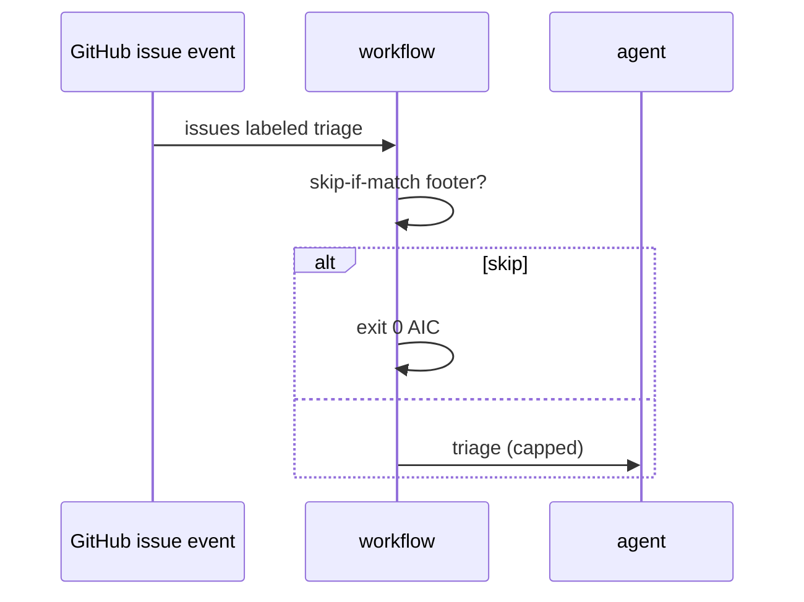

# R02: Issue/label + skip-if-match filters
- Status: todo
- Area: triggers
- Wave: PR 0
- Block: 2
- Lane: Cursor CLI
- Depends on: R01, O03
- proof: ./scripts/verify.sh
- door: two-way
## Goal
Document issue and label triggers with skip-if-match and skip-if-no-match guards for IssueOps and triage workflows.
## Context
Issue triggers can loop if misconfigured. skip-if-match prevents re-entry. LabelOps patterns apply to F06 later. on.roles and skip-bots required (POL10).
## Steps
1. Document issue opened/edited/labeled trigger shapes.
2. Require skip-if-match for bot-authored issues and workflow footers.
3. Map label_command patterns for human-initiated triage.
4. Keep issue triggers off until workflow is past staged mode.
## Definition of Done
- [ ] F06 PBI references R02 trigger template.
- [ ] Loop prevention checklist in X02 dry-run doc.
- [ ] POL10 on.roles documented for issue triggers.
## Evidence
(commands, logs, verify log on SHA, run links)
## Flow

## Named asks for Sven
(none)
## Cost
n/a
## Sources
- https://github.github.com/gh-aw/reference/triggers/
- https://github.github.com/gh-aw/patterns/issue-ops/
- https://github.github.com/gh-aw/patterns/label-ops/
