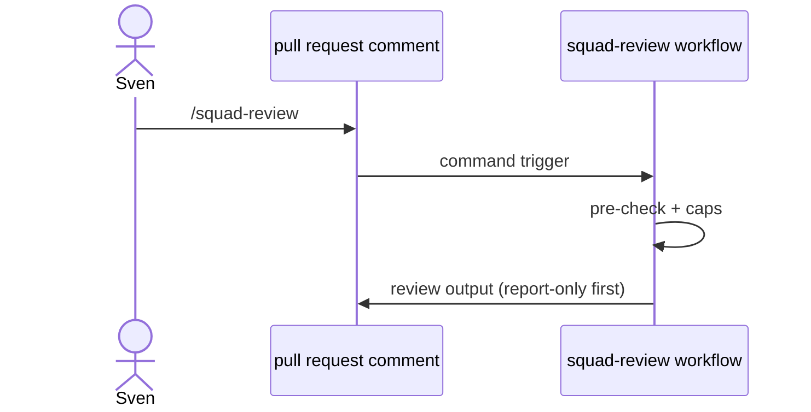

# R03: Slash commands + reactions
- Status: todo
- Area: triggers
- Wave: PR 0
- Block: 2
- Lane: Cursor CLI
- Depends on: R01
- proof: ./scripts/verify.sh
- door: two-way
## Goal
Document ChatOps slash commands (e.g. squad-review) and reaction triggers with integrity and permission guards.
## Context
squad-review today uses slash command pattern. Reactions can gate expensive runs. min-integrity approved filters untrusted comments.
## Steps
1. Document command-triggers frontmatter for PR comment commands.
2. Map squad-review to future F01 with same trigger seam.
3. Require workflow_dispatch alternative for every slash trigger.
4. Document reaction triggers as optional cost saver.
## Definition of Done
- [ ] ChatOps pattern linked from F01 and workflows/squad-review.md migration plan.
- [ ] Slash commands respect on.roles and skip-bots.
- [ ] Integrity level documented for comment bodies.
## Evidence
(commands, logs, verify log on SHA, run links)
## Flow

## Named asks for Sven
(none)
## Cost
n/a
## Sources
- https://github.github.com/gh-aw/reference/command-triggers/
- https://github.github.com/gh-aw/patterns/chat-ops/
