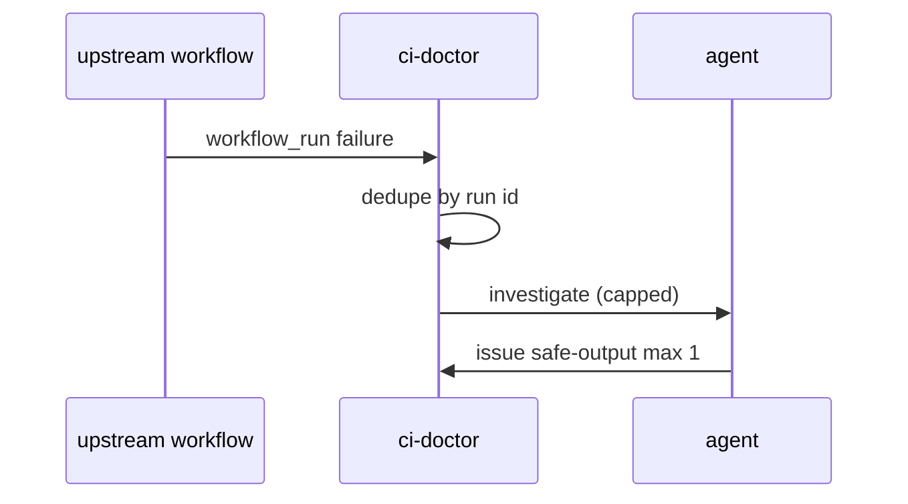

# R04: workflow_run + deployment_status
- Status: todo
- Area: triggers
- Wave: PR 0
- Block: 3
- Lane: Cursor CLI
- Depends on: R01, R02
- proof: ./scripts/verify.sh
- door: two-way
## Goal
Document workflow_run and deployment_status triggers for CI Doctor and deployment incident patterns.
## Context
F02 ci-doctor uses workflow_run on failed CI. deployment_status supports release/incident monitors. High event volume requires dedupe (O03) and filters.
## Steps
1. Specify workflow_run filters (conclusion failure, branch main).
2. Document deployment_status for future incident workflow.
3. Require dedupe by workflow run id in issue title.
4. Keep dispatch path for manual replay.
## Definition of Done
- [ ] F02 trigger section matches R04 template.
- [ ] Event storms mitigated with skip-if-match and cooldown.
- [ ] No pull_request_target unsafe patterns (POL14).
## Evidence
(commands, logs, verify log on SHA, run links)
## Flow

## Named asks for Sven
(Q1 (central-run ci-doctor vs installed))
## Cost
n/a
## Sources
- https://github.github.com/gh-aw/reference/triggers/
- https://github.github.com/gh-aw/gallery/ci-failure-investigation/
