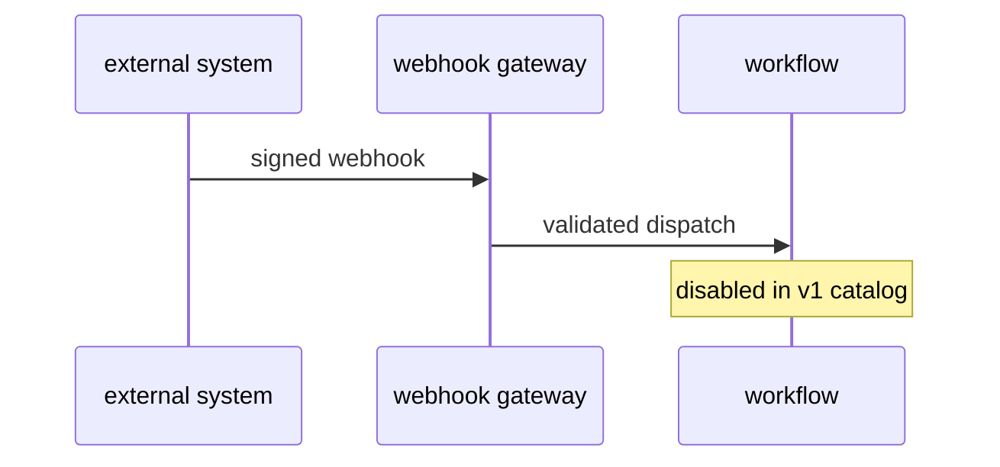

# R05: Webhook triggers (later)
- Status: todo
- Area: triggers
- Wave: PR 0
- Block: 6
- Lane: Cursor CLI
- Depends on: R01, S01
- proof: ./scripts/verify.sh
- door: two-way
## Goal
Document experimental webhook gateway triggers and why they stay disabled for personal catalog v1.
## Context
Webhook triggers expose ingress surface. Spec exists for org gateway deployments. Not used until network and auth model is approved.
## Steps
1. Summarize webhook gateway spec and required infrastructure.
2. List blockers: no public ingress on personal trial repos without review.
3. Define future criteria to enable (org or dedicated gateway).
## Definition of Done
- [ ] Explicit deferral to W6 with security prerequisites.
- [ ] No webhook on: in catalog policy until R05 implementation PBI closes.
## Evidence
(commands, logs, verify log on SHA, run links)
## Flow

## Named asks for Sven
(none)
## Cost
n/a
## Sources
- https://github.github.com/gh-aw/reference/webhook-triggers/
- https://github.github.com/gh-aw/specs/webhook-gateway-specification/
