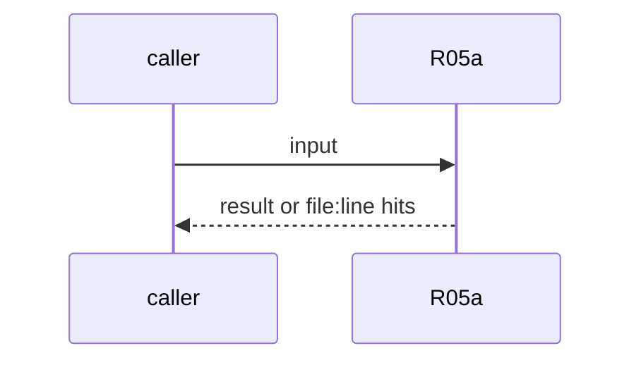
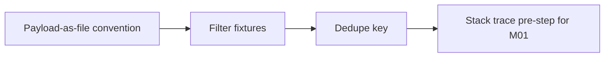

# R05a: Event guards: untrusted payload, fail-closed filters, dedupe
- Status: todo
- Area: triggers
- Wave: W3
- Block: 3
- Lane: Builder
- Depends on: R05, M01, AO08
- proof: filter fixtures print would trigger / would not trigger; an unevaluable filter never matches; a repeated delivery id or body hash starts nothing; stack trace extract is a deterministic pre-step
- door: two-way
- triage: build
- feedback: filter and dedupe fixtures in scripts/verify.sh
- harness: none (script run by scripts/verify.sh)
- review-input: diff + this PBI + DoD (+ linked spec) + PR description, never builder session logs (PA6)
- kind: script
- Source: D25, D26, D27, D29 https://docs.warp.dev/factories/webhooks/ https://docs.warp.dev/factories/automations/ https://x.com/BHolmesDev/status/2110793920930107817 https://docs.warp.dev/factories/api-and-sdk/demo-sentry-monitoring-with-sdk/
## Goal
Event-started work gets the payload as a file marked untrusted, never pasted into the prompt. Filters fail closed and have would/would-not fixtures. Deliveries dedupe on delivery id, then body hash. A stack trace is extracted by a deterministic step before the agent.
## Context
Warp webhooks: the body is attached as `event-payload.json` and anything inside it is untrusted context; dedupe by delivery id header, then a hash of the body, and a duplicate starts nothing. Warp automations: "Fail closed: A filter that can't be evaluated never matches." Sentry demo: the service extracts the stack trace and injects it into the run. Not built in PR #4: docs only, nothing enabled (PA9).
## Steps
1. Payload-as-file convention.
2. Filter fixtures.
3. Dedupe key.
4. Stack trace pre-step for M01.
## Definition of Done
- [ ] Would/would-not fixtures
- [ ] Fail-closed fixture
- [ ] Duplicate fixture starts nothing
- [ ] Pre-step is a script (0 AIC)
## Technical design
- Components and files: R05, M01, `test/fixtures/`
- Module boundary: payload file + filter + dedupe key
- Interfaces: event payload file path
- Sequence:

- Failure modes: Unknown shape never matches
- Security: Payload is untrusted (OWASP LLM01)
- Observability: delivery log
- Cost: 0 AIC for guards
- Rollback: Disable the trigger (POL25 keeps it dispatch-only until Sven's yes)
- Proof: same as proof: above
- Door: two-way (revert is one commit)
## Evidence
(todo)
## Flow

## Named asks for Sven
none
## Cost
0 AIC for guards
## Sources
- [Warp custom webhooks doc](https://docs.warp.dev/factories/webhooks/)
- [Warp automations doc](https://docs.warp.dev/factories/automations/)
- [Ben Holmes, The road to self-improving software](https://x.com/BHolmesDev/status/2110793920930107817)
- [Warp Sentry monitoring demo](https://docs.warp.dev/factories/api-and-sdk/demo-sentry-monitoring-with-sdk/)
- Strategy id list v3.12 (aw-final-ids.md), url-learnings.md D25, D26, D27, D29
