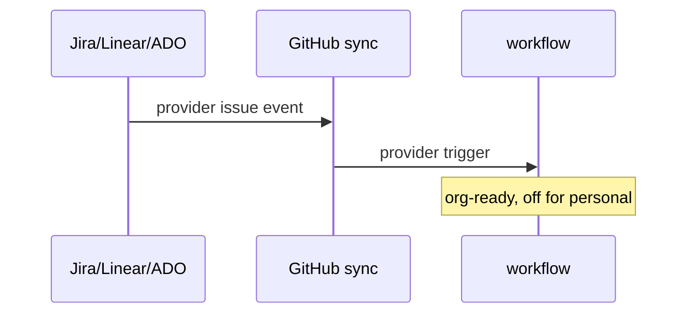

# R06: Provider triggers (org-ready doc)
- Status: todo
- Area: triggers
- Wave: PR 0
- Block: 6
- Lane: Cursor CLI
- Depends on: R02
- proof: ./scripts/verify.sh
- door: two-way
## Goal
Document Jira, Linear, and Azure DevOps provider issue triggers as org-ready capability not activated on personal account.
## Context
Provider triggers need org secrets and often central billing. Built org-ready: owner variable only changes on org move (G05).
## Steps
1. Summarize provider-issue-triggers reference.
2. Map required secrets to org secrets store (G05), not repo files.
3. Keep GitHub-native issue triggers as default for Sven repos.
## Definition of Done
- [ ] Org-ready note: enabling provider triggers is G05 checklist item only.
- [ ] No provider credentials in catalog repo.
## Evidence
(commands, logs, verify log on SHA, run links)
## Flow

## Named asks for Sven
(none)
## Cost
n/a
## Sources
- https://github.github.com/gh-aw/reference/provider-issue-triggers/
