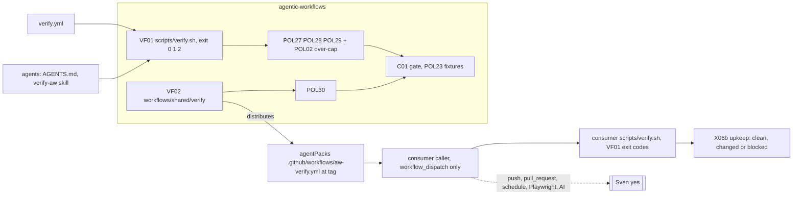

# docs/pbi/verify/
One verify entry point for this catalog and for consumer repos. Source: Sven via Fleet, 2026-10-26, the verification approach from the Matt Pocock and poteto talk (pstack verify guide, create and maintain verification skill).
Order: VF01 -> VF02. VF01 is done (PR #10: scripts/verify.sh exit 0 1 2, POL27 to POL29). Nothing is enabled until Sven says yes. Actions billing is blocked today (Q0), so the local verify log on the exact SHA is the gate.
Where things live: `scripts/verify.sh` is the only runner (C01). Each rule lives in one `policies/POLnn.yml` with its check in `policies/checks/POLnn.sh` and its proof in `test/fixtures/bad/POLnn/` and `test/fixtures/good/POLnn/` (a folder). The consumer template lives in `workflows/shared/verify/` and agentPacks distributes it. Done PBIs move to `docs/pbi/done/`.

| ID | Title | Block | Door | Wave | Status | Depends on | New rules | File |
|---|---|---:|---|---|---|---|---|---|
| VF01 | One verify entry point: scripts/verify.sh for CI, local gate and every agent | 2 | two-way | W2 | done | C01, POL02, POL17, POL23, X06, C14 | POL27, POL28, POL29 | [../done/VF01.md](../done/VF01.md) |
| VF02 | Verify workflow template for consumer repos (API and frontend) | 2 | one-way | W2 | todo | VF01, POL01, POL03, C12, G00a, X06b | POL30 | [VF02.md](VF02.md) |
| VF02a | VF02 part: POL01 yml whole-file walk, parse error, yml roots | 2 | two-way | W2 | done | none | none | [VF02a](../done/VF02a-pol01-extension.md) |
| VF02d1 | VF02 part: gate job run allowlist (POL27 and POL28) | 2 | two-way | W2 | done | VF01 | none | [VF02d1](../done/VF02d1.md) |
| WF01 | One shared workflow file lister | 2 | two-way | W2 | todo | SM05c | none | [WF01.md](WF01.md) |

New POL ids: POL27 (toolchain pinned in one place), POL28 (one verify entry point), POL29 (gate self-test), POL30 (consumer template: no spend, no auto trigger without Sven's yes). POL01 to POL26 are taken on main. PR #5 adds no POL id.

Depends on #5: none. VF01 and VF02 link only files on main. PR #5 also edits `docs/pbi/README.md`, but in other places (the smoke folder line, Block 3 rows and the Block 3 PBIs line). This PR touches the Block 2 rows, the Block 2 PBIs line, Named asks and Supporting artifacts, so the two do not overlap.

