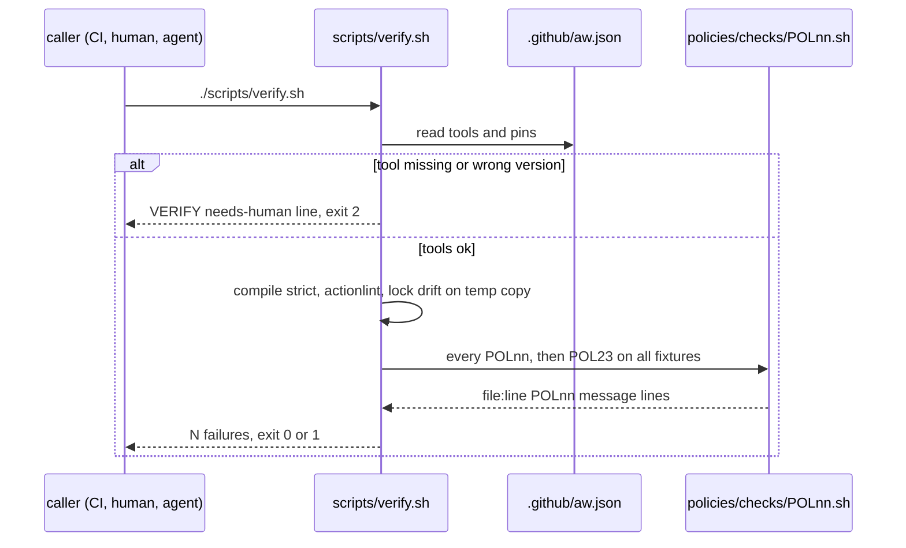
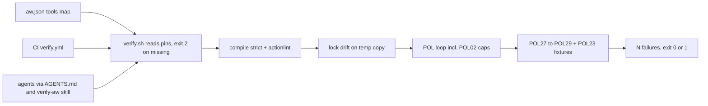

# VF01: One verify entry point: scripts/verify.sh for CI, local gate and every agent
- Status: todo
- Area: verify
- Wave: W2
- Block: 2
- Lane: Builder
- Depends on: C01, POL02, POL17, POL23, X06, C14 (id only, no file yet)
- proof: `./scripts/verify.sh` prints `0 failures` and exits 0 on the green SHA; `bash policies/checks/POL23.sh` shows POL27, POL28 and POL29 each exit 1 on `test/fixtures/bad/POLnn/` and 0 on `test/fixtures/good/POLnn.md`; with `actionlint` removed from PATH, `./scripts/verify.sh` exits 2 and prints `scripts/verify.sh:1 VERIFY needs-human missing: actionlint`
- door: two-way
- triage: build (the gate exists in C01; this PBI closes the gaps in the table below, no new trigger)
- feedback: `./scripts/verify.sh; echo "exit=$?"` gives `0 failures` and `exit=0` on the good tree, `exit=1` on each bad fixture copy and `exit=2` with a tool removed from PATH (DoD rows 1 to 4)
- harness: none (script)
- review-input: diff + this PBI + DoD (+ linked spec) + PR description, never builder session logs (PA6)
- kind: script (deterministic)
- Source: PA8 (no D row; Sven via Fleet, Development Agentic Workflows room, 2026-10-26, verification approach from the Matt Pocock and poteto talk) https://github.com/cursor/plugins/blob/main/pstack/docs/guide/06-verify-and-ship.md
## Goal
One script decides green or red. CI, the local gate and every agent (Builder, Tester, Reviewer, Copilot, Cursor) run the same `scripts/verify.sh` with no arguments. It covers `gh aw compile --strict`, actionlint, lock file sync and the per-workflow cost cap. A missing or wrong tool stops the run with exit 2 (needs-human). It never skips a check.
## Context
`scripts/verify.sh` already exists ([C01](../done/C01-verify-script.md), done in PR #4). Most of the bar is there. This PBI writes down what is missing and closes it. It does not copy the gist items. It links them:
- Gist handover points A, B and C are the minimum bar named in [C01 Context](../done/C01-verify-script.md) (compile strict, lock drift, linters, pins). See C01 Sources for where they live.
- [gist-review.md](../gist-review.md) rows 1, 3, 4, 5, 6 and 32, plus additions A1 (proof and door), A3 (one line per failure, last line `N failures`) and A4 ([POL23](../done/POL23-no-tautological-checks.md), no tautological check).
- [X06](../done/X06-verification-skill.md) is the thin agent skill over this script. The upkeep pass for that skill is X06b (id in the Strategy id list v3.12, no file yet).
- C14 (sha256 pin on every curl download in `verify.yml`) and C15 (`promoted:` gains a name only with Sven's yes) are ids in the Strategy id list v3.12, no file yet. VF01 links them and does not redo them.

Learnings from the pstack sources (read 2026-10-26):
- One entry point. Every person and every agent drives the check the same way, so "verify it" needs no setup talk.
- A check you have never seen fail proves nothing. Every check gets a bad input that must fail.
- If a check could not run, the answer is "inconclusive", never a pass. Here that is exit 2.
- Keep the rules in scripts and keep the skill thin. The skill only says which command to run.
- Upkeep is its own pass with three outcomes: clean, changed or blocked. That is X06b and VF02, not this PBI.

Gap table: what VF01 needs vs `scripts/verify.sh` on `origin/main` at 2ccf76d (same file at PR #5 head 719cd75).

| # | Item | Today | Where today (file:line) | Gap to close |
|---|---|---|---|---|
| 1 | `gh aw compile --strict` | has | `scripts/verify.sh:18` to `:27` (compile `--dir workflows --strict --actionlint`) | No bad fixture that proves a compile error turns red. Add one under POL29. |
| 2 | gh-aw version pinned | has | `scripts/verify.sh:12` to `:15` (pin from `.github/aw.json:2`) | Wrong version exits 1. It must exit 2 (needs-human). |
| 3 | actionlint on compiled locks | has | `scripts/verify.sh:23` to `:26` | No bad fixture with an actionlint error. Add one under POL29. |
| 4 | actionlint on `.github/workflows/*.yml` | has | `scripts/verify.sh:32` to `:36` | Same as row 3. |
| 5 | actionlint version pinned | partial | presence only at `scripts/verify.sh:13`; version only in `.github/workflows/verify.yml:30` | Local run takes any actionlint. Pin in `.github/aw.json` and compare. POL27. |
| 6 | Lock file sync (lock matches `.md`) | has | `scripts/verify.sh:29` to `:30` (git diff after compile); `policies/checks/POL17.sh:9` to `:21` (frontmatter hash, compiler and engine pin) | Body drift is a `git diff` on `workflows/`. A dirty local tree also turns red, with the same message. Run the drift check on a temp copy of the committed tree. Fixture under POL29. |
| 7 | Per-workflow cost cap | has | `policies/checks/POL02.sh:6` to `:14` via the loop at `scripts/verify.sh:50` to `:54`; ceilings in `policies/POL02.yml:9` to `:13` | Only a "caps in import only" bad fixture (`test/fixtures/bad/POL02.md`). Add an over-ceiling fixture. Stays in POL02. |
| 8 | Missing tool fails closed | partial | `scripts/verify.sh:13` and `:16` (missing tool exits 1); `scripts/verify.sh:6` (not a repo exits 2) | Missing tool must exit 2 (needs-human, PA5: 0 ok, 1 failed, 2 needs-human). |
| 9 | Tool versions pinned in one place | missing | `.github/workflows/verify.yml:28` to `:32` (gh-aw, actionlint, gitleaks, yq versions in the run step); `.github/aw.json` has only gh-aw and copilot | One `tools:` map in `.github/aw.json`. verify.sh and verify.yml read it. sha256 per download is C14. POL27. |
| 10 | CI calls the same script | has | `.github/workflows/verify.yml:34` to `:37` | No check keeps it that way. POL28. |
| 11 | Agents call the same script | has | `AGENTS.md:13` and `:24`; `.github/copilot-instructions.md:14`; `.github/skills/verify-aw/SKILL.md:3` and `:16`; `CONTRIBUTING.md:13` | No check keeps it that way. POL28. |
| 12 | Output contract (gist A3) | has | `scripts/verify.sh:3` to `:4`, `:8`, `:74` to `:75` | Exit 2 lines need a fixed shape: `file:line VERIFY needs-human <reason>`. |
| 13 | Every check has a bad fixture (gist A4) | has | `scripts/verify.sh:56` to `:57` (POL23) | New POL27 to POL29 join POL23 by their `bad_fixture` and `good_fixture` fields. |
| 14 | No new trigger | has | `.github/workflows/verify.yml:5` to `:6` (`workflow_dispatch` only, POL03) | Keep. VF01 adds no trigger. |

## Where it lives
One rule, one place. Each prose rule points to its check. Each check points back to this PBI.
- POL27 Verify toolchain pinned in one place
  - Rule definition: `policies/POL27.yml` with `id`, `title`, `rule`, `why`, `check`, `bad_fixture`, `good_fixture`, `pbi`, `pins` (model: `policies/POL17.yml`). `pins: .github/aw.json`. `pbi: docs/pbi/done/VF01.md` after the move, `docs/pbi/verify/VF01.md` until then.
  - Rule text: every tool `scripts/verify.sh` needs has one version in `.github/aw.json` `tools:`. `verify.yml` installs exactly those versions. Every downloaded binary has a sha256 (C14).
  - Check script: `policies/checks/POL27.sh`, prints `file:line POL27 message`.
  - Proof: `test/fixtures/bad/POL27/` (`verify-drifted-version.yml`, `verify-curl-no-sha256.yml`, `aw-missing-tool.json`) and `test/fixtures/good/POL27.md`.
- POL28 One verify entry point
  - Rule definition: `policies/POL28.yml` (same fields, `pins: .github/aw.json`).
  - Rule text: a `.github/workflows/*.yml` step that gates runs `./scripts/verify.sh` and nothing else. No ad hoc `gh aw compile`, `actionlint` or `shellcheck` step. `AGENTS.md`, `.github/copilot-instructions.md` and `.github/skills/verify-aw/SKILL.md` each name `scripts/verify.sh`.
  - Check script: `policies/checks/POL28.sh`, prints `file:line POL28 message`.
  - Proof: `test/fixtures/bad/POL28/` (`ci-adhoc-compile.yml`, `agents-no-verify.md`) and `test/fixtures/good/POL28.md`.
- POL29 Gate self-test: compile, actionlint and lock drift turn red
  - Rule definition: `policies/POL29.yml` (same fields, `pins: .github/aw.json`).
  - Rule text: each gate step fails on its known bad input. The check copies each fixture folder into a temp git repo, like the C05 loop at `scripts/verify.sh:41` to `:48`.
  - Check script: `policies/checks/POL29.sh`, prints `file:line POL29 message`.
  - Proof: `test/fixtures/bad/POL29/` (`compile-error/`, `actionlint-error/`, `lock-drift/`) and `test/fixtures/good/POL29.md`.
- Cost cap stays in POL02 (no new id). The over-ceiling proof is `test/fixtures/bad/POL02-over.md`. `policies/POL02.yml` keeps the ceilings.
- Exit codes (0 ok, 1 failed, 2 needs-human) live in the header of `scripts/verify.sh` (lines 2 to 4 today) and in [C01](../done/C01-verify-script.md). `docs/how-to/verify-workflow.md` points to them.
- Runner: only `scripts/verify.sh` (the C01 gate). New checks join its POL loop. No new script runs them.
- This PBI file lives in `docs/pbi/verify/`. When done it moves to `docs/pbi/done/` with `- Status: done` and `- PR: #<n>`.
## Steps
1. Add a `tools:` map to `.github/aw.json` with gh-aw, actionlint, gitleaks, yq and shellcheck versions and sha256 per download.
2. `scripts/verify.sh` reads the tool list from `.github/aw.json`. A missing tool or a wrong version prints `file:line VERIFY needs-human ...` and exits 2. It never runs the rest.
3. `.github/workflows/verify.yml` installs from the same map and checks the sha256. It still runs only `./scripts/verify.sh`. The trigger stays `workflow_dispatch`.
4. Lock drift runs on a temp copy of the committed tree, so a dirty local tree does not hide or fake drift.
5. Add POL27, POL28 and POL29 (yml, check, bad and good fixtures) and `test/fixtures/bad/POL02-over.md`.
6. Update `docs/how-to/verify-workflow.md` and `.github/skills/verify-aw/SKILL.md` with exit 2 and what a human does then.
7. Run `./scripts/verify.sh` twice on the SHA and attach both logs (Q0).
## Definition of Done
- [ ] `./scripts/verify.sh` exits 0 with last line `0 failures` on the green SHA.
- [ ] Each bad fixture under `test/fixtures/bad/POL27/`, `POL28/`, `POL29/` and `test/fixtures/bad/POL02-over.md` makes its check exit 1.
- [ ] Each good fixture `test/fixtures/good/POL27.md`, `POL28.md`, `POL29.md` exits 0.
- [ ] With any tool from `.github/aw.json` `tools:` removed from PATH, `./scripts/verify.sh` exits 2.
- [ ] With a wrong tool version, `./scripts/verify.sh` exits 2.
- [ ] The exit 2 line reads `file:line VERIFY needs-human <reason>`.
- [ ] No check is skipped silently. A check that cannot run is exit 2.
- [ ] `policies/POL27.yml`, `POL28.yml` and `POL29.yml` carry every field of `policies/POL17.yml`.
- [ ] `.github/workflows/verify.yml` keeps `workflow_dispatch` as its only trigger.
- [ ] `.github/workflows/verify.yml` runs only `./scripts/verify.sh` after the install step.
- [ ] `AGENTS.md`, `.github/copilot-instructions.md` and the verify-aw skill name `scripts/verify.sh` (POL28 green).
- [ ] No long dashes, no secrets, no IDs added (POL16, POL04, gitleaks).
- [ ] This file moves to `docs/pbi/done/` with `- Status: done` and `- PR: #<n>`.
## Technical design
- Components and files: `scripts/verify.sh`, `.github/aw.json`, `.github/workflows/verify.yml`, `policies/POL27.yml`, `policies/POL28.yml`, `policies/POL29.yml`, `policies/checks/POL27.sh`, `policies/checks/POL28.sh`, `policies/checks/POL29.sh`, `test/fixtures/bad/POL27/`, `test/fixtures/bad/POL28/`, `test/fixtures/bad/POL29/`, `test/fixtures/bad/POL02-over.md`, `test/fixtures/good/POL27.md`, `test/fixtures/good/POL28.md`, `test/fixtures/good/POL29.md`, `docs/how-to/verify-workflow.md`, `.github/skills/verify-aw/SKILL.md`
- Module boundary: `./scripts/verify.sh` with no arguments and exit 0, 1 or 2 is the small interface; the tool pins, compile, lint, drift and POL loop sit behind it
- Interfaces: input none (repo root found by git). Output one line per failure `file:line RULE message`, section headers start with `# `, last line `N failures`. Exit 0 ok, 1 failed, 2 needs-human (PA5). Pins: `.github/aw.json` keys `gh-aw`, `engines`, `tools`.
- Sequence:

- Failure modes: tool missing or wrong version gives exit 2 and a human installs the pin; a compile, lint, drift or POL hit gives exit 1 with `file:line`; a check that cannot parse its input fails closed with exit 1; a bad fixture that passes is a POL23 hit; a dirty tree no longer fakes drift because drift runs on a temp copy
- Security: read only, no network in checks (`policies/checks/lib.sh:2`), downloads pinned by version and sha256 (C14), `verify.yml` keeps `permissions: contents: read` and `persist-credentials: false`, no secret values in files
- Observability: the verify log on the exact SHA (Q0), one line per failure, last line `N failures`, exit code in the PR evidence comment
- Cost: 0 AIC. Actions minutes only on a manual `workflow_dispatch` run.
- Rollback: revert the PR; `scripts/verify.sh` goes back to the C01 version and the POL27 to POL29 files go away
- Proof: same as proof: above
- Door: two-way (local script and docs, no trigger, no spend, revert is one commit)
## Evidence
- Two `./scripts/verify.sh` logs on the PR SHA, `0 failures`, exit 0.
- `POL23` output that lists POL27, POL28, POL29 bad exit 1 and good exit 0.
- One log with `actionlint` removed from PATH that shows exit 2.
## Flow

## Named asks for Sven
- None for VF01. It adds no trigger and spends nothing.
- Q0 stays open: Actions billing is blocked, so the local verify log on the exact SHA is the gate.
## Cost
0 AIC. No new trigger. A manual CI run costs Actions minutes only when someone dispatches it.
## Sources
- svennijhuis/agentic-workflows@2ccf76d: `scripts/verify.sh`, `.github/workflows/verify.yml`, `.github/aw.json`, `policies/POL02.yml`, `policies/POL17.yml`, `policies/checks/POL02.sh`, `policies/checks/POL17.sh`, `policies/checks/lib.sh`, `AGENTS.md`, `.github/copilot-instructions.md`, `.github/skills/verify-aw/SKILL.md`, `CONTRIBUTING.md`
- [C01](../done/C01-verify-script.md), [X06](../done/X06-verification-skill.md), [POL02](../done/POL02-cost-caps-required.md), [POL17](../done/POL17-lock-file-committed-fresh.md), [POL23](../done/POL23-no-tautological-checks.md), [TPL01](../done/TPL01-one-pbi-template.md), [gist-review.md](../gist-review.md)
- Strategy id list v3.12: X06b, C14, C15 (ids only, no file yet)
- https://github.com/cursor/plugins/blob/main/pstack/docs/guide/06-verify-and-ship.md (read 2026-10-26)
- https://github.com/cursor/plugins/blob/main/pstack/skills/create-verification-skill/SKILL.md (read 2026-10-26)
- https://github.com/cursor/plugins/blob/main/pstack/skills/maintain-verification-skill/SKILL.md (read 2026-10-26)
