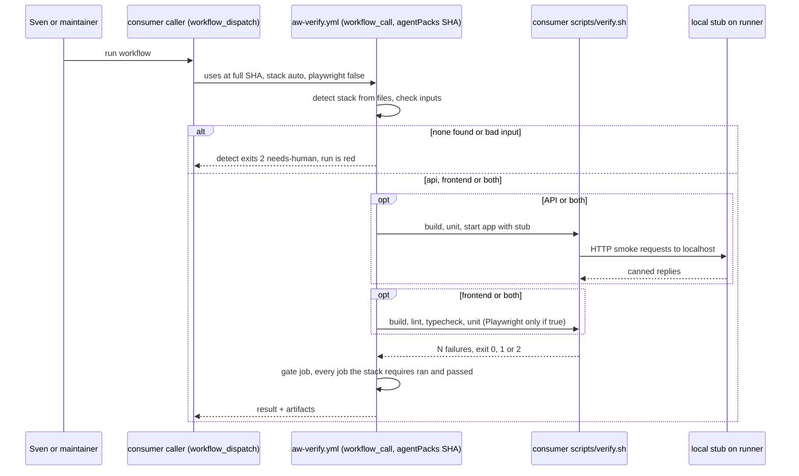
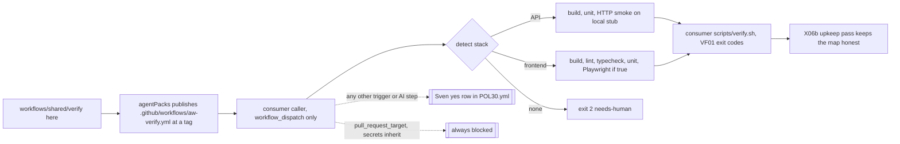

# VF02: Verify workflow template for consumer repos (API and frontend), shipped by agentPacks
- Status: todo
- Area: verify
- Wave: W2
- Block: 2
- Lane: Builder
- Depends on: VF01, POL01, POL03, C12, G00a, X06b (id only, no file yet)
- proof: `./scripts/verify.sh` exits 0 with `0 failures`; POL23 runs every immediate child of `test/fixtures/bad/POL30/` alone and each exits 1, and `test/fixtures/good/POL30/` exits 0 (for every POL30 directory argument, good or bad, POL30 loads `<dir>/sven-yes.yml` when it exists, and POL23 sets `POL30_REPO=example/consumer` on every POL30 run); `bash workflows/shared/verify/verify-starter.sh` in a temp consumer repo whose `.github/workflows/caller.yml` has `on: pull_request_target` exits 1; the `scripts/verify.sh` actionlint loop covers `workflows/shared/verify/*.yml` and is clean; one staged dispatch run in the X01 trial repo after Sven's yes shows each detected stack step green
- door: one-way (enabling the template in a consumer runs Actions there and can spend minutes)
- one-way gate: Sven's exact yes required per consumer repo and per trigger (row in `policies/POL30.yml` `sven_yes`, Named asks below). Rollback: delete the caller file in that consumer repo, or set it back to `workflow_dispatch` only, and remove its `sven_yes` row
- triage: spec (template and rule are docs plus files in this repo; enabling anywhere is an ask)
- feedback: `bash policies/checks/POL30.sh` exits 1 on every case in `test/fixtures/bad/POL30/` and 0 on `test/fixtures/good/POL30/`, inside `./scripts/verify.sh` with `0 failures` (DoD rows 1 to 3)
- harness: none (script); the template runs on GitHub Actions in the consumer, no agent engine
- review-input: diff + this PBI + DoD (+ linked spec) + PR description, never builder session logs (PA6)
- kind: script (deterministic)
- Source: PA8 (no D row; Sven via Fleet, Development Agentic Workflows room, 2026-10-26, verification approach from the Matt Pocock and poteto talk) https://github.com/cursor/plugins/blob/main/pstack/skills/create-verification-skill/SKILL.md
## Goal
A consumer repo gets one verify workflow from agentPacks instead of writing its own. It picks API steps or frontend steps by the stack it finds. It ends in the consumer's own `scripts/verify.sh` with the VF01 exit codes. Out of the box it runs only by hand (`workflow_dispatch`). It spends no tokens.
## Context
VF01 is the shared entry point contract: every repo has one `scripts/verify.sh`, exit 0 ok, 1 failed, 2 needs-human. VF02 brings that to consumer repos (API repos and frontend repos). It does not make a second gate.

Where things live:
- The authoring copy lives in this repo under `workflows/shared/verify/`. That folder holds the template, a thin caller example and a starter `verify.sh`.
- agentPacks (svennijhuis/agentPacks) distributes it, like the other shared fragments ([C12](../done/C12-agentpacks-import-contract.md), [G00a](../done/G00a-consumer-strategy.md)). GitHub only runs a reusable workflow from `.github/workflows/` of the called repo. So agentPacks publishes the copy at `.github/workflows/aw-verify.yml` on a tag, and a consumer calls it by full SHA (POL01).
- The consumer holds its caller file and its own `scripts/verify.sh`. Nothing is enabled in any consumer by this PBI.
- This PBI file lives in `docs/pbi/verify/`. When done it moves to `docs/pbi/done/` with `- Status: done` and `- PR: #<n>`.

Parts (Strategy split on main `1987bfa`, one PBI per PR; this file stays todo until the last part merges):
- VF02a POL01 extension: done, [VF02a](../done/VF02a-pol01-extension.md) (Cursor 5654194791 f1).
- VF02b POL30 core (rule file, loader, rows, repo): todo. DoD note (Cursor 5655309259 f4, low, carried from VF02a): `yq` keeps the last of two duplicate `uses` keys in one step and exits 0, so POL01 reads only the last one (GitHub rejects such a file). Add a DoD row: a duplicate key in any walked yml is `POL01 parse error` (or `POL30 parse error`), exit 1.
- VF02c POL30 triggers, roles, uses form: todo (Cursor 5654194791 f4).
- VF02d POL30 job hardening: todo (Cursor 5654194791 f3, f9 continue-on-error). The POL27 and POL28 gate job `run:` allowlist part moved to VF02d1; VF02d keeps the rest.
- VF02d1 gate job `run:` allowlist (POL27 and POL28): done in #13, [VF02d1](../done/VF02d1.md) (Product Owner 2026-10-26, Cursor 5655973880 f1 to f7; round 2 key allowlist: Tester 6424839165, Cursor 5657508090 f1 to f8, f9 low is a VF02d todo).
- VF02e POL30 inputs, spend grants, smoke URLs, gate: todo (Cursor 5654194791 f9 playwright and gate).
- VF02f template files and starter: todo.
- VF02L Sven yes, X01 staged dispatch run, agentPacks publish copy: Sven only, no PR here.

Steps by detected stack (detect job reads files only under the validated `working-directory`, never the repo root when that input is set; inputs can override):
- API signals: `*.csproj` or `*.sln`, `Cargo.toml`, `pyproject.toml`, or `package.json` with a dependency on `express`, `fastify`, `@nestjs/core`, `hono` or `koa`.
- Frontend signals: `package.json` with a dependency or devDependency on `react`, `next`, `vue`, `nuxt`, `svelte`, `@sveltejs/kit`, `@angular/core`, `astro` or `solid-js`, or a file `angular.json`, `next.config.*`, `nuxt.config.*`, `svelte.config.*` or `astro.config.*`.
- A `package.json` that matches neither list is not a stack. It does not default to API.
- API: build, unit tests, contract and HTTP smoke against a local stub. The app starts on localhost with its outside calls stubbed. Requests come from the repo's own scenario files. No call leaves the runner.
- Frontend: build, lint, typecheck, unit tests. Playwright smoke is optional and off by default (`playwright: false`).
- Both found: both jobs run.
- Nothing found: the detect job exits 2 (needs-human) and the run is red, never a silent pass.
- No command for a step of the chosen stack (no package script, no Makefile target, no generic recipe for that toolchain): the step stays and fails with exit 2. A missing command is never a skip.
- A final `gate` job (`if: always()`, `needs` every job) runs a script that exits 1 unless every required `needs.<job>.result` is `success` and `detected-stack` is `api`, `frontend` or `both`. So it fails when detect failed, when `detected-stack` is missing, empty or not `api`, `frontend` or `both`, or when a job that stack requires is skipped, failed or cancelled. `api` requires the API job, `frontend` the frontend job, `both` both. A job the stack does not require may be skipped.

Post-deploy smoke on tst and acc is a different thing (live APIs, OIDC). It is planned in a separate PR and is not part of VF02.

Learnings from the pstack sources (read 2026-10-26):
- Interview the repo, not the user. The detect job reads files and asks only for what it cannot see.
- Use the repo's own commands first (package scripts, Makefile). Fall back to a generic recipe only when none exists. When neither exists, the step fails with exit 2.
- Evidence must survive cleanup. Test reports and screenshots go up as run artifacts.
- A feature map says what proves each feature. The upkeep pass keeps it honest and ends clean, changed or blocked, with at most one PR. In this catalog that pass is X06b.
## Where it lives
One rule, one place. Each prose rule points to its check. Each check points back to this PBI.
- Kind of file: `workflows/shared/verify/*.yml` is GitHub Actions CI yml, not a gh-aw shared fragment. Unlike the fragments `AGENTS.md:11` describes (no `on:`), these files have `on:`. `gh aw compile` must ignore them: it compiles only `workflows/*.md`, and the compile output names no file under `workflows/shared/verify/`. The `AGENTS.md` layout table gains a row for this folder.
- Template files: `workflows/shared/verify/verify.yml` (reusable, `on: workflow_call`), `workflows/shared/verify/caller-example.yml` (thin caller, `on: workflow_dispatch`), `workflows/shared/verify/verify-starter.sh` (starter for a consumer `scripts/verify.sh`), `workflows/shared/verify/README.md` (how to adopt).
- POL30 Consumer verify template: no spend and no auto trigger without Sven's yes
  - Rule definition: `policies/POL30.yml` with `id`, `title`, `rule`, `why`, `check`, `bad_fixture`, `good_fixture`, `pbi`, `pins` (model: `policies/POL17.yml`), plus `sven_yes: []` with rows `{repo, path, trigger, grant, date, quote}`. `pins: .github/aw.json`. `pbi: docs/pbi/done/VF02.md` after the move, `docs/pbi/verify/VF02.md` until then.
  - Rule text: file roles. The template is `verify.yml` (in repo mode `workflows/shared/verify/verify.yml`, in a fixture folder `<dir>/verify.yml`) or a file argument named `template-*.yml`; its only legal trigger is `workflow_call`. Every other workflow yml (any file that is not a yes list) is a caller, including `caller.yml` in a fixture folder and `caller-example.yml`; its only legal trigger is `workflow_dispatch`. No folder or file name is special-cased to pass.
  - Rule text: the template has `workflow_call` as its only trigger; `template-workflow-dispatch.yml` (template on `workflow_dispatch`) is a hit.
  - Rule text: the caller example has `workflow_dispatch` as its only trigger.
  - Rule text: the template rejects every trigger other than `workflow_call`, row or not; `grant: trigger` applies only to caller files (`template-push-with-yes/` exits 1).
  - Rule text: on a caller, any other trigger is a hit unless a valid `sven_yes` row with `grant: trigger` matches its repo, file path and trigger. This is an allow list, not a deny list: every trigger name other than the one legal trigger needs a row, named or not (`push`, `pull_request`, `merge_group`, `schedule`, `workflow_run`, `repository_dispatch`, `issue_comment`, `release`, `deployment`, `workflow_call` on a caller and the rest). Each trigger of a list or map `on:` is checked on its own, so `on: [workflow_dispatch, push]` still needs a `push` row.
  - Rule text: a row covers exactly one repo, one file path, one trigger and one grant. A row for `schedule` does not cover `push`.
  - Rule text: a yml in scope with no `on:` key is a hit, same as `policies/checks/POL03.sh:19`. A file whose top level is `sven_yes` is a yes list, not a workflow; a file with both is a hit.
  - Rule text: `pull_request_target` always fails, in the template and in the caller, even when a `sven_yes` row names it. No row can allow it. Inside `workflow_call` the template sees `github.event_name` as `workflow_call` and cannot see the caller trigger, so the consumer caller is checked by `verify-starter.sh`, which runs POL30 on the consumer `.github/workflows/*.yml` (Steps 3).
  - Rule text: a `sven_yes` row with `trigger: pull_request_target` fails the file.
  - Rule text: `sven_yes` is a list. A string, a map, null or an unreadable `policies/POL30.yml` fails the file.
  - Rule text: each `sven_yes` row is a map with `repo`, `path`, `trigger`, `grant`, `date` and `quote`, each a string that is not empty after trim. `grant` is exactly `trigger`, `aic` or `playwright`.
  - Rule text: `repo`, `path`, `trigger` and `grant` match by exact string. `repo` is matched against the resolved repo (`POL30_REPO`, then `GITHUB_REPOSITORY`, then origin; POL23 sets `POL30_REPO=example/consumer`). `path` is the repo relative file path, or the path inside the case folder for a fixture. A `*`, a glob character (`*`, `?`, `[`) or a value outside the `grant` list fails the file.
  - Rule text: a missing key, an empty or blank value, or a value that is a list, a map or null fails the whole file. A row that fails never counts as a yes.
  - Rule text: any step that spends tokens or AIC (`gh aw run`, an AI engine) needs a matching row with `grant: aic`, one per trigger of the file. A `grant: trigger` row never unlocks an AI step. Secrets are never unlocked by a row (next line).
  - Rule text: the only allowed secret or token expressions are `github.token` and `secrets.GITHUB_TOKEN`.
  - Rule text: the template and the caller never use `secrets: inherit`, a `secrets:` map or any `secrets` expression other than `secrets.GITHUB_TOKEN` (so `secrets.<NAME>`, `secrets[...]`, `secrets[format(...)]` and `toJson(secrets)` fail). The ban matches `secrets` in any case; the allow is exact case, so `secrets.github_token` fails. Checked before `sven_yes` is read, so no row unlocks a secret.
  - Rule text: `playwright` defaults to `false`. A caller that passes `playwright: true` needs a matching row with `grant: playwright`.
  - Rule text: every job sets `timeout-minutes` and a `permissions` map that is exactly `contents: read`. A job with no `permissions` key fails (it would get the repo default token, which can be contents write). A top-level `permissions` alone does not count.
  - Rule text: `contents: write`, `id-token: write`, `actions: write`, `permissions: write-all`, `permissions: read-all` or any other key or value fails. A top-level `permissions: contents: read` with a job that omits `permissions` fails that job.
  - Rule text: artifacts upload with `actions/upload-artifact` major v4, pinned by full SHA (POL01). Its permission map is the same `contents: read`, nothing more: upload-artifact talks to the artifact service with the runner's own `ACTIONS_RUNTIME_TOKEN`, not `GITHUB_TOKEN`, so it needs no `actions: write` (agreed by PO, Strategy, Reviewer and Tester 2 on `192f3e2`). The X01 staged run proves it; a 403 there is a VF02 change with a new review, never a silent widen.
  - Rule text: every `actions/checkout` step sets `persist-credentials: false`.
  - Rule text: input `stack` is one of `auto`, `api`, `frontend`, `both`. Anything else exits 2 in the detect job.
  - Rule text: input `working-directory` is either the whole value `.` (the repo root, the default) or one or more `/` separated segments, each matching `[A-Za-z0-9._-]+`, with no `.` or `..` segment and no leading `/`. Anything else exits 2 in the detect job. It reaches steps only as an `env:` value and as `working-directory:`, never as `${{ inputs.* }}` inside `run:`. Any `${{ inputs.* }}`, `${{ github.* }}` (including `github.event.*`, `github.ref`, `github.head_ref`), `${{ needs.* }}` or `${{ steps.* }}` inside `run:` fails; such values reach a script only through `env:`, so the gate job reads `detected-stack` from an `env:` value.
  - Rule text: API smoke URLs are parsed, not substring matched. Scheme is `http` or `https`, the host is exactly `localhost` or `127.0.0.1`, else a hit (`http://localhost.evil.example` and `http://127.0.0.1.nip.io` fail). Redirects are never followed (`curl` with no `-L`, `--location` or `--location-trusted`, and with `--max-redirs 0`). A short-option cluster that contains `L` (`-fsSL`, `-sL`) counts as `-L`.
  - Rule text: the same URL rule applies to the repo's scenario files. POL30 checks URLs in the yml here. The API job parses every scenario URL at run time before any request and exits 2 on a host that is not exactly `localhost` or `127.0.0.1`.
  - Rule text: the template ends with a `gate` job that has `if: always()` and `needs` every other job. Its script exits 1 unless every required `needs.<job>.result` is `success` and `needs.detect.outputs.detected-stack` is `api`, `frontend` or `both`. A gate whose script exits 0 regardless (`template-gate-always-success.yml`) is a hit. `continue-on-error: true` on any job or step is a hit, because it turns a failed step into job result `success` (`template-continue-on-error.yml`).
  - Check script: `policies/checks/POL30.sh`, prints `file:line POL30 message`. It reads `on:` through `scripts/lib/on-triggers.sh` and fails closed on a parse error.
  - Check script: it checks `pull_request_target` and secrets before it reads `sven_yes`, so no row can unlock them.
  - Check script: where `sven_yes` comes from, first match wins: for a directory argument (good or bad) `<dir>/sven-yes.yml` when it exists; else the file in `POL30_YES` when set; else `policies/POL30.yml`. A parse error on the selected yes file prints `file:line POL30 parse error` and exits 1 before any fallback; it never falls through to the next source or to no rows (`sven-yes-broken.yml`). A file argument whose top level is `sven_yes` is validated as a yes list, so a bad row in it is a hit.
  - Check script: the repo is `POL30_REPO` when set, else `GITHUB_REPOSITORY` when set, else `owner/name` parsed from `git remote get-url origin` (a GitHub https or ssh URL). A hit, never a pass, only when all three are missing or the origin is not a GitHub URL. So a local `./scripts/verify.sh` with neither variable set reads the repo from origin and runs green. POL23 sets `POL30_REPO=example/consumer` on every POL30 run, good and bad, so local and CI runs read the same rows.
  - Check script: POL23 runs each immediate child of `test/fixtures/bad/POL30/` alone. A folder case holds the yml under test plus `sven-yes.yml`, so the paired row is the list under test.
  - Check script: repo-mode roots are `workflows/shared/verify/*.yml` and `policies/POL30.yml`. A missing root, an empty scan or a parse error prints a line and exits 1 (VF01 gap row 18).
  - Check script, consumer mode: `verify-starter.sh` runs POL30 (shipped beside it at the same tag) on the consumer `.github/workflows/*.yml`. It resolves the repo in the same order as POL30 (`POL30_REPO`, then `GITHUB_REPOSITORY`, then origin); all three missing is a hit. A caller may `uses:` the template in one remote form only: `uses: <owner>/<repo>/.github/workflows/aw-verify.yml@<40-hex>`. A relative `uses:` (`./outside.yml`), a tag, a branch or any other reusable workflow is a hit, so no caller hands its triggers and secrets to a file POL30 never scans.
  - Proof, triggers: `test/fixtures/bad/POL30/` `template-push.yml`, `template-pull-request.yml`, `template-no-on.yml`, `caller-schedule.yml`, `caller-workflow-run.yml`, `caller-workflow-call.yml`, `caller-repository-dispatch.yml`, `caller-issue-comment.yml`, `caller-merge-group.yml`, `caller-deployment.yml`, `caller-dispatch-and-push.yml`, `template-workflow-dispatch.yml`, `caller-uses-relative.yml` (`uses: ./outside.yml`), `caller-uses-tag.yml` (`uses: ...aw-verify.yml@v1.2.3`), `broken.yml`.
  - Proof, rows (folder cases hold the yml plus `sven-yes.yml`): `caller-pull-request-target-with-yes/`, `caller-push-yes-for-schedule/` (row says `schedule`, file says `push`), `template-ai-step-grant-trigger-only/` (AI step, row has only `grant: trigger`), `sven-yes-repo-star/` (`repo: "*"`), `sven-yes-path-glob/`, `sven-yes-bad-grant/`, `template-push-with-yes/` (template `verify.yml` on `push` plus a matching `grant: trigger` row).
  - Proof, yes lists alone: `sven-yes-pull-request-target.yml`, `sven-yes-single-map.yml` (`sven_yes` is one map, not a list), `sven-yes-empty-quote.yml`, `sven-yes-blank-repo.yml`, `sven-yes-missing-date.yml`, `sven-yes-missing-grant.yml`, `sven-yes-null.yml`, `sven-yes-string.yml`, `sven-yes-broken.yml` (invalid yml; as a folder's `sven-yes.yml` next to a dispatch-only caller it still exits 1).
  - Proof, spend: `template-ai-step.yml`, `template-playwright-default-on.yml`, `caller-playwright-true.yml`.
  - Proof, secrets: `caller-secrets-inherit.yml`, `caller-named-secret.yml`, `template-secrets-index.yml` (`secrets[format(...)]`), `template-secrets-tojson.yml` (`toJson(secrets)`), `template-secrets-lowercase-token.yml` (`secrets.github_token`).
  - Proof, permissions: `template-no-timeout.yml`, `template-no-permissions.yml` (a job with no `permissions` key), `template-contents-write.yml`, `template-permissions-write-all.yml`, `template-permissions-read-all.yml`, `template-actions-write.yml`, `template-top-level-permissions-only.yml` (top-level `contents: read`, one job with no `permissions`), `template-id-token-write.yml`, `template-persist-credentials.yml`.
  - Proof, inputs and smoke: `template-bad-stack.yml`, `template-bad-working-directory.yml`, `template-input-in-run.yml`, `template-github-ref-in-run.yml` (`${{ github.ref }}` in `run:`), `template-output-in-run.yml` (`${{ needs.detect.outputs.detected-stack }}` in `run:`), `template-continue-on-error.yml`, `template-api-smoke-curl-fsSL.yml` (`curl -fsSL`), `template-api-smoke-external-url.yml`, `template-api-smoke-localhost-suffix.yml`, `template-api-smoke-follow-redirect.yml`, `template-api-smoke-curl-location.yml` (`curl --location`), `template-no-final-gate.yml`, `template-gate-always-success.yml` (gate with `if: always()` and `needs` set, script exits 0 regardless).
  - Proof, good: `test/fixtures/good/POL30/` holds `verify.yml` (the template, `workflow_call`), `caller.yml` (a caller, `workflow_dispatch` plus `schedule`, `uses: example/agentpacks/.github/workflows/aw-verify.yml@<40-hex>`) and `sven-yes.yml` with one full row for that file (`grant: trigger`, `trigger: schedule`, repo `example/consumer`). POL30 loads that `sven-yes.yml` because it is a directory argument, and POL23 sets `POL30_REPO=example/consumer`. It exits 0 only when that row is read. Its only token expressions are `github.token` and `secrets.GITHUB_TOKEN`, the only two allowed (Reviewer delta item 1).
  - Proof, good grants: POL23 runs each `test/fixtures/good/POL30-*/` folder as one case, like bad folders. `good/POL30-aic/` holds `verify.yml` with an AI step plus `sven-yes.yml` with a matching `grant: aic` row; `good/POL30-playwright/` holds `verify.yml`, a `caller.yml` that passes `playwright: true` and `sven-yes.yml` with a matching `grant: playwright` row. Each exits 0, and with that row removed each exits 1.
  - Proof: POL23 runs each case alone (VF01 gap row 17). `sven-yes-pull-request-target.yml` alone exits 1, because its row names `pull_request_target`.
  - Proof: `sven-yes-empty-quote.yml` has a row with `quote: "  "` and fails.
- Action pins: POL01 keeps the rule. Its target list gains `workflows/shared/verify/*.yml` (no new id). Proof: `test/fixtures/bad/POL01-verify-template-tag.yml`.
  - Before VF02a, POL01 file mode read only frontmatter (via `q()` in `policies/checks/lib.sh:37`), so that fixture passed. VF02a: a `*.yml` or `*.yaml` argument goes to the whole-file walk `yml_walk` (`policies/checks/POL01.sh:41`); a `.md` keeps the frontmatter path `q()` (`POL01.sh:50` to `:57`), so a markdown body is never parsed as yml (Cursor 5654194791 f1).
  - Fail closed: before VF02a, repo mode ran `yq` in a process substitution and `q()` (`policies/checks/lib.sh:37`) drops errors with `2>/dev/null`, so a parse error printed nothing and `pol_done` exited 0. `yml_walk` keeps the `yq` status: a non-zero `yq` prints `file:line POL01 parse error` and exits 1, in file mode and repo mode. Proof: `test/fixtures/bad/POL01-verify-template-broken.yml` (invalid yml) exits 1.
  - Repo mode always walks `.github/workflows/*.yml` and `*.yaml` and adds the `policies/POL01.yml` `yml_roots` globs (`workflows/shared/verify/*.yml`; every glob matches both `.yml` and `.yaml`, each file once, lock files included) (`POL01.sh:59` to `:85`). A missing, empty, non-list or unreadable `yml_roots` is a hit; a glob with no match is not.
- Exit codes: VF01 owns them. The starter `verify.sh` copies the contract and links VF01.
- Runner here: only `scripts/verify.sh` (the C01 gate). POL30 joins its POL loop. No new script runs it.
- actionlint: the `scripts/verify.sh` actionlint loop (`:32` to `:36`, `.github/workflows/*.yml` today) also covers `workflows/shared/verify/*.yml`.
- agentPacks side: pack-check in agentPacks mirrors POL30 on its published copy. That is an agentPacks PBI, linked by id when it exists.
## Steps
1. Write `workflows/shared/verify/verify.yml`: a `detect` job (reads files only under the validated `working-directory`), then `api` and `frontend` jobs gated on its outputs, then a `gate` job with `if: always()` whose script checks every required `needs.<job>.result` and `detected-stack`. Each stack job ends with `./scripts/verify.sh`. Detect validates `stack` and `working-directory` and exits 2 on none or bad input.
2. Write `workflows/shared/verify/caller-example.yml`: `workflow_dispatch` only, `uses:` the agentPacks copy by full SHA, inputs `stack`, `playwright: false`.
3. Write `workflows/shared/verify/verify-starter.sh`: first POL30 on the consumer `.github/workflows/*.yml` (repo from `POL30_REPO`, then `GITHUB_REPOSITORY`, then origin, a hit only when all three are missing; a `uses:` other than `<owner>/<repo>/.github/workflows/aw-verify.yml@<40-hex>` is a hit), then API and frontend steps by stack, VF01 output and exit codes, exit 2 when no stack is found or a tool is missing.
4. Add `policies/POL30.yml`, `policies/checks/POL30.sh`, the bad and good fixtures, the POL01 target line and the POL01 parse error exit. Add the `workflows/shared/verify/` row to the `AGENTS.md` layout table.
5. Write `workflows/shared/verify/README.md`: adopt steps, the asks, the rollback.
6. Run `./scripts/verify.sh` twice on the SHA (Q0).
7. After Sven's yes only: one staged dispatch run in the X01 trial repo, artifacts attached.
## Definition of Done
- [ ] `./scripts/verify.sh` exits 0 with `0 failures` and runs POL30.
- [ ] Each immediate child of `test/fixtures/bad/POL30/` (file, or folder whose `sven-yes.yml` POL30 loads) makes POL30 exit 1, with `POL30_REPO=example/consumer` set by POL23 (Cursor 5651632842 high 2).
- [ ] `test/fixtures/good/POL30/` makes POL30 exit 0 when POL23 runs it (no extra env beyond `POL30_REPO`), and with its `sven-yes.yml` removed it exits 1, so the row is really read (Cursor 5648752180 high 4, 5651632842 high 2).
- [ ] `env -u GITHUB_REPOSITORY -u POL30_REPO ./scripts/verify.sh` exits 0 with `0 failures` in this repo (repo read from origin) (Reviewer delta FAIL on 225d113).
- [ ] In a temp repo with no `origin` remote and `POL30_REPO` and `GITHUB_REPOSITORY` both unset, POL30 exits 1 (all three missing).
- [ ] `template-workflow-dispatch.yml` makes POL30 exit 1 (template role, legal trigger `workflow_call` only).
- [ ] `bash workflows/shared/verify/verify-starter.sh` in a temp consumer repo exits 1 with a POL30 line when `.github/workflows/caller.yml` has `on: pull_request_target`, exits 0 when `caller.yml` is `workflow_dispatch` only and `uses: example/agentpacks/.github/workflows/aw-verify.yml@<40-hex>`, exits 1 when that `uses:` is `./outside.yml` or `@v1.2.3`, and exits 1 when the repo has no `origin` remote and `POL30_REPO` and `GITHUB_REPOSITORY` are both unset (Cursor 5651632842 high 4, 5653971922 high 1, Reviewer delta FAIL on 225d113).
- [x] `test/fixtures/bad/POL01-verify-template-tag.yml` makes POL01 exit 1. Done in VF02a.
- [x] `test/fixtures/bad/POL01-verify-template-broken.yml` makes POL01 exit 1 with `POL01 parse error`, in file mode and through repo mode (Cursor 5651632842 high 3). Done in VF02a.
- [ ] `policies/POL30.yml` carries every field of `policies/POL17.yml` plus `sven_yes: []`.
- [ ] `verify.yml` trigger is `workflow_call` only.
- [ ] `caller-example.yml` trigger is `workflow_dispatch` only.
- [ ] Every action is pinned by full SHA.
- [ ] Every job has `timeout-minutes` and a `permissions` map that is exactly `contents: read`; every checkout has `persist-credentials: false`.
- [ ] `template-no-permissions.yml`, `template-contents-write.yml`, `template-permissions-write-all.yml`, `template-permissions-read-all.yml`, `template-actions-write.yml` and `template-top-level-permissions-only.yml` each make POL30 exit 1 (Cursor 5648677300 medium 6, 5648752180 medium 7, 5651632842 medium 7).
- [ ] Artifact upload uses `actions/upload-artifact` v4 by full SHA with `contents: read` only; no job has `actions: write`.
- [x] Moved to VF02d1 (done in #13, [VF02d1](../done/VF02d1.md), Product Owner 2026-10-26): gate-job `run:` allowlist, deferred from VF01 #10 (Tester 2 comment 6421487873 item 3). Every `run:` line in a `.github/workflows/*.yml` or `*.yaml` job matches one `run_allow:` regex in `policies/POL28.yml` (missing, empty or non-list is a hit, fail closed), and anything else is a hit, exit 1. Bad cases `bash -c "actionlint x"`, `if actionlint; then ...; fi`, `go run github.com/rhysd/actionlint/cmd/actionlint@v1.7.12`, `npx shellcheck x` and `make lint` each exit exactly 1, plus every Cursor 5655973880 case (VF02d1 fix map).
- [x] Tester 2's 5 sha check carries (comment 6421708289) closed in VF01 #10 round 3 (POL27 exact check line allowlist, Reviewer 6421748756); VF02d1 adds each as its own bad case.
- [x] VF02d1 round 2 (#13): gate job key allowlist `shape_hits` closes Tester 6424839165 items 1 to 9, `container:` and `services:` (item 10, also Cursor 5657508090 f5), and Cursor 5657508090 f1 to f8.
- [ ] VF02d todo from VF02d1 (Cursor 5657508090 f9, low): POL27 tests the version token anywhere in the url, so `?x=1.7.1` or `#1.7.12` passes the token check (the sha256 still binds the bytes). Test the token on the path before `?` or `#` only, and extend `bad/POL27/aw-version-substring` with a query string case.
- [ ] VF02d todo from VF02d1: POL28 `setup_allow:` accepts any `gh-aw --pin vX.Y.Z`; only POL27 binds the pin. Read the pin from `.github/aw.json` in POL28 too, so the second check is not looser.
- [ ] VF02d todo from VF02d1: POL03 file mode still reads a `.yaml` argument through the `.md` path (it hits, with a second message). SM05a (#14) rewrites that line to `*.yml|*.yaml`; check it after both merge.
- [ ] VF02d todo from VF02d1: `shape_hits` covers `.github/workflows/` gate jobs only; POL30 job hardening for catalog workflows still needs the same key allowlist (`if`, `container`, `services`, `working-directory`, env, checkout `with:`).
- [ ] VF02d todo, waived from #13 by the Product Owner (Cursor 5657954247 f1 high): the POL28 `run_allow` curl shape `curl( -[A-Za-z]+)* -o ...` takes any letter-only short option, and POL27 (`policies/checks/POL27.sh` L58) accepts every top-level line that starts with `curl ` once the first URL is a `tools:` URL. `curl -Kevilrc -sSfL -o <file> <tools url>` passes both (`-K` is `--config`, so the config file runs an extra transfer that can read the step env); `-k` and `-o -` pass too. Allow only the flags the real workflow uses, `curl -sSfL -o [A-Za-z0-9._-]+ https://...`, make POL27 hit unless the line matches that same shape, and add a bad fixture with that `-Kevilrc` run line (exit 1).
- [ ] VF02d todo, waived from #13 by the Product Owner (Cursor 5657954247 f2 medium): tar flags are any letter cluster (`policies/POL28.yml` L21) and POL27 reads the archive name as awk field 3 (`policies/checks/POL27.sh` L88), so `tar xIbash <checked-file>` and `tar xfC <checked-file> outdir` pass both checks. Allow only the clusters the real workflow uses (`xzf` and `xJf`) plus the existing `--strip-components` and member suffix, and add a bad fixture for each of those two lines (exit 1).
- [ ] VF02d todo, waived from #13 by the Product Owner (Cursor 5657954247 f3 medium): `scripts/test-POL28-allow.sh` only rewrites `run_allow` to `".*"`, and every POL28 bad fixture is a `ci-*` file, so `setup_allow` (used only for `verify.yml`) is never exercised. Add a case that sets `setup_allow` to `".*"` on a scratch `verify.yml` with one extra `echo pwned` line and assert POL28 exits 0 for that copy, while the same file with the real `setup_allow` exits 1.
- [ ] VF02d todo, waived from #13 by the Product Owner (Tester, low): a second job that runs `./scripts/verify.sh` without a checkout still passes POL28. It cannot fake a green gate (no tree to run), but the allowlist does not name it; require a checkout step in every job that runs verify, or allow only one verify job.
- [ ] VF02d todo, waived from #13 by the Product Owner (Reviewer, low): `timeout-minutes: 0` on the gate job passes; require a positive integer.
- [ ] No job uses a secret or token expression other than `github.token` and `secrets.GITHUB_TOKEN`; `template-secrets-index.yml`, `template-secrets-tojson.yml` and `template-secrets-lowercase-token.yml` each make POL30 exit 1. No `sven_yes` row unlocks a secret (Cursor 5648677300 medium 4, 5651632842 medium 7).
- [ ] `pull_request_target` fails POL30 even with a matching `sven_yes` row; the folder case `test/fixtures/bad/POL30/caller-pull-request-target-with-yes/` makes POL30 exit 1 (`pull_request_target` is rejected before its directory `sven-yes.yml` is read), and so does `sven-yes-pull-request-target.yml` alone (Reviewer item 1).
- [ ] A `sven_yes` row with a missing, empty or blank `repo`, `path`, `trigger`, `grant`, `date` or `quote`, or with a list, map or null value, fails the file; `sven-yes-empty-quote.yml`, `sven-yes-blank-repo.yml`, `sven-yes-missing-date.yml`, `sven-yes-missing-grant.yml`, `sven-yes-null.yml`, `sven-yes-string.yml` and `sven-yes-single-map.yml` each make POL30 exit 1 (Reviewer item 2, Cursor 5648677300 high 1).
- [ ] A row matches one repo, one path, one trigger and one grant by exact string; `caller-push-yes-for-schedule/`, `sven-yes-repo-star/`, `sven-yes-path-glob/` and `sven-yes-bad-grant/` each make POL30 exit 1 (Cursor 5648677300 high 1, 5648752180 high 4).
- [ ] An AI step needs a `grant: aic` row; `template-ai-step.yml` and `template-ai-step-grant-trigger-only/` make POL30 exit 1. `playwright: true` needs a `grant: playwright` row; `caller-playwright-true.yml` makes POL30 exit 1.
- [ ] A yml with no `on:` is a hit; `template-no-on.yml` makes POL30 exit 1.
- [ ] The template and the caller never use `secrets: inherit` or a named secret; `test/fixtures/bad/POL30/caller-secrets-inherit.yml` makes POL30 exit 1, and so does `caller-named-secret.yml` (Reviewer item 3).
- [ ] `test/fixtures/good/POL30/` has one non-dispatch trigger plus one full matching `grant: trigger` row and exits 0, so a valid row passes.
- [ ] A caller trigger other than `workflow_dispatch` with no matching row fails; `caller-workflow-call.yml`, `caller-repository-dispatch.yml`, `caller-issue-comment.yml`, `caller-merge-group.yml`, `caller-deployment.yml` and `caller-dispatch-and-push.yml` each make POL30 exit 1.
- [ ] `template-id-token-write.yml`, `template-persist-credentials.yml`, `template-bad-stack.yml`, `template-bad-working-directory.yml`, `template-input-in-run.yml`, `template-github-ref-in-run.yml`, `template-output-in-run.yml`, `template-api-smoke-external-url.yml`, `template-api-smoke-localhost-suffix.yml`, `template-api-smoke-follow-redirect.yml`, `template-api-smoke-curl-location.yml`, `template-api-smoke-curl-fsSL.yml`, `template-no-final-gate.yml`, `template-gate-always-success.yml` and `template-continue-on-error.yml` each make POL30 exit 1 (Cursor 5651632842 medium 7, 5653971922 medium 5, 6, 7).
- [ ] `template-push-with-yes/` makes POL30 exit 1: no row unlocks a template trigger other than `workflow_call` (Cursor 5653971922 medium 3).
- [ ] `sven-yes-broken.yml` makes POL30 exit 1 alone and as the `sven-yes.yml` of a folder with a dispatch-only caller; no fallback to another yes source (Cursor 5653971922 medium 4).
- [ ] `caller-uses-relative.yml` and `caller-uses-tag.yml` make POL30 exit 1; the good `caller.yml` with `uses: <owner>/<repo>/.github/workflows/aw-verify.yml@<40-hex>` exits 0 (Cursor 5653971922 high 1).
- [ ] `good/POL30-aic/` and `good/POL30-playwright/` each exit 0, and each exits 1 with its row removed (Cursor 5653971922 medium 8).
- [ ] Detect accepts the whole value `working-directory: .` and rejects `..`, a leading `/` and any other `.` segment (`a/./b`) with exit 2 (Cursor 5653971922 medium 2).
- [ ] The API job parses each scenario URL before any request and exits 2 on a host that is not exactly `localhost` or `127.0.0.1`; redirects are never followed.
- [x] POL01 file mode makes `test/fixtures/bad/POL01-verify-template-tag.yml` exit 1 (whole-file walk). Done in VF02a.
- [ ] `scripts/verify.sh` runs actionlint on `workflows/shared/verify/*.yml`.
- [ ] Detect finds API, frontend, both or none on four fixture trees; none exits 2 and the run is red.
- [ ] Detect reads only the validated `working-directory`: on a tree with `web/package.json` (`react`) and no stack file at the root, `working-directory: web` gives `frontend` and `.` gives none (exit 2) (Cursor 5651632842 medium 7).
- [ ] `gh aw compile --dir workflows` output names no file under `workflows/shared/verify/`, and `AGENTS.md` lists that folder as Actions CI yml, not a gh-aw fragment (Cursor 5651632842 low 8).
- [ ] A `package.json` with no listed dependency is none, not API.
- [ ] With `detected-stack` empty or invalid, or a job the stack requires skipped, failed or cancelled, the `gate` job fails the run. With `api` the skipped frontend job does not fail it, and with `frontend` the skipped API job does not (Cursor 5648752180 medium 6).
- [ ] A stack step with no command fails with exit 2, never a skip.
- [ ] API job runs build, unit tests and HTTP smoke against a local stub with no outbound call.
- [ ] Frontend job runs build, lint, typecheck and unit tests; Playwright runs only when `playwright: true`.
- [ ] Test reports and screenshots upload as artifacts and survive cleanup.
- [ ] The starter `verify.sh` prints `file:line RULE message` lines and `N failures`, exit 0, 1 or 2.
- [ ] Nothing is enabled in any consumer repo by this PR.
- [ ] No long dashes, no secrets, no IDs added.
- [ ] This file moves to `docs/pbi/done/` with `- Status: done` and `- PR: #<n>`.
## Technical design
- Components and files: `workflows/shared/verify/verify.yml`, `workflows/shared/verify/caller-example.yml`, `workflows/shared/verify/verify-starter.sh`, `workflows/shared/verify/README.md`, `policies/POL30.yml`, `policies/checks/POL30.sh`, `test/fixtures/bad/POL30/`, `test/fixtures/good/POL30/`, `policies/checks/POL23.sh` (`POL30_REPO` on every POL30 run), `test/fixtures/bad/POL01-verify-template-tag.yml`, `test/fixtures/bad/POL01-verify-template-broken.yml`, `policies/checks/POL01.sh` (yml walk, parse error exit, yml roots; done in VF02a), `AGENTS.md` (layout row); agentPacks: `.github/workflows/aw-verify.yml` (published copy, separate PR there)
- Module boundary: the caller passes `stack` and `playwright` to one reusable workflow and gets one pass or fail plus artifacts; stack detection, toolchain setup, stub start and the consumer `scripts/verify.sh` sit behind it
- Interfaces: `workflow_call` inputs `stack` (auto, api, frontend, both; default auto; anything else exits 2), `playwright` (boolean, default false), `working-directory` (default `.`; the whole value `.` or `[A-Za-z0-9._-]+` segments with no `.` or `..` segment and no leading `/`; passed only as `env:`, else exit 2). Outputs `detected-stack`, `result`. Exit contract of the consumer `scripts/verify.sh`: 0 ok, 1 failed, 2 needs-human (VF01). Secrets: none beyond the default token.
- Sequence:

- Failure modes: no stack found gives exit 2 and the run stops; a missing tool gives exit 2; a red step gives exit 1 with `file:line`; the stub port is taken and the API job fails at start with the port in the message; a consumer pins the template by tag and POL01 fails in this repo (the consumer side is caught by agentPacks pack-check); a trigger, AI step or `playwright: true` without a matching row of the right `grant`, any `pull_request_target`, a missing `on:`, a malformed or wildcard `sven_yes` row, `secrets: inherit`, any secret other than `secrets.GITHUB_TOKEN`, a job with no `permissions` key, a gate script that exits 0 regardless, or a repo that is missing from `POL30_REPO`, `GITHUB_REPOSITORY` and origin alike fails POL30 here; a `pull_request_target` caller in a consumer fails `verify-starter.sh` there; a `yq` parse error fails POL01; a smoke URL whose parsed host is not exactly `localhost` or `127.0.0.1` exits 2 at run time; a required stack job that is skipped or an empty `detected-stack` fails the `gate` job; a step with no command exits 2
- Security: every job `permissions: contents: read` exactly (a missing key fails), no `actions: write` (upload-artifact v4 uses the runner token), `persist-credentials: false` on every checkout, actions by full SHA, no `secrets: inherit` and no secret expression other than `github.token` and `secrets.GITHUB_TOKEN`, no outbound call in API smoke (parsed host exactly localhost, no redirects), inputs never interpolated into `run:`, `pull_request_target` never allowed (no `sven_yes` row unlocks it), fork PRs get no secrets, no token spend without a `grant: aic` row
- Observability: one job summary per stack with the `N failures` line, uploaded test reports and screenshots, `detected-stack` output on the run page
- Cost: 0 AIC. Actions minutes only on a manual run, and only in a consumer where Sven said yes. Playwright off by default because it is the costliest step.
- Rollback: in a consumer, delete the caller file or set it back to `workflow_dispatch` only and remove the `sven_yes` row; in this repo, revert the PR
- Proof: same as proof: above
- Door: one-way (enabling in a consumer runs Actions there; the files in this repo alone are two-way)
## Evidence
- Two `./scripts/verify.sh` logs on the PR SHA, `0 failures`.
- POL30 output: each bad case exits 1, good folder exits 0, good folder without `sven-yes.yml` exits 1.
- After Sven's yes: the X01 trial run link with the job summary and artifacts.
## Flow

## Named asks for Sven
- Enable the caller in a named consumer repo (per repo, one-way). Default stays `workflow_dispatch` only.
- Any trigger other than `workflow_dispatch` on a caller (`push`, `pull_request`, `merge_group`, `schedule`, `workflow_run` and the rest), per repo, file and trigger.
- Not an ask: `pull_request_target`, `secrets: inherit` and named secrets stay blocked even with a yes.
- Turn on Playwright smoke in a consumer (Actions minutes, `grant: playwright` row).
- Any step that spends tokens or AIC (an AI engine or `gh aw run`), `grant: aic` row. None is planned.
- One staged dispatch run in the X01 trial repo to prove the template.
- X06b upkeep pass on a schedule (one-way if scheduled).
## Cost
0 AIC. Actions minutes per manual run in a consumer, only after Sven's yes for that repo. Playwright adds the most minutes and is off by default.
## Sources
- svennijhuis/agentic-workflows@2ccf76d: `workflows/shared/README.md`, `policies/POL01.yml`, `policies/POL03.yml`, `policies/POL25.yml`, `policies/checks/POL03.sh`, `scripts/lib/on-triggers.sh`, `governance/rollout.yml`
- [VF01](../done/VF01.md), [C12](../done/C12-agentpacks-import-contract.md), [G00a](../done/G00a-consumer-strategy.md), [POL01](../done/POL01-pinned-versions-only.md), [POL03](../done/POL03-staged-report-only-before-writes.md), [POL25](../done/POL25-agentic-dispatch-only.md), [X06](../done/X06-verification-skill.md), [gist-review.md](../gist-review.md) rows 3, 5 and 13
- Strategy id list v3.12: X06b (id only, no file yet)
- https://github.com/cursor/plugins/blob/main/pstack/docs/guide/06-verify-and-ship.md (read 2026-10-26)
- https://github.com/cursor/plugins/blob/main/pstack/skills/create-verification-skill/SKILL.md (read 2026-10-26)
- https://github.com/cursor/plugins/blob/main/pstack/skills/maintain-verification-skill/SKILL.md (read 2026-10-26)
- https://docs.github.com/en/actions/how-tos/reuse-automations/reuse-workflows (read 2026-10-26; reusable workflows live in `.github/workflows/`)
- [PR #13 Cursor review 5657954247, findings 1 to 3; Tester and Reviewer lows](https://github.com/svennijhuis/agentic-workflows/pull/13)
