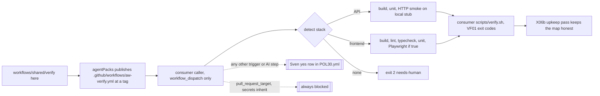

# VF02: Verify workflow template for consumer repos (API and frontend), shipped by agentPacks
- Status: todo
- Area: verify
- Wave: W2
- Block: 2
- Lane: Builder
- Depends on: VF01, POL01, POL03, C12, G00a, X06b (id only, no file yet)
- proof: `./scripts/verify.sh` exits 0 with `0 failures`; `bash policies/checks/POL30.sh test/fixtures/bad/POL30/` exits 1 and `bash policies/checks/POL30.sh test/fixtures/good/POL30.md` exits 0; the `scripts/verify.sh` actionlint loop covers `workflows/shared/verify/*.yml` and is clean; one staged dispatch run in the X01 trial repo after Sven's yes shows each detected stack step green
- door: one-way (enabling the template in a consumer runs Actions there and can spend minutes)
- one-way gate: Sven's exact yes required per consumer repo and per trigger (row in `policies/POL30.yml` `sven_yes`, Named asks below). Rollback: delete the caller file in that consumer repo, or set it back to `workflow_dispatch` only, and remove its `sven_yes` row
- triage: spec (template and rule are docs plus files in this repo; enabling anywhere is an ask)
- feedback: `bash policies/checks/POL30.sh` exits 1 on every file in `test/fixtures/bad/POL30/` and 0 on `test/fixtures/good/POL30.md`, inside `./scripts/verify.sh` with `0 failures` (DoD rows 1 to 3)
- harness: none (script); the template runs on GitHub Actions in the consumer, no agent engine
- review-input: diff + this PBI + DoD (+ linked spec) + PR description, never builder session logs (PA6)
- kind: script (deterministic)
- Source: PA8 (no D row; Sven via Fleet, Development Agentic Workflows room, 2026-10-26, verification approach from the Matt Pocock and poteto talk) https://github.com/cursor/plugins/blob/main/pstack/skills/create-verification-skill/SKILL.md
## Goal
A consumer repo gets one verify workflow from agentPacks instead of writing its own. It picks API steps or frontend steps by the stack it finds. It ends in the consumer's own `scripts/verify.sh` with the VF01 exit codes. Out of the box it runs only by hand (`workflow_dispatch`). It spends no tokens.
## Context
VF01 is the shared entry point contract: every repo has one `scripts/verify.sh`, exit 0 ok, 1 failed, 2 needs-human. VF02 brings that to consumer repos (API repos and frontend repos). It does not make a second gate.

Where things live:
- The authoring copy lives in this repo under `workflows/shared/verify/`. That folder holds the template, a thin caller example and a starter `verify.sh`.
- agentPacks (svennijhuis/agentPacks) distributes it, like the other shared fragments ([C12](../done/C12-agentpacks-import-contract.md), [G00a](../done/G00a-consumer-strategy.md)). GitHub only runs a reusable workflow from `.github/workflows/` of the called repo. So agentPacks publishes the copy at `.github/workflows/aw-verify.yml` on a tag, and a consumer calls it by full SHA (POL01).
- The consumer holds its caller file and its own `scripts/verify.sh`. Nothing is enabled in any consumer by this PBI.
- This PBI file lives in `docs/pbi/verify/`. When done it moves to `docs/pbi/done/` with `- Status: done` and `- PR: #<n>`.

Steps by detected stack (detect job reads files, inputs can override):
- API signals: `*.csproj` or `*.sln`, `Cargo.toml`, `pyproject.toml`, or `package.json` with a dependency on `express`, `fastify`, `@nestjs/core`, `hono` or `koa`.
- Frontend signals: `package.json` with a dependency or devDependency on `react`, `next`, `vue`, `nuxt`, `svelte`, `@sveltejs/kit`, `@angular/core`, `astro` or `solid-js`, or a file `angular.json`, `next.config.*`, `nuxt.config.*`, `svelte.config.*` or `astro.config.*`.
- A `package.json` that matches neither list is not a stack. It does not default to API.
- API: build, unit tests, contract and HTTP smoke against a local stub. The app starts on localhost with its outside calls stubbed. Requests come from the repo's own scenario files. No call leaves the runner.
- Frontend: build, lint, typecheck, unit tests. Playwright smoke is optional and off by default (`playwright: false`).
- Both found: both jobs run.
- Nothing found: the detect job exits 2 (needs-human) and the run is red, never a silent pass.
- No command for a step of the chosen stack (no package script, no Makefile target, no generic recipe for that toolchain): the step stays and fails with exit 2. A missing command is never a skip.
- A final `gate` job (`if: always()`, `needs` every job) fails when detect failed, when `detected-stack` is missing, empty or not `api`, `frontend` or `both`, or when a job the stack names did not run and succeed. Skipped jobs never make a green run.

Post-deploy smoke on tst and acc is a different thing (live APIs, OIDC). It is planned in a separate PR and is not part of VF02.

Learnings from the pstack sources (read 2026-10-26):
- Interview the repo, not the user. The detect job reads files and asks only for what it cannot see.
- Use the repo's own commands first (package scripts, Makefile). Fall back to a generic recipe only when none exists. When neither exists, the step fails with exit 2.
- Evidence must survive cleanup. Test reports and screenshots go up as run artifacts.
- A feature map says what proves each feature. The upkeep pass keeps it honest and ends clean, changed or blocked, with at most one PR. In this catalog that pass is X06b.
## Where it lives
One rule, one place. Each prose rule points to its check. Each check points back to this PBI.
- Template files: `workflows/shared/verify/verify.yml` (reusable, `on: workflow_call`), `workflows/shared/verify/caller-example.yml` (thin caller, `on: workflow_dispatch`), `workflows/shared/verify/verify-starter.sh` (starter for a consumer `scripts/verify.sh`), `workflows/shared/verify/README.md` (how to adopt).
- POL30 Consumer verify template: no spend and no auto trigger without Sven's yes
  - Rule definition: `policies/POL30.yml` with `id`, `title`, `rule`, `why`, `check`, `bad_fixture`, `good_fixture`, `pbi`, `pins` (model: `policies/POL17.yml`), plus `sven_yes: []` with rows `{repo, path, trigger, date, quote}`. `pins: .github/aw.json`. `pbi: docs/pbi/done/VF02.md` after the move, `docs/pbi/verify/VF02.md` until then.
  - Rule text: the template has `workflow_call` as its only trigger.
  - Rule text: the caller example has `workflow_dispatch` as its only trigger.
  - Rule text: any other trigger is a hit unless a valid `sven_yes` row matches its repo, file path and trigger. This is an allow list, not a deny list: `push`, `pull_request`, `merge_group`, `schedule`, `workflow_run`, `repository_dispatch`, `issue_comment`, `release` and `workflow_call` on a caller all need a row.
  - Rule text: `pull_request_target` always fails, in the template and in the caller, even when a `sven_yes` row names it. No row can allow it.
  - Rule text: a `sven_yes` row with `trigger: pull_request_target` fails the file.
  - Rule text: `sven_yes` is a list. A string, a map, null or an unreadable `policies/POL30.yml` fails the file.
  - Rule text: each `sven_yes` row is a map with `repo`, `path`, `trigger`, `date` and `quote`, each a string that is not empty after trim.
  - Rule text: a missing key, an empty or blank value, or a value that is a list, a map or null fails the whole file. A row that fails never counts as a yes.
  - Rule text: any step that spends tokens or AIC (`gh aw run`, an AI engine, an engine secret name) needs a `sven_yes` row.
  - Rule text: the template and the caller never use `secrets: inherit` and never name a secret (`secrets.<NAME>` or a `secrets:` map), except the default `GITHUB_TOKEN`.
  - Rule text: `playwright` defaults to `false`.
  - Rule text: every job sets `timeout-minutes` and `permissions: contents: read`, and no other permission.
  - Rule text: `contents: write`, `id-token: write` or any other write permission fails. Artifact upload uses the runner token, not `GITHUB_TOKEN`, so it needs no `actions: write`.
  - Rule text: every `actions/checkout` step sets `persist-credentials: false`.
  - Rule text: input `stack` is one of `auto`, `api`, `frontend`, `both`. Anything else exits 2 in the detect job.
  - Rule text: input `working-directory` is a relative path inside the workspace (no leading `/`, no `..`). Anything else exits 2 in the detect job.
  - Rule text: API smoke URLs point at `localhost` or `127.0.0.1` only.
  - Rule text: the template ends with a `gate` job that has `if: always()` and `needs` every other job.
  - Check script: `policies/checks/POL30.sh`, prints `file:line POL30 message`. It reads `on:` through `scripts/lib/on-triggers.sh` and fails closed on a parse error.
  - Check script: it checks `pull_request_target` and secrets before it reads `sven_yes`, so no row can unlock them.
  - Check script: it reads `sven_yes` from `policies/POL30.yml`, or from the file in `POL30_YES` for a fixture.
  - Check script: repo-mode roots are `workflows/shared/verify/*.yml` and `policies/POL30.yml`. A missing root, an empty scan or a parse error prints a line and exits 1 (VF01 gap row 18).
  - Proof: `test/fixtures/bad/POL30/` (`template-push.yml`, `template-pull-request.yml`, `caller-schedule.yml`, `caller-workflow-run.yml`, `caller-workflow-call.yml`, `caller-repository-dispatch.yml`, `template-ai-step.yml`, `template-playwright-default-on.yml`, `template-no-timeout.yml`, `template-write-permissions.yml`, `template-id-token-write.yml`, `template-persist-credentials.yml`, `template-bad-stack.yml`, `template-bad-working-directory.yml`, `template-api-smoke-external-url.yml`, `template-no-final-gate.yml`, `broken.yml`, `caller-pull-request-target-with-yes.yml` (with `pol30-yes-pull-request-target.yml` as its `sven_yes` input), `sven-yes-empty-quote.yml`, `sven-yes-blank-repo.yml`, `sven-yes-missing-date.yml`, `sven-yes-null.yml`, `sven-yes-string.yml`, `caller-secrets-inherit.yml`, `caller-named-secret.yml`) and `test/fixtures/good/POL30.md`.
  - Proof: POL23 runs each case alone (VF01 gap row 17). `pol30-yes-pull-request-target.yml` alone also exits 1, because its row names `pull_request_target`.
  - Proof: `sven-yes-empty-quote.yml` has a row with `quote: "  "` and fails.
- Action pins: POL01 keeps the rule. Its target list gains `workflows/shared/verify/*.yml` (no new id). Proof: `test/fixtures/bad/POL01-verify-template-tag.yml`.
  - Today POL01 file mode reads only frontmatter (`policies/checks/POL01.sh:41` via `q()` in `policies/checks/lib.sh:37`), so that fixture would pass. File mode walks the whole file with `yq`, like repo mode (`POL01.sh:44` to `:50`).
  - Repo mode reads its yml roots from `policies/POL01.yml` (`.github/workflows/*.yml`, `workflows/shared/verify/*.yml`), not a hardcoded glob.
- Exit codes: VF01 owns them. The starter `verify.sh` copies the contract and links VF01.
- Runner here: only `scripts/verify.sh` (the C01 gate). POL30 joins its POL loop. No new script runs it.
- actionlint: the `scripts/verify.sh` actionlint loop (`:32` to `:36`, `.github/workflows/*.yml` today) also covers `workflows/shared/verify/*.yml`.
- agentPacks side: pack-check in agentPacks mirrors POL30 on its published copy. That is an agentPacks PBI, linked by id when it exists.
## Steps
1. Write `workflows/shared/verify/verify.yml`: a `detect` job, then `api` and `frontend` jobs gated on its outputs, then a `gate` job with `if: always()`. Each stack job ends with `./scripts/verify.sh`. Detect validates `stack` and `working-directory` and exits 2 on none or bad input.
2. Write `workflows/shared/verify/caller-example.yml`: `workflow_dispatch` only, `uses:` the agentPacks copy by full SHA, inputs `stack`, `playwright: false`.
3. Write `workflows/shared/verify/verify-starter.sh`: API and frontend steps by stack, VF01 output and exit codes, exit 2 when no stack is found or a tool is missing.
4. Add `policies/POL30.yml`, `policies/checks/POL30.sh`, the bad and good fixtures, and the POL01 target line.
5. Write `workflows/shared/verify/README.md`: adopt steps, the asks, the rollback.
6. Run `./scripts/verify.sh` twice on the SHA (Q0).
7. After Sven's yes only: one staged dispatch run in the X01 trial repo, artifacts attached.
## Definition of Done
- [ ] `./scripts/verify.sh` exits 0 with `0 failures` and runs POL30.
- [ ] Each file in `test/fixtures/bad/POL30/` makes POL30 exit 1.
- [ ] `test/fixtures/good/POL30.md` makes POL30 exit 0.
- [ ] `test/fixtures/bad/POL01-verify-template-tag.yml` makes POL01 exit 1.
- [ ] `policies/POL30.yml` carries every field of `policies/POL17.yml` plus `sven_yes: []`.
- [ ] `verify.yml` trigger is `workflow_call` only.
- [ ] `caller-example.yml` trigger is `workflow_dispatch` only.
- [ ] Every action is pinned by full SHA.
- [ ] Every job has `timeout-minutes` and `permissions: contents: read` and no other permission; every checkout has `persist-credentials: false`.
- [ ] No job uses a secret other than the default token.
- [ ] `pull_request_target` fails POL30 even with a matching `sven_yes` row; `test/fixtures/bad/POL30/caller-pull-request-target-with-yes.yml` (with `pol30-yes-pull-request-target.yml`) makes POL30 exit 1 (Reviewer item 1).
- [ ] A `sven_yes` row with a missing, empty or blank `repo`, `path`, `trigger`, `date` or `quote`, or with a list, map or null value, fails the file; `test/fixtures/bad/POL30/sven-yes-empty-quote.yml` makes POL30 exit 1, and so do `sven-yes-blank-repo.yml`, `sven-yes-missing-date.yml`, `sven-yes-null.yml` and `sven-yes-string.yml` (Reviewer item 2).
- [ ] The template and the caller never use `secrets: inherit` or a named secret; `test/fixtures/bad/POL30/caller-secrets-inherit.yml` makes POL30 exit 1, and so does `caller-named-secret.yml` (Reviewer item 3).
- [ ] `test/fixtures/good/POL30.md` has one full `sven_yes` row and still exits 0, so a valid row passes.
- [ ] A caller trigger other than `workflow_dispatch` with no matching row fails; `caller-workflow-call.yml` and `caller-repository-dispatch.yml` make POL30 exit 1.
- [ ] `template-id-token-write.yml`, `template-persist-credentials.yml`, `template-bad-stack.yml`, `template-bad-working-directory.yml`, `template-api-smoke-external-url.yml` and `template-no-final-gate.yml` each make POL30 exit 1.
- [ ] POL01 file mode makes `test/fixtures/bad/POL01-verify-template-tag.yml` exit 1 (whole-file walk).
- [ ] `scripts/verify.sh` runs actionlint on `workflows/shared/verify/*.yml`.
- [ ] Detect finds API, frontend, both or none on four fixture trees; none exits 2 and the run is red.
- [ ] A `package.json` with no listed dependency is none, not API.
- [ ] With `detected-stack` empty or invalid, or a named stack job skipped, the `gate` job fails the run.
- [ ] A stack step with no command fails with exit 2, never a skip.
- [ ] API job runs build, unit tests and HTTP smoke against a local stub with no outbound call.
- [ ] Frontend job runs build, lint, typecheck and unit tests; Playwright runs only when `playwright: true`.
- [ ] Test reports and screenshots upload as artifacts and survive cleanup.
- [ ] The starter `verify.sh` prints `file:line RULE message` lines and `N failures`, exit 0, 1 or 2.
- [ ] Nothing is enabled in any consumer repo by this PR.
- [ ] No long dashes, no secrets, no IDs added.
- [ ] This file moves to `docs/pbi/done/` with `- Status: done` and `- PR: #<n>`.
## Technical design
- Components and files: `workflows/shared/verify/verify.yml`, `workflows/shared/verify/caller-example.yml`, `workflows/shared/verify/verify-starter.sh`, `workflows/shared/verify/README.md`, `policies/POL30.yml`, `policies/checks/POL30.sh`, `test/fixtures/bad/POL30/`, `test/fixtures/good/POL30.md`, `test/fixtures/bad/POL01-verify-template-tag.yml`, `policies/checks/POL01.sh` (target line); agentPacks: `.github/workflows/aw-verify.yml` (published copy, separate PR there)
- Module boundary: the caller passes `stack` and `playwright` to one reusable workflow and gets one pass or fail plus artifacts; stack detection, toolchain setup, stub start and the consumer `scripts/verify.sh` sit behind it
- Interfaces: `workflow_call` inputs `stack` (auto, api, frontend, both; default auto; anything else exits 2), `playwright` (boolean, default false), `working-directory` (default `.`, relative inside the workspace, else exit 2). Outputs `detected-stack`, `result`. Exit contract of the consumer `scripts/verify.sh`: 0 ok, 1 failed, 2 needs-human (VF01). Secrets: none beyond the default token.
- Sequence:

- Failure modes: no stack found gives exit 2 and the run stops; a missing tool gives exit 2; a red step gives exit 1 with `file:line`; the stub port is taken and the API job fails at start with the port in the message; a consumer pins the template by tag and POL01 fails in this repo (the consumer side is caught by agentPacks pack-check); a trigger added without a valid `sven_yes` row, any `pull_request_target`, a malformed `sven_yes` row, `secrets: inherit` or a named secret fails POL30 here; a skipped stack job or an empty `detected-stack` fails the `gate` job; a step with no command exits 2
- Security: `permissions: contents: read` and no write permission, `persist-credentials: false` on every checkout, actions by full SHA, no `secrets: inherit` and no named secret (only the default token), no outbound call in API smoke (stub on localhost only), `pull_request_target` never allowed (no `sven_yes` row unlocks it), fork PRs get no secrets, no token spend without a `sven_yes` row
- Observability: one job summary per stack with the `N failures` line, uploaded test reports and screenshots, `detected-stack` output on the run page
- Cost: 0 AIC. Actions minutes only on a manual run, and only in a consumer where Sven said yes. Playwright off by default because it is the costliest step.
- Rollback: in a consumer, delete the caller file or set it back to `workflow_dispatch` only and remove the `sven_yes` row; in this repo, revert the PR
- Proof: same as proof: above
- Door: one-way (enabling in a consumer runs Actions there; the files in this repo alone are two-way)
## Evidence
- Two `./scripts/verify.sh` logs on the PR SHA, `0 failures`.
- POL30 output: each bad fixture exits 1, good exits 0.
- After Sven's yes: the X01 trial run link with the job summary and artifacts.
## Flow

## Named asks for Sven
- Enable the caller in a named consumer repo (per repo, one-way). Default stays `workflow_dispatch` only.
- Any trigger other than `workflow_dispatch` on a caller (`push`, `pull_request`, `merge_group`, `schedule`, `workflow_run` and the rest), per repo, file and trigger.
- Not an ask: `pull_request_target`, `secrets: inherit` and named secrets stay blocked even with a yes.
- Turn on Playwright smoke in a consumer (Actions minutes).
- Any step that spends tokens or AIC (an AI engine or `gh aw run`). None is planned.
- One staged dispatch run in the X01 trial repo to prove the template.
- X06b upkeep pass on a schedule (one-way if scheduled).
## Cost
0 AIC. Actions minutes per manual run in a consumer, only after Sven's yes for that repo. Playwright adds the most minutes and is off by default.
## Sources
- svennijhuis/agentic-workflows@2ccf76d: `workflows/shared/README.md`, `policies/POL01.yml`, `policies/POL03.yml`, `policies/POL25.yml`, `policies/checks/POL03.sh`, `scripts/lib/on-triggers.sh`, `governance/rollout.yml`
- [VF01](VF01.md), [C12](../done/C12-agentpacks-import-contract.md), [G00a](../done/G00a-consumer-strategy.md), [POL01](../done/POL01-pinned-versions-only.md), [POL03](../done/POL03-staged-report-only-before-writes.md), [POL25](../done/POL25-agentic-dispatch-only.md), [X06](../done/X06-verification-skill.md), [gist-review.md](../gist-review.md) rows 3, 5 and 13
- Strategy id list v3.12: X06b (id only, no file yet)
- https://github.com/cursor/plugins/blob/main/pstack/docs/guide/06-verify-and-ship.md (read 2026-10-26)
- https://github.com/cursor/plugins/blob/main/pstack/skills/create-verification-skill/SKILL.md (read 2026-10-26)
- https://github.com/cursor/plugins/blob/main/pstack/skills/maintain-verification-skill/SKILL.md (read 2026-10-26)
- https://docs.github.com/en/actions/how-tos/reuse-automations/reuse-workflows (read 2026-10-26; reusable workflows live in `.github/workflows/`)
