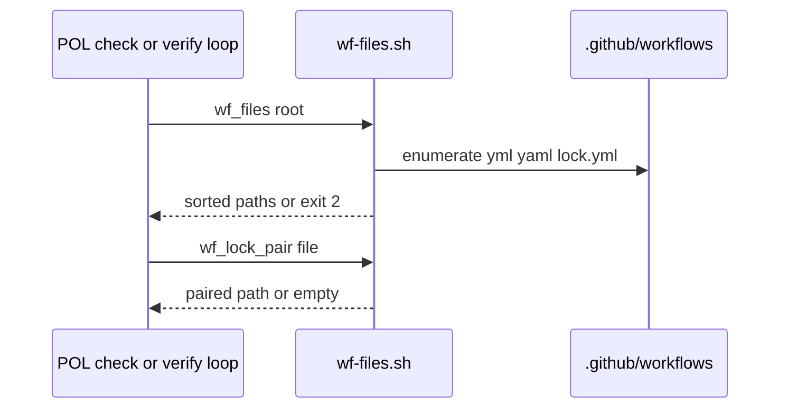
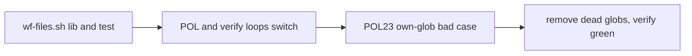

# WF01: One shared workflow file lister
- Status: todo
- Area: verify
- Wave: W2
- Block: 2
- Lane: Builder
- Depends on: SM05c
- proof: `rg -n 'workflows/\*' policies/checks scripts` shows only `scripts/lib/wf-files.sh`; temp root with `probe.yaml` plus `on: push` makes POL03 exit 1; POL23 bad case (own glob in a check script) exits 1; `./scripts/verify.sh` ends with `0 failures` twice; `bash scripts/check-pbi-template.sh` and `bash scripts/check-pbi-docs.sh` print nothing; gitleaks clean
- door: two-way
- triage: build (one lib replaces divergent globs; lane 1 after SM05c)
- feedback: `./scripts/verify.sh` ends with `0 failures`; `rg -n 'workflows/\*' policies/checks scripts` lists only the lib; lib unit test on a temp root passes (DoD rows)
- harness: none (script)
- review-input: diff + this PBI + DoD (+ linked spec) + PR description, never builder session logs (PA6)
- kind: script (deterministic)
- Source: PA8 (no D row; Strategy, Development Agentic Workflows room, 2026-10-26) https://github.com/svennijhuis/agentic-workflows/pull/14
## Goal
Every policy finds workflow files the same way. No policy can miss `.yaml` or lock files again.
## Context
Lane 1 after SM05c (edits POL23; id only, no file yet). Docs PBI filed in the next lane 3 docs PR.

Why (three hits, same bug):
1. PR #14 POL03 repo loop walks only `*.yml` (Reviewer c6424901842, Tester 2 c6424924159).
2. `verify.sh` fixture loops miss `*.yaml` (SM01a, PR #15).
3. `check-smoke` reads only `*.yml` (SM01a row, Cursor 5657322997 on PR #11).

Shape:
- `scripts/lib/wf-files.sh`, one function `wf_files <root>`: prints sorted, NUL-safe list of `.github/workflows/*.yml`, `*.yaml`, `*.lock.yml`.
- `wf_lock_pair <file>`: prints the paired `.lock.yml` or source `.md`/`.yml`, empty when orphan.
- Fails closed: missing root or unreadable dir exits 2.

Related carry (not WF01 scope, note only): non-decimal int literals hit twice: SM01a `status: 0x12C`, PR #16 `steps: 0x2`. Candidate shared `is_dec_int` helper in `scripts/lib` when SM01a lands.
## Steps
1. Add lib plus unit test (temp root with `a.yml`, `b.yaml`, `c.lock.yml`, orphan lock, spaces in name).
2. Switch every POL repo loop (POL03, POL25, POL27, POL28, rest) and `verify.sh` fixture loops to it.
3. POL23 case: a `policies/checks/*.sh` with its own `.github/workflows/*` glob is a hit.
4. Remove the now dead local globs.
## Definition of Done
- [ ] `scripts/lib/wf-files.sh` exposes `wf_files` and `wf_lock_pair`; missing root or unreadable dir exits 2
- [ ] Unit test on a temp root covers `a.yml`, `b.yaml`, `c.lock.yml`, orphan lock, spaces in name
- [ ] `rg -n 'workflows/\*' policies/checks scripts` shows only the lib
- [ ] Temp root with `probe.yaml` plus `on: push` makes POL03 exit 1 (repeatable test)
- [ ] POL23 bad case (check script with its own workflows glob) exits 1; good case passes
- [ ] `./scripts/verify.sh` ends with `0 failures` twice; both PBI checks print nothing; gitleaks clean
- [ ] Small enough for 2 rounds: anything open after round 2 goes to the list
## Technical design
- Components and files: `scripts/lib/wf-files.sh`, unit test beside the lib or under `test/`, `policies/checks/POL03.sh`, `POL25.sh`, `POL27.sh`, `POL28.sh`, other POL repo loops, `scripts/verify.sh` fixture loops, POL23 tautology case for a check-owned glob
- Module boundary: `wf_files <root>` and `wf_lock_pair <file>` are the small interface; sorted NUL-safe enumeration and lock pairing sit behind them
- Interfaces: `wf_files` prints paths on stdout, exit 0 on success, 2 on missing root or unreadable dir; `wf_lock_pair` prints one paired path or empty; POL checks call `wf_files` instead of inline globs
- Sequence:

- Failure modes: missing root or unreadable dir exits 2; orphan lock prints empty pair; a check that keeps its own workflows glob fails POL23
- Security: read-only directory listing; no network; no secrets in the lib
- Observability: exit code and POL23 line when a tautological glob remains
- Cost: 0
- Rollback: revert the PR; restore local globs in each check
- Proof: same as proof: above
- Door: two-way (script and policy loops only)
## Evidence
Gate log comment, `rg` output, lib test output, POL23 mutation run
## Flow

## Named asks for Sven
- none
## Cost
0 (script)
## Sources
- Strategy, Development Agentic Workflows room, 2026-10-26
- [PR #14](https://github.com/svennijhuis/agentic-workflows/pull/14) (Reviewer c6424901842, Tester 2 c6424924159)
- SM01a and PR #15 (verify fixture loops); Cursor 5657322997 on [PR #11](https://github.com/svennijhuis/agentic-workflows/pull/11)
