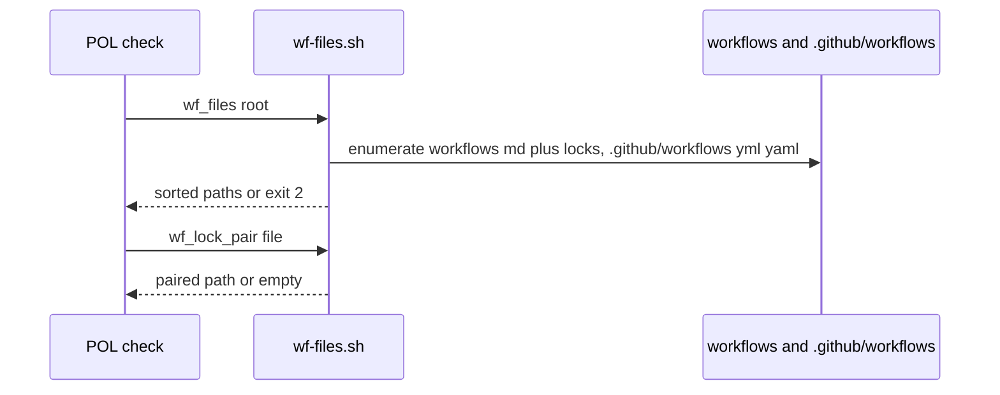
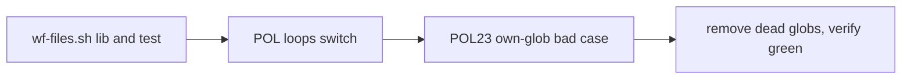

# WF01: One shared workflow file lister
- Status: todo
- Area: verify
- Wave: W2
- Block: 2
- Lane: Builder
- Depends on: SM05c
- proof: no workflow walk (glob, `find` or `ls`) outside `scripts/lib/wf-files.sh` (the DoD walk check prints nothing, also when the dir is set on an earlier line); missing `.github/workflows` exits 2 and a README-only `workflows/` exits 0 with an empty catalog list; temp root with `.github/workflows/probe.yaml` plus `on: push` makes POL03 exit 1, orphan `workflows/orphan.lock.yml` or `.github/workflows/evil.lock.yml` with `on: push` makes POL03 exit 1, and `workflows/probe.md` with `on: push` makes POL25 exit 1; catalog present with empty `.github/workflows` makes POL28 exit 1; POL23 bad cases `test/fixtures/bad/POL23-own-glob/` and `bad/POL23-split-walk/` exit 1; `./scripts/verify.sh` ends with `0 failures` twice; `bash scripts/check-pbi-template.sh` and `bash scripts/check-pbi-docs.sh` print nothing; gitleaks clean
- door: two-way
- triage: build (one lib replaces divergent globs; lane 1 after SM05c)
- feedback: `./scripts/verify.sh` ends with `0 failures`; the DoD walk check prints nothing; lib unit test on a temp root passes (DoD rows)
- harness: none (script)
- review-input: diff + this PBI + DoD (+ linked spec) + PR description, never builder session logs (PA6)
- kind: script (deterministic)
- Source: PA8 (no D row; Strategy, Development Agentic Workflows room, 2026-10-26) https://github.com/svennijhuis/agentic-workflows/pull/14
## Goal
Every policy finds workflow files the same way. No policy can miss `.yaml` or lock files again.
## Context
Lane 1 after SM05c (edits POL23; id only, no file yet). Docs PBI filed in the next lane 3 docs PR.

Why (three hits, same bug):
1. PR #14 POL03 repo loop walks only `*.yml` (Reviewer c6424901842, Tester 2 c6424924159).
2. `verify.sh` fixture loops miss `*.yaml` (SM01a row 9, PR #15; that loop stays in SM01a, see Shape).
3. `check-smoke` reads only `*.yml` (SM01a row, Cursor 5657322997 on PR #11).

Shape (Cursor 5657888041 f1 high on PR #18):
- `scripts/lib/wf-files.sh`, one function `wf_files <root> [--no-lock]`. It prints a sorted, NUL-separated list of every workflow file a POL check reads:
  - catalog sources `workflows/*.md` (and below, same as `targets` in `policies/checks/lib.sh`, README.md excluded) plus the sibling `.lock.yml` of each;
  - `.github/workflows/*.yml` and `*.yaml`, including `*.lock.yml` and `*.lock.yaml`;
  - POL01 keeps its `yml_roots` globs from `policies/POL01.yml` (for example `workflows/shared/verify/*.yml`) as extra roots on top of this list, not inside the lib.
- `--no-lock` drops every `*.lock.yml` and `*.lock.yaml`. Only POL28 repo mode calls `wf_files` with `--no-lock` (today it skips lock files under `.github/workflows` only; `policies/checks/POL28.sh` L87). The POL03 repo loop does not pass `--no-lock`: on main `policies/checks/POL03.sh` L96-L97 runs `triggers_ok` on every `.github/workflows/*.yml` and `*.yaml` (locks included), L99-L102 checks orphan `workflows/*.lock.yml`, and L73 still reaches a sibling lock when the catalog `.md` is visited.
- `wf_lock_pair <file>`: prints the paired `.lock.yml` or source `.md`, `.yml` or `.yaml`, empty when orphan.
- Fails closed (Cursor 5658106584 f6 on PR #18): `wf_files` exits 2 when the root is missing, when `.github/workflows` is missing or unreadable, or when `workflows/` is unreadable. A `workflows/` that holds only README.md is not an error: it exits 0 with an empty catalog list, so nothing fires before POL01 adds its `yml_roots`. Every caller saves the exit code, then loads the NUL-separated list with `mapfile -d ''` (a newline `mapfile` joins path names and the scan exits 0). Exit 2 becomes a hit. POL28 counts only paths under `.github/workflows` (or `wf_files` takes a tree selector): a non-empty catalog must not hide an empty `.github/workflows` list; POL28 hits when that list is empty, replacing `policies/checks/POL28.sh` L88 (L87 hides `find` errors with `2>/dev/null`).
- Out of scope: the smoke fixture loops (`test/fixtures/smoke/good*.yml`, `bad-*.yml` in `scripts/verify.sh`) are not workflow files; SM01a row 9 owns their `.yaml` glob.

Related carry (not WF01 scope, note only): non-decimal int literals hit twice: SM01a `status: 0x12C`, PR #16 `steps: 0x2`. Candidate shared `is_dec_int` helper in `scripts/lib` when SM01a lands.
## Steps
1. Add lib plus unit test (temp root with `workflows/a.md` and its `a.lock.yml`, `.github/workflows/b.yml`, `c.yaml`, `d.lock.yaml`, an orphan lock, a name with spaces, a missing root, and `--no-lock`).
2. Switch every POL repo loop (POL03, POL25, POL27, POL28, rest) to it, including `targets` in `policies/checks/lib.sh` (L26 sets `workflows`, L28 runs `find`) and POL25 `files` (`policies/checks/POL25.sh` L23); only POL28 repo mode passes `--no-lock`; POL01 adds its `yml_roots` on top (`policies/checks/POL01.sh` L59). Each caller saves `wf_files` exit status, then `mapfile -d ''` the list, and aborts on a non zero exit.
3. POL23 case: a `policies/checks/*.sh` or `scripts/*.sh` that hits a real workflow walk (`find`, `ls`, or a glob on `workflows` or `.github/workflows`, including when the directory is set on an earlier line and walked on a later one) is a hit. Allow `wf_files` call arguments, comments, and the POL01 `yml_roots` line at `policies/checks/POL01.sh` L59. Fixtures: `test/fixtures/bad/POL23-own-glob/` and `test/fixtures/bad/POL23-split-walk/` (directory on one line, `find` on a later line), each exit 1, plus a good case that exits 0.
4. Remove the now dead local globs.
## Definition of Done
- [ ] `scripts/lib/wf-files.sh` exposes `wf_files [--no-lock]` and `wf_lock_pair`; a missing root, a missing or unreadable `.github/workflows` or an unreadable `workflows/` exits 2, and every caller saves the status then `mapfile -d ''` the list and turns exit 2 into a hit (a test stubs `wf_files` to exit 2 and POL03, POL25, POL27, POL28 each exit 1)
- [ ] A temp root whose `workflows/` holds only README.md makes `wf_files` exit 0 with an empty catalog list; a temp root with no `.github/workflows` makes it exit 2; a temp root with `workflows/squad-review.md` present and `.github/workflows` empty makes POL28 exit 1
- [ ] Unit test on a temp root covers `workflows/a.md` plus `a.lock.yml`, `.github/workflows/b.yml`, `c.yaml`, `d.lock.yaml`, orphan lock, spaces in name, `--no-lock`
- [ ] POL28 repo mode still skips lock files under `.github/workflows` via `--no-lock`; the POL03 repo loop still scans `.github/workflows` yml and yaml including locks and orphan catalog locks (`policies/checks/POL03.sh` L96-L102); POL01 still walks its `yml_roots`
- [ ] Walk check (Cursor 5658106584 f5 on PR #18) prints nothing: any real `find`, `ls`, or glob walk on `workflows` or `.github/workflows` in `policies/checks` and `scripts` outside `scripts/lib/wf-files.sh` is a hit (including split walks); `wf_files` arguments, comments and the POL01 `yml_roots` line at `policies/checks/POL01.sh` L59 are allowed; `targets` and POL25 `files` call `wf_files` instead of inline walks
- [ ] Temp root with `.github/workflows/probe.yaml` plus `on: push` makes POL03 exit 1; temp root with orphan `workflows/orphan.lock.yml` or `.github/workflows/evil.lock.yml` plus `on: push` makes POL03 exit 1; `workflows/probe.md` with `on: push` makes POL25 exit 1 (repeatable tests)
- [ ] `test/fixtures/bad/POL23-own-glob/` and `test/fixtures/bad/POL23-split-walk/` each exit 1; good POL23 case passes
- [ ] `./scripts/verify.sh` ends with `0 failures` twice; both PBI checks print nothing; gitleaks clean
- [ ] Small enough for 2 rounds: anything open after round 2 goes to the list
## Technical design
- Components and files: `scripts/lib/wf-files.sh`, unit test beside the lib or under `test/`, `policies/checks/POL03.sh`, `POL25.sh`, `POL27.sh`, `POL28.sh`, other POL repo loops, POL23 tautology case for a check-owned glob
- Module boundary: `wf_files <root>` and `wf_lock_pair <file>` are the small interface; sorted NUL-safe enumeration and lock pairing sit behind them
- Interfaces: `wf_files` prints sorted NUL-separated paths on stdout, exit 0 on success (an empty catalog list when `workflows/` holds only README.md), 2 on a missing root, a missing or unreadable `.github/workflows` or an unreadable `workflows/`; callers save the exit code, `mapfile -d ''` the list, hit on exit 2, and POL28 also on an empty `.github/workflows`-only list; `wf_lock_pair` prints one paired path or empty; POL checks call `wf_files` instead of inline globs
- Sequence:

- Failure modes: a missing root or a missing or unreadable `.github/workflows` exits 2 and the caller makes it a hit (fail closed); POL28 hits on an empty list; orphan lock prints empty pair; a check that keeps its own workflows glob fails POL23
- Security: read-only directory listing; no network; no secrets in the lib
- Observability: exit code and POL23 line when a tautological glob remains
- Cost: 0
- Rollback: revert the PR; restore local globs in each check
- Proof: same as proof: above
- Door: two-way (script and policy loops only)
## Evidence
Gate log comment, walk check output, lib test output, POL23 mutation run
## Flow

## Named asks for Sven
- none
## Cost
0 (script)
## Sources
- Strategy, Development Agentic Workflows room, 2026-10-26
- [PR #14](https://github.com/svennijhuis/agentic-workflows/pull/14) (Reviewer c6424901842, Tester 2 c6424924159)
- SM01a and PR #15 (verify fixture loops); Cursor 5657322997 on [PR #11](https://github.com/svennijhuis/agentic-workflows/pull/11)
- [PR #18 Cursor review 5657888041, finding 1](https://github.com/svennijhuis/agentic-workflows/pull/18)
- [PR #18 Cursor review 5658106584, findings 5, 6 and 8](https://github.com/svennijhuis/agentic-workflows/pull/18)
