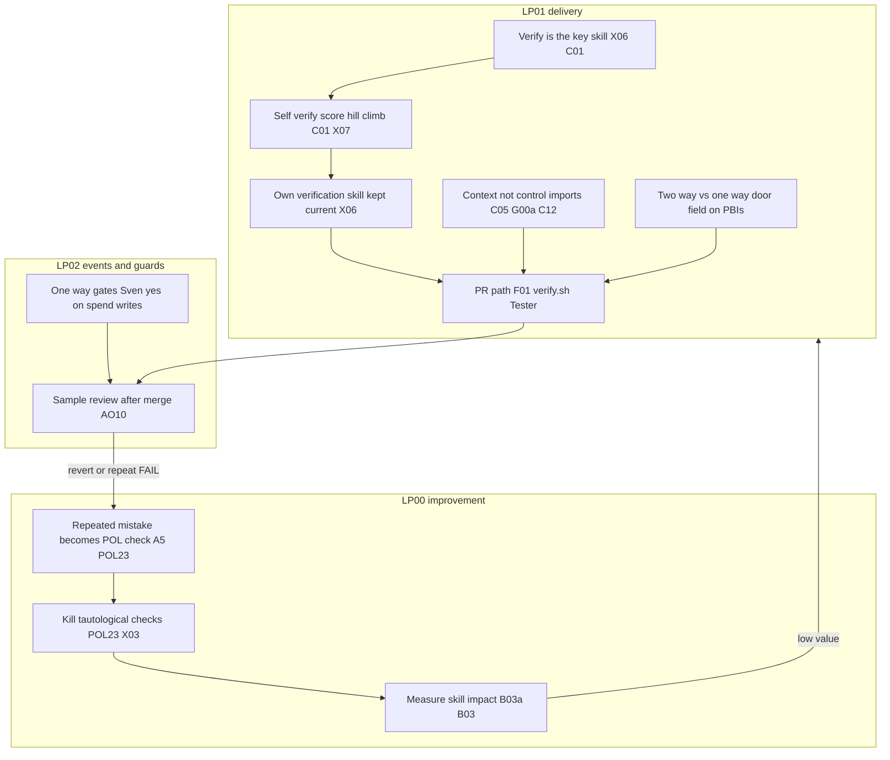
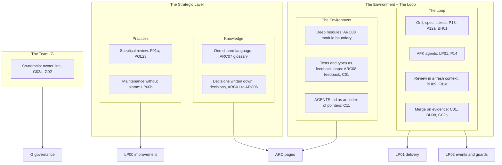

# Vision: poteto and Matt Pocock flow mapped onto the loops

Source: [gist-review.md](gist-review.md) (Matt Pocock x poteto transcript, rows 1 to 32, additions A1 to A7). Loops: [LP00](loops/LP00-improvement-loop.md), [LP01](loops/LP01-delivery-loop.md), [LP02](loops/LP02-event-map.md).

## Poteto flow on LP00, LP01, LP02

| Step | Loop | Gist | PBI file(s) |
|---|---|---|---|
| Verification is the key skill | LP01 | [row 1](gist-review.md), A1 `proof:` and A2 X06 first | [done/X06-verification-skill.md](done/X06-verification-skill.md), [done/C01-verify-script.md](done/C01-verify-script.md) |
| Self verify, score, hill climbing | LP01 | [row 2](gist-review.md), A3 one line verify output | [done/C01-verify-script.md](done/C01-verify-script.md), [testing/X07-workflow-benchmark.md](testing/X07-workflow-benchmark.md) |
| Own verification skill per app | LP01 | [row 3](gist-review.md), A2 | [done/X06-verification-skill.md](done/X06-verification-skill.md) |
| Repeated mistake becomes a lint | LP00 | [row 8](gist-review.md), A5 findings rule | [done/POL23-no-tautological-checks.md](done/POL23-no-tautological-checks.md), [README.md](README.md) (findings rule) |
| Context not control | LP01 | [row 13](gist-review.md), A7 Bar H | [done/C05-imports-import-schema.md](done/C05-imports-import-schema.md), [done/G00a-consumer-strategy.md](done/G00a-consumer-strategy.md), [done/C12-agentpacks-import-contract.md](done/C12-agentpacks-import-contract.md) |
| Two way vs one way doors | LP02 | [row 23](gist-review.md), A1 `door:` | [_template.md](_template.md), [README.md](README.md) |
| Kill tautological tests | LP00 | [row 26](gist-review.md), A4 | [done/POL23-no-tautological-checks.md](done/POL23-no-tautological-checks.md), [done/X03-gate-fixtures.md](done/X03-gate-fixtures.md) |
| Sample review, fix env on repeats | LP02 | [row 20](gist-review.md), A5 | [agent-ops/AO10-sampled-human-review.md](agent-ops/AO10-sampled-human-review.md) |
| Measure skill impact | LP00 | [row 31](gist-review.md), A6 | [observability/B03a-value-vs-cost.md](observability/B03a-value-vs-cost.md), [observability/B03-outcomes-impact.md](observability/B03-outcomes-impact.md) |

## Matt Pocock Software Factory layers on LP00, LP01, LP02, ARC, G

Source: [Matt Pocock, Software Factory map](https://x.com/mattpocockuk/status/2112184048248336654) (D38). Layer and box names are the ones on the map.

| Map box | Maps to | PBI file(s) |
|---|---|---|
| Grill, spec, tickets | LP01 | [multi-repo/P13-grilling-workflow.md](multi-repo/P13-grilling-workflow.md), [multi-repo/P12a-spec-product-tech.md](multi-repo/P12a-spec-product-tech.md), [agent-factory/BH01-triage-exits.md](agent-factory/BH01-triage-exits.md) |
| Review in a fresh context | LP01 | [agent-factory/BH09-fresh-context-review-guard.md](agent-factory/BH09-fresh-context-review-guard.md), [agent-factory/F01a-review-severity-cap.md](agent-factory/F01a-review-severity-cap.md) |
| Merge on evidence | LP01, LP02 | [done/C01-verify-script.md](done/C01-verify-script.md), [agent-factory/BH08-verify-job.md](agent-factory/BH08-verify-job.md) |
| Deep modules, tests and types as feedback loops | ARC | [done/ARC08-module-boundary-feedback-loop.md](done/ARC08-module-boundary-feedback-loop.md) |
| AGENTS.md as an index of pointers | ARC | [done/C11-instructions-copilot-agents-md.md](done/C11-instructions-copilot-agents-md.md) |
| One shared language | ARC | [done/ARC07-harness-model.md](done/ARC07-harness-model.md) |
| Decisions written down | ARC | [decisions/0002-settled-decisions.md](decisions/0002-settled-decisions.md), [done/ARC01-context.md](done/ARC01-context.md) |
| Maintenance without blame | LP00 | [loops/LP00b-blameless-retro.md](loops/LP00b-blameless-retro.md) |
| Ownership: "the agent wrote it" is no excuse | G | [done/G02a-pr-owner-architecture-questions.md](done/G02a-pr-owner-architecture-questions.md), [governance/G02-raci.md](governance/G02-raci.md) |

Not mapped yet: Clear goals, Planning nerve, On the same page as the agent, Leadership that backs it. They are team habits, not files; the Matt/pstack pass may add rows.
