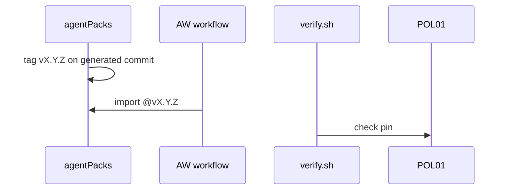

# agentPacks import contract (C12 v1.1)

Canonical contract lives in [agentPacks PR #80](https://github.com/svennijhuis/agentPacks/pull/80). This repo mirrors the allowlist in [policies/POL01.yml](../../policies/POL01.yml) (`agentpacks_allowlist`; gh-aw v0.93.4 rejects unknown `aw.yml` keys) and enforces pins with POL01.

## Pins

- `imports:` and `plugins:` use `@vX.Y.Z` on the generated agentPacks marketplace commit, or its 40-hex SHA.
- Never a branch ref. Never `plugins:` at a `main` SHA ([POL01](../../policies/POL01.yml)).
- Bump pins only via L02 `scripts/bump-pin.sh` (tags only) when that script ships.

## PR #2 correction

[agentic-workflows PR #2](https://github.com/svennijhuis/agentic-workflows/pull/2) pinned `plugins:` at a `main` SHA. That loads **zero** Copilot agents. Until agentPacks ships C12 tags, `squad-review` uses `skills:` plus `commands/` import at a pinned SHA, not `plugins:` at main.

## Inputs

Per-stack bundles first; typed `import-schema` inputs later. Consumers do not edit imported agentPacks files ([G00a](../pbi/done/G00a-consumer-strategy.md)).

## Allowlist v1 (agentPacks owns)

Mirrored in `policies/POL01.yml` (`agentpacks_allowlist`):

- `shared/standards/{http-api,testing-principles,design,engineering}.md`
- `plugins/{dotnet,rust,typescript}/standards/*.md`
- `plugins/squad/commands/squad-review.md`
- `plugins: plugins/squad` (tag only when tags exist)
- Later `gh-aw/*.md`

## Caps

`max-ai-credits`, `max-daily-ai-credits`, `max-turns`, `timeout-minutes` belong in **each workflow's own frontmatter** ([POL02](../../policies/POL02.yml)). The compiler ignores caps in imports. Repo vars `GH_AW_DEFAULT_MAX_AI_CREDITS` and `GH_AW_DEFAULT_MAX_DAILY_AI_CREDITS` are optional fallbacks.

## Compat

agentPacks semver; breaking contract changes are major. Run X01 trial before bumping pins on main.

## Load patterns

**Plugins (tag only when available):**

```yaml
plugins:
  - svennijhuis/agentPacks/plugins/git@v1.0.0
```

**Single skill:**

```yaml
skills:
  - svennijhuis/agentPacks/plugins/squad/skills/squad@<40-hex-sha>
```

Catalog fragment [`workflows/shared/agentpacks.md`](../../workflows/shared/agentpacks.md) wires squad-review until F01 and C12 tags land.

Private plugin repos need `github-token` or `github-app` on the object form ([gh-aw frontmatter](https://github.github.com/gh-aw/reference/frontmatter/)).

## MCP from mcp-services

HTTP MCP to deployed [mcp-services](https://github.com/svennijhuis/mcp-services) instances. Snippets under `workflows/shared/mcp/`. Do not vendor server binaries here.

## Decision rule

1. Human in an editor: install agentPacks from generated marketplace (agentPacks README).
2. Unattended Actions: install from this catalog; import `workflows/shared/agentpacks.md` or pinned allowlist paths.
3. New behaviour in both places: add to agentPacks, then reference from a catalog fragment.

## Flow



## See also

- PBI [C12](../pbi/done/C12-agentpacks-import-contract.md)
- [consume.md](../how-to/consume.md)
