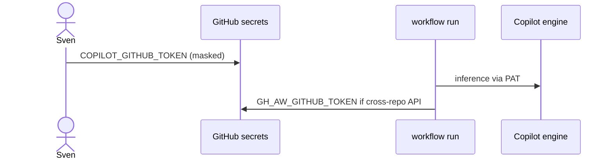

# Auth and secrets

Consumer-facing summary of [ARC03](../pbi/done/ARC03-identity-auth.md). Secret **names** only; never put values in git.

## Tokens in Block 1 scope

| Secret / token | Role | Notes |
| --- | --- | --- |
| `COPILOT_GITHUB_TOKEN` | Fine-grained PAT in the **consumer** repo | Sven sets via masked secret field. Owner must have Copilot entitlement. Powers Copilot engine inference. |
| `GH_AW_GITHUB_TOKEN` | Cross-repo GitHub API fallback | Later blocks; separate blast radius from Copilot PAT. |
| `GITHUB_TOKEN` | Agent job | Read-only in the agent job. |
| GitHub App | Org engine auth | After Q3; replaces long-lived PAT at org switch ([ARC06](../pbi/done/ARC06-org-switch.md)). |

Cross-repo write PATs with `contents:write` or `pull-requests:write` on other repos are out of scope. Copilot cloud agent opens draft PRs under its own identity when assign flows land (P04).

## `copilot-requests: none`

Catalog workflows use `copilot-requests: none` until org Copilot billing switch. Personal accounts do not use org billing tips for `copilot-requests: write`.

## `ignore-if-missing`

Some compile paths allow `ignore-if-missing` for secrets that are not needed locally. Production consumer repos still set real secrets before dispatch.

## Check secret names (never values)

In the target repo:

```bash
gh secret list
```

Use names only in docs and logs.

## Sequence



## See also

- PBI [C04](../pbi/done/C04-auth-copilot-pat.md)
- [gh-aw auth reference](https://github.github.com/gh-aw/reference/auth/)
