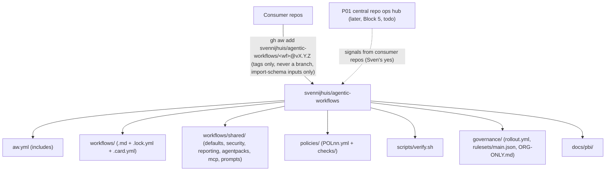
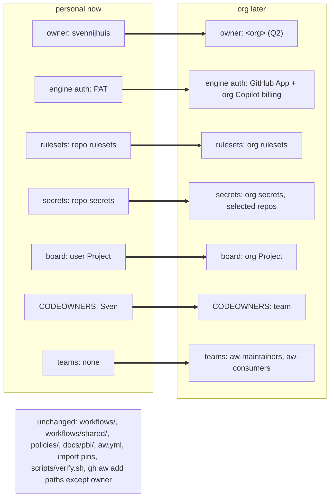

# Org-only checklist (G05)

Today the catalog lives on the personal account `svennijhuis`. This file lists what changes when it moves to a GitHub org. Nothing here is enabled today; G05 writes this checklist only; no org is created or touched. Org switch is one-way and needs Sven's exact yes; rollback: do not apply the switch steps.

Related PBIs: [G05-org-only-appendix](../docs/pbi/done/G05-org-only-appendix.md), [ARC06-org-switch](../docs/pbi/done/ARC06-org-switch.md), [G00-org-target-structure](../docs/pbi/done/G00-org-target-structure.md), [C02-org-ready-layout](../docs/pbi/done/C02-org-ready-layout.md), [P01-central-repo-ops-hub](../docs/pbi/multi-repo/P01-central-repo-ops-hub.md).

## Structure

### Central repo hub

### Personal now vs org later

## Central Copilot billing

- [ ] Enable org billing path for `copilot-requests` on consumer and catalog repos after switch (see [gh-aw billing](https://github.github.com/gh-aw/reference/billing/)).
- [ ] Until switch, keep every catalog workflow on `copilot-requests: none` ([POL21](../policies/POL21.yml); personal account; org Copilot billing is not used).

## Rulesets

- [ ] Apply branch protection on `main`: squash merge, required review thread resolution, no deletion ([governance/rulesets/main.json](rulesets/main.json) is proposed today, not applied on the personal account).
- [ ] Require the `verify` check from [C01](../docs/pbi/done/C01-verify-script.md) on every PR to the catalog and AW consumer repos.
- [ ] Enforce [POL19](../policies/POL19.yml) no force push at org ruleset level (`non_fast_forward`), not only in docs and checks.

## Org secrets

- [ ] Store provider trigger credentials in org secrets for [R06](../docs/pbi/triggers/R06-provider-triggers.md) (Jira, Linear, Azure DevOps), not in repo files ([POL04](../policies/POL04.yml), secret names only).
- [ ] Share cross-repo tokens via org secrets with selected repos to avoid per-repo PAT sprawl (pairs with GitHub App path in [ARC03](../docs/pbi/done/ARC03-identity-auth.md)).
- [ ] Document secret names in workflow cards and PBI evidence; never commit values.

## Teams

- [ ] Map [.github/CODEOWNERS](../.github/CODEOWNERS) paths (`*`, `/aw.yml`, `/workflows/`, `/governance/`, `/.github/`, all `@svennijhuis` today; the file says to replace them with team handles in an org) to a maintainer team (for example `@<org>/aw-maintainers` per [ARC06](../docs/pbi/done/ARC06-org-switch.md)).
- [ ] Add consumer-facing team (`aw-consumers`) when org Projects and hub workflows need it ([P01](../docs/pbi/multi-repo/P01-central-repo-ops-hub.md) Block 5).
- [ ] Repo visibility (Q2): open, waits on Sven's answer.

## GHES

- [ ] Read [Enterprise configuration](https://github.github.com/gh-aw/reference/enterprise-configuration/) for enterprise host options and compiler enterprise controls; reference only until GHES is needed.
- [ ] Nothing GHES or enterprise is used on the personal account today; open this section only when an enterprise host is needed.

## Q2 decision

Q2 (visibility and org name): open. Recorded here when Sven answers.

Nothing else changes at switch: no catalog layout, workflow behavior, or C12 pin rules change; only the owner string and the boxes above.
