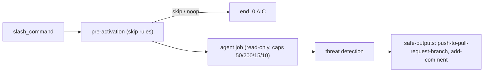

# 048 PR fix: /pr-fix pushes a fix to the PR branch

| Priority | Status | Epic | Depends on |
| --- | --- | --- | --- |
| P2 | Todo | Workflows | [001](001-central-catalog-layout.md), [003](003-cost-caps.md), [004](004-personal-copilot-auth.md) |

## Context

On demand: a maintainer comments `/pr-fix <what>`; the agent pushes one commit to the PR branch. Human triggered, so cost is bounded.

## Sources

- https://github.com/githubnext/agentics/blob/main/workflows/pr-fix.md
- https://github.github.com/gh-aw/reference/safe-outputs-pull-requests/
- https://github.github.com/gh-aw/reference/command-triggers/

## Design

Files: `workflows/pr-fix.md`, `workflows/pr-fix.lock.yml`, `aw.yml` include, row in `workflows/README.md` and root README.

Frontmatter (compile-checked against gh-aw v0.93.4 while writing this PBI):

```yaml
---
description: "PR fix: /pr-fix pushes a fix to the PR branch"
on:
  slash_command:
    name: pr-fix
    strategy: centralized
    events: [pull_request_comment]
  reaction: eyes
  roles: [admin, maintainer, write]
engine: copilot
max-ai-credits: 50
max-daily-ai-credits: 200
max-turns: 15
timeout-minutes: 10
imports:
  - shared/defaults.md
  - shared/security.md
permissions:
  contents: read
  pull-requests: read
  issues: read
  copilot-requests: none
tools:
  github:
    toolsets: [repos, pull_requests]
  edit:
  bash:
    - git:*
    - dotnet:*
    - npm:*
    - cargo:*
safe-outputs:
  push-to-pull-request-branch:
    max: 1
  add-comment:
    max: 1
---
```



## Code example

Prompt body:

```markdown
Do only what the comment asks. Reproduce first, then fix, then run the repo's tests. Never weaken a test. One commit. Comment what changed and test output.
```

Consumer:

```bash
gh aw add svennijhuis/agentic-workflows/pr-fix@v1
git add .github/workflows/pr-fix.md .github/workflows/pr-fix.lock.yml
gh aw update pr-fix            # later, 3-way merge
gh aw logs pr-fix --json | jq '.runs[] | {aic, duration}'
```

## DoD

| # | Check | Command | Expected |
| --- | --- | --- | --- |
| 1 | Workflow file exists | `test -f workflows/pr-fix.md && echo ok` | ok |
| 2 | Compiles strict | `gh aw compile workflows/pr-fix.md --strict 2>&1 \| tail -1` | Compiled 1 workflow: 1 succeeded |
| 3 | Lint clean | `gh aw lint workflows/pr-fix.md; echo rc=$?` | rc=0 |
| 4 | Four cost caps | `rg -c '^(max-ai-credits: 50\|max-daily-ai-credits: 200\|max-turns: 15\|timeout-minutes: 10)$' workflows/pr-fix.md` | 4 |
| 5 | Personal auth | `rg -c '^  copilot-requests: none$' workflows/pr-fix.md` | 1 |
| 6 | No org billing mode | `rg -n 'copilot-requests: write' workflows/pr-fix.md` | no output |
| 7 | No branch refs | `rg -n '@(main\|marketplace\|master)\b' workflows/pr-fix.md` | no output |
| 8 | Every safe output capped | `rg -c '^    max: ' workflows/pr-fix.md` | >= 2 |
| 9 | In manifest | `rg -c 'workflows/pr-fix.md' aw.yml` | 1 |
| 10 | Listed in workflows/README.md | `rg -c '\[pr-fix' workflows/README.md` | 1 |
| 11 | Lock committed | `git ls-files workflows/pr-fix.lock.yml` | workflows/pr-fix.lock.yml |
| 12 | Name is not an agentPacks skill | `gh api 'repos/svennijhuis/agentPacks/git/trees/main?recursive=1' --jq '.tree[].path' \| rg -x 'plugins/.*/skills/pr-fix/SKILL.md'` | no output |
| 13 | Trial dry run | `gh aw trial ./workflows/pr-fix.md --dry-run; echo rc=$?` | rc=0 |
| 14 | Guard script (C01/POL) | `bash scripts/verify.sh; echo rc=$?` | rc=0 |
| 15 | Roles restricted | `rg -n '^  roles:' workflows/pr-fix.md` | 1 line |

## Evidence

Not started. Paste the real output of each DoD command here when done.

## Non-goals

No force push. No new PRs. No edits outside the PR diff unless the fix needs it.

## Risks

Write access to PR branch: protected by roles + threat detection; keep `max: 1`.

## Post-merge

Tag a catalog release (006). Consumer sets `COPILOT_GITHUB_TOKEN` (012). Check AIC after 5 runs (076).
