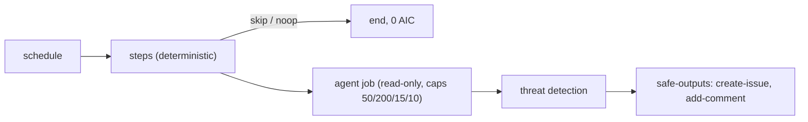

# 078 Azure exception watcher (deterministic KQL)

| Priority | Status | Epic | Depends on |
| --- | --- | --- | --- |
| P1 | Todo | Ops | [001](001-central-catalog-layout.md), [003](003-cost-caps.md), [004](004-personal-copilot-auth.md) |

## Context

Hourly exceptions from App Insights. Azure MCP over OIDC inside the agent is a gap, so query in `steps:` with azure/login OIDC (Reader role). No exceptions: noop, 0 AIC.

## Sources

- https://github.github.com/gh-aw/patterns/deterministic-ops/
- https://github.github.com/gh-aw/reference/schedule-syntax/
- https://github.github.com/gh-aw/guides/mcps/
- https://docs.github.com/actions/security-for-github-actions/security-hardening-your-deployments/configuring-openid-connect-in-azure

## Design

Files: `workflows/exception-watcher.md`, `workflows/exception-watcher.lock.yml`, `aw.yml` include, row in `workflows/README.md` and root README.

Frontmatter (compile-checked against gh-aw v0.93.4 while writing this PBI):

```yaml
---
description: "Azure exception watcher (deterministic KQL)"
on:
  schedule: hourly
  workflow_dispatch:
engine: copilot
max-ai-credits: 50
max-daily-ai-credits: 200
max-turns: 15
timeout-minutes: 10
steps:
  - uses: azure/login@v2
    with:
      client-id: ${{ vars.AZURE_CLIENT_ID }}
      tenant-id: ${{ vars.AZURE_TENANT_ID }}
      subscription-id: ${{ vars.AZURE_SUBSCRIPTION_ID }}
  - name: Query exceptions last hour
    run: |
      az monitor app-insights query --app "${{ vars.APPINSIGHTS_APP_ID }}" --analytics-query 'exceptions | where timestamp > ago(1h) | summarize count(), any(outerMessage) by problemId' -o json > /tmp/gh-aw/agent/exceptions.json
      [ "$(jq '.tables[0].rows | length' /tmp/gh-aw/agent/exceptions.json)" = 0 ] && echo '{"type":"noop","message":"no exceptions"}' >> "$GH_AW_SAFE_OUTPUTS" || true
imports:
  - shared/defaults.md
  - shared/security.md
permissions:
  contents: read
  issues: read
  id-token: write
  copilot-requests: none
tools:
  github:
    toolsets: [issues]
safe-outputs:
  create-issue:
    title-prefix: "[exception] "
    labels: [exception]
    max: 3
  add-comment:
    max: 3
---
```



## Code example

Prompt body:

```markdown
Read `/tmp/gh-aw/agent/exceptions.json`. Group by problemId. For each group search open `[exception]` issues: comment count + last seen, else open one.
```

Consumer:

```bash
gh aw add svennijhuis/agentic-workflows/exception-watcher@v1
git add .github/workflows/exception-watcher.md .github/workflows/exception-watcher.lock.yml
gh aw update exception-watcher            # later, 3-way merge
gh aw logs exception-watcher --json | jq '.runs[] | {aic, duration}'
```

## DoD

| # | Check | Command | Expected |
| --- | --- | --- | --- |
| 1 | Workflow file exists | `test -f workflows/exception-watcher.md && echo ok` | ok |
| 2 | Compiles strict | `gh aw compile workflows/exception-watcher.md --strict 2>&1 \| tail -1` | Compiled 1 workflow: 1 succeeded |
| 3 | Lint clean | `gh aw lint workflows/exception-watcher.md; echo rc=$?` | rc=0 |
| 4 | Four cost caps | `rg -c '^(max-ai-credits: 50\|max-daily-ai-credits: 200\|max-turns: 15\|timeout-minutes: 10)$' workflows/exception-watcher.md` | 4 |
| 5 | Personal auth | `rg -c '^  copilot-requests: none$' workflows/exception-watcher.md` | 1 |
| 6 | No org billing mode | `rg -n 'copilot-requests: write' workflows/exception-watcher.md` | no output |
| 7 | No branch refs | `rg -n '@(main\|marketplace\|master)\b' workflows/exception-watcher.md` | no output |
| 8 | Every safe output capped | `rg -c '^    max: ' workflows/exception-watcher.md` | >= 2 |
| 9 | In manifest | `rg -c 'workflows/exception-watcher.md' aw.yml` | 1 |
| 10 | Listed in workflows/README.md | `rg -c '\[exception-watcher' workflows/README.md` | 1 |
| 11 | Lock committed | `git ls-files workflows/exception-watcher.lock.yml` | workflows/exception-watcher.lock.yml |
| 12 | Name is not an agentPacks skill | `gh api 'repos/svennijhuis/agentPacks/git/trees/main?recursive=1' --jq '.tree[].path' \| rg -x 'plugins/.*/skills/exception-watcher/SKILL.md'` | no output |
| 13 | Trial dry run | `gh aw trial ./workflows/exception-watcher.md --dry-run; echo rc=$?` | rc=0 |
| 14 | Guard script (C01/POL) | `bash scripts/verify.sh; echo rc=$?` | rc=0 |
| 15 | OIDC only, no secrets | `rg -n 'secrets\.' workflows/exception-watcher.md` | no output |
| 16 | Noop path | `rg -c '"type":"noop"' workflows/exception-watcher.md` | 1 |

## Evidence

Not started. Paste the real output of each DoD command here when done.

## Non-goals

No Azure writes. No Azure MCP in the agent. No `az` apply of any kind.

## Risks

Hourly = 24 activations/day; noop path must hold. Needs Entra federated credential (Sven decision, no secrets).

## Post-merge

Tag a catalog release (006). Consumer sets `COPILOT_GITHUB_TOKEN` (012). Check AIC after 5 runs (076).
