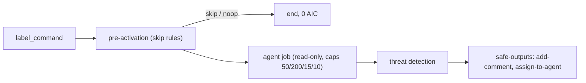

# 095 ResearchPlanAssignOps with Copilot agent

| Priority | Status | Epic | Depends on |
| --- | --- | --- | --- |
| P3 | Todo | Patterns | [001](001-central-catalog-layout.md), [003](003-cost-caps.md), [004](004-personal-copilot-auth.md), [013](013-github-app-cross-repo.md) |

## Context

Research an issue, write a plan comment, assign to Copilot coding agent; human merges.

## Sources

- https://github.github.com/gh-aw/patterns/research-plan-assign-ops/
- https://github.github.com/gh-aw/reference/copilot-cloud-agent/

## Design

Files: `workflows/research-plan-assign.md`, `workflows/research-plan-assign.lock.yml`, `aw.yml` include, row in `workflows/README.md` and root README.

Frontmatter (compile-checked against gh-aw v0.93.4 while writing this PBI):

```yaml
---
description: "ResearchPlanAssignOps with Copilot agent"
on:
  label_command:
    name: agent-plan
    events: [issues]
engine: copilot
max-ai-credits: 50
max-daily-ai-credits: 200
max-turns: 15
timeout-minutes: 10
imports:
  - shared/defaults.md
  - shared/security.md
permissions:
  contents: read
  issues: read
  copilot-requests: none
tools:
  github:
    toolsets: [issues, repos]
safe-outputs:
  add-comment:
    max: 1
  assign-to-agent:
    max: 1
---
```



## Code example

Prompt body:

```markdown
Research the codebase for the issue. Post a plan with files and tests. Then assign to the coding agent.
```

Consumer:

```bash
gh aw add svennijhuis/agentic-workflows/research-plan-assign@v1
git add .github/workflows/research-plan-assign.md .github/workflows/research-plan-assign.lock.yml
gh aw update research-plan-assign            # later, 3-way merge
gh aw logs research-plan-assign --json | jq '.runs[] | {aic, duration}'
```

## DoD

| # | Check | Command | Expected |
| --- | --- | --- | --- |
| 1 | Workflow file exists | `test -f workflows/research-plan-assign.md && echo ok` | ok |
| 2 | Compiles strict | `gh aw compile workflows/research-plan-assign.md --strict 2>&1 \| tail -1` | Compiled 1 workflow: 1 succeeded |
| 3 | Lint clean | `gh aw lint workflows/research-plan-assign.md; echo rc=$?` | rc=0 |
| 4 | Four cost caps | `rg -c '^(max-ai-credits: 50\|max-daily-ai-credits: 200\|max-turns: 15\|timeout-minutes: 10)$' workflows/research-plan-assign.md` | 4 |
| 5 | Personal auth | `rg -c '^  copilot-requests: none$' workflows/research-plan-assign.md` | 1 |
| 6 | No org billing mode | `rg -n 'copilot-requests: write' workflows/research-plan-assign.md` | no output |
| 7 | No branch refs | `rg -n '@(main\|marketplace\|master)\b' workflows/research-plan-assign.md` | no output |
| 8 | Every safe output capped | `rg -c '^    max: ' workflows/research-plan-assign.md` | >= 2 |
| 9 | In manifest | `rg -c 'workflows/research-plan-assign.md' aw.yml` | 1 |
| 10 | Listed in workflows/README.md | `rg -c '\[research-plan-assign' workflows/README.md` | 1 |
| 11 | Lock committed | `git ls-files workflows/research-plan-assign.lock.yml` | workflows/research-plan-assign.lock.yml |
| 12 | Name is not an agentPacks skill | `gh api 'repos/svennijhuis/agentPacks/git/trees/main?recursive=1' --jq '.tree[].path' \| rg -x 'plugins/.*/skills/research-plan-assign/SKILL.md'` | no output |
| 13 | Trial dry run | `gh aw trial ./workflows/research-plan-assign.md --dry-run; echo rc=$?` | rc=0 |
| 14 | Guard script (C01/POL) | `bash scripts/verify.sh; echo rc=$?` | rc=0 |

## Evidence

Not started. Paste the real output of each DoD command here when done.

## Non-goals

No write outputs beyond the listed safe-outputs. No cross-repo writes.

## Risks

assign-to-agent needs a PAT or App; Copilot cloud agent bills AIC.

## Post-merge

Tag a catalog release (006). Consumer sets `COPILOT_GITHUB_TOKEN` (012). Check AIC after 5 runs (076).
