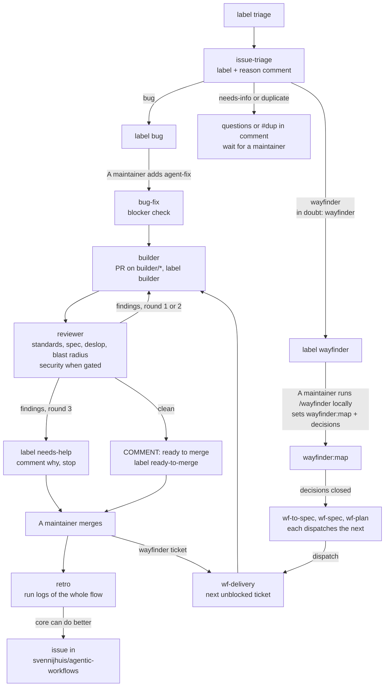
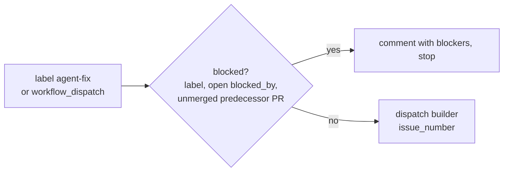
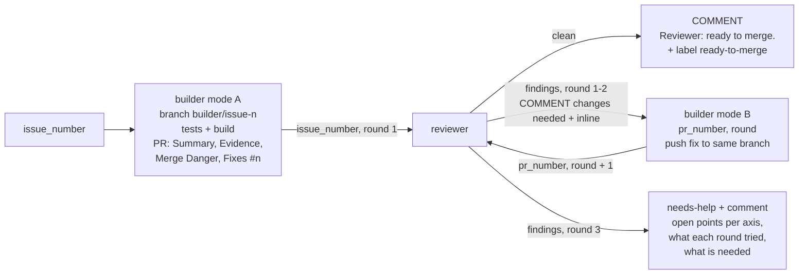
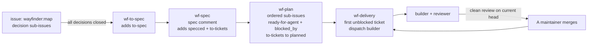
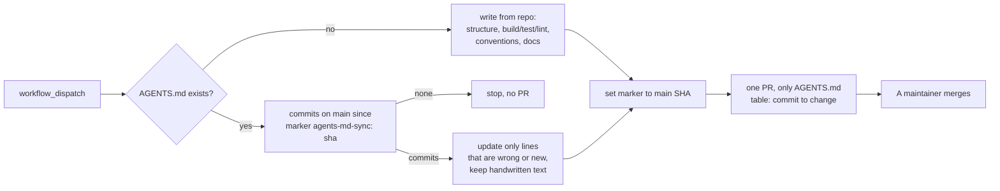

# Installable workflows

This folder is the library. Every workflow lives here, other repositories install from it. In the target repo:

```bash
gh aw add svennijhuis/agentic-workflows/workflows/<name>.md@<tag>
gh aw compile
git add .github/workflows
git commit -m "add <name>"
```

`gh aw add` also fetches the relative `imports:` (shared fragments and the skill copies under [shared/skills/](shared/skills/)) and every workflow named in `dispatch-workflow`, so `builder` brings `reviewer` and the other way round. Commit everything it writes under `.github/workflows/`, including `shared/`: imports are read at runtime from there.

Each file **must** have an `on:` trigger. Kebab-case stem becomes the `gh aw add` id. Each workflow sets cost caps, permissions, and network in frontmatter.

| Workflow | Purpose |
| --- | --- |
| [issue-triage.md](issue-triage.md) | Label `triage`: sets `bug` or `wayfinder` (plus `security` or `needs-info`), or `duplicate`, with one reason comment |
| [bug-fix.md](bug-fix.md) | Label `agent-fix`: blocker check, then start the builder |
| [issue-builder.md](issue-builder.md) | Build an issue into a PR on `builder/*`, or fix a PR in a review round. Starts the reviewer |
| [pr-reviewer.md](pr-reviewer.md) | Part of the build loop: reviews a builder PR on four axes, plus security on a trust-boundary diff. Clean, send back (max 2), or `needs-help`. Started by the builder, not by hand |
| [retro.md](retro.md) | After a builder PR is merged: read the run logs, open a core issue when the flow can do better |
| [wf-to-spec.md](wf-to-spec.md), [wf-spec.md](wf-spec.md), [wf-plan.md](wf-plan.md), [wf-delivery.md](wf-delivery.md) | Wayfinder chain: map to spec, tickets, builder per ticket |
| [agents-md-sync.md](agents-md-sync.md) | Write or update AGENTS.md from main commits |
| [agentic-token-audit.md](agentic-token-audit.md) | Daily AIC report per workflow and per flow, trend in repo-memory |

Shared fragments: [shared/](shared/). Validate in the layout of a target repo: `gh aw compile --dir workflows` fails on `dispatch-workflow`, because the compiler looks for dispatch targets in `.github/workflows/`. See the root [README](../README.md#validate).

## The flow



A maintainer always merges. Nothing in this folder merges, approves, or assigns Copilot.

Auth and secrets, names only (steps in [docs/install.md](../docs/install.md)):

- Engine: built for an org. Every workflow sets `copilot-requests: write`, so Copilot runs on the Actions `GITHUB_TOKEN` and is billed to the org. Needs org Copilot policy "Allow use of Copilot CLI billed to the organization". `COPILOT_GITHUB_TOKEN` is then ignored for inference and not needed.
- `NUGET_FEED_TOKEN` (secret) and `NUGET_FEED_URL`, `NUGET_FEED_USER` (variables): only for C# repos with a private NuGet feed, used by `shared/nuget-auth.md`, which you add to `issue-builder` in C# repos.
- `AW_CORE_ISSUES_TOKEN`: only for `retro`, a fine-grained token with Issues read and write on `svennijhuis/agentic-workflows`.

Labels: `triage`, `bug`, `wayfinder`, `security`, `needs-info`, `duplicate`, `agent-fix`, `blocked`, `wayfinder:map`, `to-spec`, `specced`, `to-tickets`, `planned`, `ready-for-agent`, plus `builder` (on every builder PR) `needs-help` (set by the reviewer after round 3) and `ready-to-merge` (set by the reviewer on a clean review, next to the comment review `Reviewer: ready to merge.`). Create `builder`, `needs-help`, `ready-to-merge`, `security`, `needs-info` and `duplicate` in the target repo once.

### Handoffs

Every write by a workflow uses the Actions `GITHUB_TOKEN`, and GitHub starts no workflow from an event made with that token: a label set by `wf-spec` does not start `wf-plan`. A `workflow_dispatch` is the exception. So every handoff is a `dispatch_workflow`: wf-to-spec to wf-spec to wf-plan to wf-delivery, bug-fix and wf-delivery to builder, builder and reviewer to each other. The label stays as the state; the dispatch is the start signal. Human events (a label, a comment, a merge) start workflows as usual.

### Markers

Visible lines at the start of a comment or review body, written by `github-actions[bot]`, are the contract between the workflows. Not HTML comments: GitHub strips those from review bodies.

| Marker | Written by | Read by |
| --- | --- | --- |
| `Builder started: <run>` | bug-fix, wf-delivery, with the dispatch | bug-fix, wf-delivery: a build runs, start no second one (after 90 minutes without PR it counts as failed) |
| `Builder question:` | builder, when it stops on an unclear issue | wf-delivery: wait until a human comments, then start the builder again |
| `Reviewer: changes needed, round <n>.` | reviewer, findings in round 1 or 2 | builder (work list, round check), reviewer (round count) |
| `Reviewer: ready to merge.` | reviewer, clean | wf-delivery: ticket waits for a maintainer's merge |

### Cost caps

1 AI Credit (AIC) is $0.01, an estimate from public model pricing. gh-aw defaults are 1000 AIC per run and 5000 per workflow per day; these start values sit below that and get tuned from [agentic-token-audit](#agentic-token-audit) after one or two weeks of real runs.

| Workflow | `max-ai-credits` per run | `max-daily-ai-credits` | `max-turns` | `timeout-minutes` |
| --- | --- | --- | --- | --- |
| issue-triage | 75 | 750 | 30 | 10 |
| bug-fix, wf-to-spec | 75 | 750 | 30 | 10 |
| wf-delivery | 200 | 2000 | 60 | 20 |
| wf-spec | 500 | 3000 | 100 | 30 |
| wf-plan | 500 | 3000 | 120 | 40 |
| issue-builder | 1000 | 6000 | 200 | 50 |
| pr-reviewer (four or five sub-agents) | 800 | 5000 | 160 | 30 |
| retro | 300 | 1500 | 60 | 20 |
| agents-md-sync | 300 | 900 | 80 | 20 |
| agentic-token-audit | 150 | 300 | 40 | 15 |

gh-aw skips `max-daily-ai-credits` for a run dispatched by another agentic workflow. For builder, reviewer and the chain steps the per-run cap and the round limit are the real bound.

Empty runs cost nothing: `if:` filters on the event (bot comments never start wf-delivery, wf-spec or wf-plan), and [shared/has-work.md](shared/has-work.md) runs `gh issue list` before the engine and writes a `noop` when no open issue carries the labels the workflow needs. The copilot harness then exits without inference. `gh issue list` reads live data; the search API behind `skip-if-no-match` can lag behind a label the previous step set a moment ago.

## issue-triage

[issue-triage.md](issue-triage.md) runs on the label `triage` (or manually with an issue number). It picks `bug` or `wayfinder` and posts one comment with the reason, an agent-fit line and up to three related issues. Adapted from the gh-aw gallery `ai-issue-triage`.

- `needs-info`: a bug without steps, expected and actual, or a request without problem and outcome. Also when the issue cannot be classified with confidence or an open gap would change the route. The comment asks the specific questions and, if the route was a guess, names it and which answer would change it.
- `duplicate`: only at high confidence, instead of `bug` or `wayfinder`. Search covers open issues and issues closed in the last 90 days.
- `security`: next to `bug` or `wayfinder`. The comment asks the reporter to move exploit details to a private security advisory and repeats none of them.

It starts nothing: no tokens spent until a maintainer adds the next label.

## bug-fix

[bug-fix.md](bug-fix.md) checks one issue for blockers and starts the builder.



- Blocked: the label `blocked`, an open `blocked_by` dependency, or a predecessor PR that is not merged. Nothing re-checks when a blocker clears: remove and add `agent-fix` again.
- One active ticket at a time: stops when this or another `agent-fix` issue has an open `builder` PR, a `Builder started:` comment under 90 minutes old without a PR, or an unanswered `Builder question:`.
- With the dispatch it posts `Builder started: <run>` on the issue.

## issue-builder and pr-reviewer

[issue-builder.md](issue-builder.md) writes the code, [pr-reviewer.md](pr-reviewer.md) reviews it. Both start only through `workflow_dispatch`: bug-fix, wf-delivery or the other one starts them.



Builder:

- Skills: `implement`, `tdd`, `codebase-design`, `diagnosing-bugs`, `pr` (imported from [shared/skills/](shared/skills/)).
- Standards: `AGENTS.md`, `.github/copilot-instructions.md`, and `.github/instructions/*.instructions.md` whose `applyTo` matches a changed file.
- Bug path (label `bug`): a command that goes red on the bug before any change, root cause per `diagnosing-bugs`, the failing test committed before the fix, red-then-green output in Evidence. With `security` too: fix at the trust boundary, no exploit detail in commits or PR text.
- Mode A (issue number): smallest change, the repo's own tests and build, one non-draft PR on `builder/issue-<n>` with label `builder`. Body per the `pr` skill plus `Fixes #n`, and `Parent: #map` for wayfinder tickets. Asks one question on the issue (`Builder question:`) instead of guessing. wf-delivery restarts it after a human answer; for a bug, a maintainer re-adds `agent-fix`.
- Mode B (PR number plus round): reads the latest `Reviewer: changes needed, round <n>.` review, pushes the fix to the same branch, posts a round comment.
- Always starts the reviewer at the end. The PR is emitted before the dispatch, and a failed PR cancels the dispatch.
- C#: add [shared/nuget-auth.md](shared/nuget-auth.md) (pre-agent step adds the private feed from `NUGET_FEED_URL`, `NUGET_FEED_USER` variables and the `NUGET_FEED_TOKEN` secret, then `dotnet restore`) (skips in repos without a C# project). The [dotnet-format hook](../hooks/README.md) runs `dotnet format` after each `.cs` edit; copy it into the target repo. Custom MCP server: see [install guide](../docs/install.md#custom-mcp-server).
- Network: gh-aw defaults plus the `dotnet` ecosystem. The private feed host is added under `network.allowed` in the target repo copy. Other ecosystems (for example `node`) likewise.

Reviewer:

- Axes, each in its own inline sub-agent with a fresh context: **Standards** (`code-review` skill, repo rules including Copilot instruction files plus smell baseline), **Spec** (`code-review` skill, does the diff do what the issue or ticket asks, not more), **Deslop** (`deslop` skill, plus: a comment stays only for a non-obvious why), **Blast radius** (what breaks outside the diff, and the one fact the change is safe because of, proven or unproven), and **Security** only when the diff touches a trust boundary (endpoint, auth, permissions or scopes, workflow files, dependencies, secrets or config, shell, file paths, network, deserialization): OWASP Top 10 plus widened scope, findings only with `path:line` evidence. Parallel when the engine allows, otherwise one after another in the same run.
- Rounds: 1 after the build, 2 and 3 after fix rounds. So the builder gets at most two send-backs: at most 3 builder runs and 3 reviewer runs per PR.
- No endless loop: an `if:` on both workflows lets the builder start only for a new build or fix round 1 or 2, and the reviewer only for round 1 to 3. On top, both count the reviewer's earlier `Reviewer: changes needed` reviews instead of trusting the round input.
- Every review is a `COMMENT` (`allowed-events: [COMMENT]`). The builder opens the PR as `github-actions[bot]` and the reviewer reviews as the same account; GitHub rejects `REQUEST_CHANGES` on your own PR. Reviews therefore never block a merge in branch protection: a maintainer is the gate.

PRs opened with `GITHUB_TOKEN` do not trigger `pull_request` workflows, which is why the builder starts the reviewer through dispatch.

## retro

[retro.md](retro.md) runs when a maintainer merges a PR with label `builder` (or manually with a PR number).

- Skills: `retro` and `writing-for-agents`.
- Input: the run logs (`agentic-workflows` tools `logs` and `audit`, `actions: read`) of the whole flow for that PR: triage, bug-fix or the wf-* chain, every builder and reviewer round, plus the PR timeline.
- Looks at navigation, automated checks, coding standards, tool use, missing information and AGENTS.md.
- A mistake seen twice gets a check (test, lint, type or CI step) as proposal before a text rule.
- Output: no comment on the merged PR. When the core can do better, one issue in `svennijhuis/agentic-workflows` with per finding what went wrong, the run link, the part to fix and a proposal. Otherwise `noop`.

## wayfinder chain

Four workflows copied from [pascalvanderheiden/turbo-agent-skills-cli](https://github.com/pascalvanderheiden/turbo-agent-skills-cli/tree/122b266d451eb8d06a8b96a0933c788c2fb0ac98/.github/workflows) at `122b266`, renamed to [wf-to-spec.md](wf-to-spec.md), [wf-spec.md](wf-spec.md), [wf-plan.md](wf-plan.md), [wf-delivery.md](wf-delivery.md). Labels are the contract between the four. Source per file (all at `122b266`, the workflow files carry no source header):

| File | Source in the upstream repo |
| --- | --- |
| [wf-to-spec.md](wf-to-spec.md) | `.github/workflows/wayfinder-to-spec.md` |
| [wf-spec.md](wf-spec.md) | `.github/workflows/wayfinder-spec.md` |
| [wf-plan.md](wf-plan.md) | `.github/workflows/wayfinder-plan.md` |
| [wf-delivery.md](wf-delivery.md) | `.github/workflows/wayfinder-delivery.md` |

That repo has no license; the repo owner confirmed copying is fine (2026-11-03).



Start: run `/wayfinder` locally. It creates the parent issue with label `wayfinder:map` and the decision sub-issues. It writes with your own `gh` login, so its events (closing a decision ticket) start workflows as usual. Use the GitHub tracker of `/setup-matt-pocock-skills` with native sub-issues: wf-to-spec reads the map's sub-issues, not the task-list fallback. wf-to-spec only wakes on a closed or reopened `wayfinder:*` ticket or the `wayfinder:map` label; map edits, new tickets and claims start nothing. Alternative: `to-spec` on an ordinary issue to skip the decision step. The workflows set the rest. Nobody opens the builder PR by hand; the builder does.

Changed from the source (house rules, applied to all four):

- Renamed to `wf-*`: file, concurrency group and markers (`wf-spec:v1`, `wf-plan:v1`).
- `schedule: every 30 minutes` removed from all four. Upstream used it to recover label events made with `GITHUB_TOKEN`; here each step dispatches the next instead. Event triggers and `workflow_dispatch` stay, filtered by `if:` and [shared/has-work.md](shared/has-work.md).
- `wf-spec` and `wf-plan` import `to-spec` and `to-tickets` from [shared/skills/](shared/skills/).
- `wf-delivery`: starts the builder per ticket (`issue_number`, `parent_issue`). With the dispatch it posts `Builder started: <run>` on the ticket. A ticket is active while its builder PR is open, its build runs (under 90 minutes) or its `Builder question:` is unanswered; a build without PR after 90 minutes is retried once, then reported to a maintainer. The gate for a ticket is a clean reviewer review (`Reviewer: ready to merge.`) on the current head, then it waits for a maintainer's merge. A `needs-help` PR waits for a maintainer. The Copilot assignment, draft-to-ready, Copilot code review wait and merge text are gone.
- All four: `shared/defaults.md` (pinned engine), caps, and GitHub tools as `gh-proxy` with explicit toolsets instead of `[default]`.

### Version lock

The gh-aw setup action is pinned in [.github/aw/actions-lock.json](../.github/aw/actions-lock.json): `github/gh-aw-actions/setup@v0.93.4` at commit `40fb427c047bb9f77324054adeb574e04c9481aa`. Compile uses that SHA, so every lock file gets the same setup action.

To update: pick the new tag, get its commit with `gh api repos/github/gh-aw-actions/git/ref/tags/<tag>` (for an annotated tag, follow `.object.sha` with `gh api repos/github/gh-aw-actions/git/tags/<sha>`), put version and sha in the file, then recompile.

## agents-md-sync

[agents-md-sync.md](agents-md-sync.md) keeps `AGENTS.md` up to date. Start: manual (`workflow_dispatch`), no schedule.



- Marker: last line `<!-- agents-md-sync: <sha> -->`. No marker yet: the file counts as handwritten, the agent only adds what is missing.
- The PR may only change `AGENTS.md` (`allowed-files`). `AGENTS.md` is a protected file in gh-aw, so the PR gets a caution block and a request-changes review: expected, a maintainer reviews and merges.
- Nothing changed: no PR.

## agentic-token-audit

[agentic-token-audit.md](agentic-token-audit.md) reports AI Credit use. Start: daily around 07:00 (fuzzy schedule) and manual. Adapted from gh-aw's own `agentic-token-audit` (origin `githubnext/agentic-ops@c611242`, MIT).

- A pre-agent step runs `gh aw logs --start-date -1d --json` and aggregates with `jq`: per workflow (runs, total, average and max AIC, turns, failures) and per flow (gh-aw episodes, such as triage to builder to reviewer rounds). No runs in the window: `noop`, no inference.
- The agent keeps a daily snapshot and a rolling 90-day summary on the branch `memory/agentic-token-audit` (repo-memory) and writes one issue `[agentic-token-audit] ...`. Older ones are closed; each expires after 7 days.
- Observations: a workflow above 30% of the total, a run at 80% of its cap or more, a workflow that stays under 20% of its cap (the cap can come down), failures. Use those to tune the [cost caps](#cost-caps).
- Upstream also draws charts with Python (pandas, matplotlib, seaborn from PyPI). Left out here to keep the network closed.
