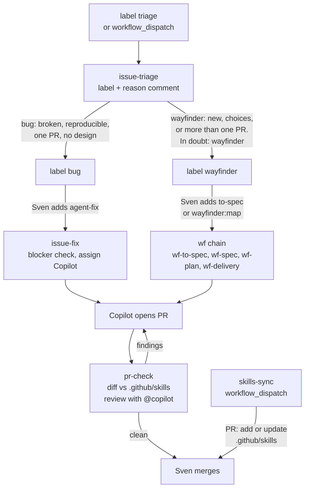
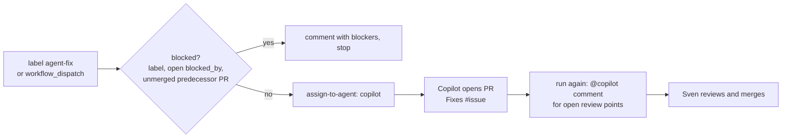
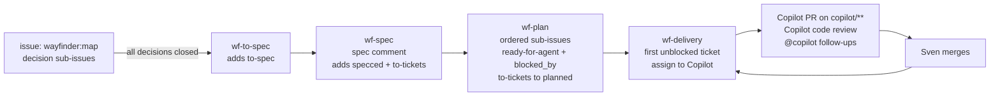
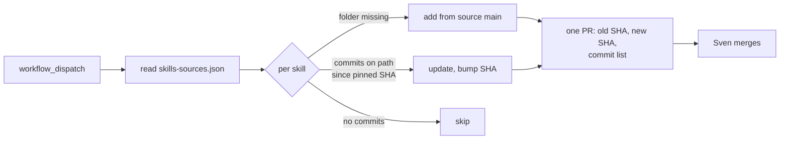
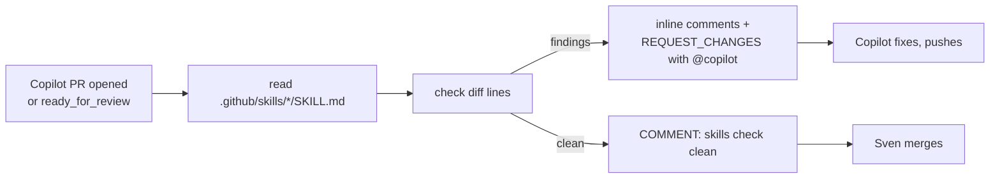

# Installable workflows

Markdown here is what other repositories install:

```bash
gh aw add svennijhuis/agentic-workflows/<file-stem>@v1.0.0
```

Each file **must** have an `on:` trigger. Kebab-case stem becomes the `gh aw add` id.

Block 1: catalog workflows are **`workflow_dispatch` only** until Sven enables more ([POL25](../policies/POL25.yml)). Each workflow sets cost caps, permissions, and network in frontmatter. Commit `.lock.yml` next to each `.md` (`make compile`). Each workflow has an agent card `<name>.card.yml` next to it: interface, harness, engine, tools, MCP transport and secret NAMES ([harness model](../docs/explanation/harness-model.md)).

| Workflow | Purpose |
| --- | --- |
| [pr-review.md](pr-review.md) | Report-only PR review (F01). `workflow_dispatch` only |

Shared fragments: [shared/](shared/). Authoring: [.github/instructions/aw.instructions.md](../.github/instructions/aw.instructions.md). Verify: `make verify`.

## issue-triage

[issue-triage.md](issue-triage.md) runs on the label `triage` (or manually with an issue number). It picks `bug` or `wayfinder`, sets that label and posts one comment with the reason. For a bug it asks for repro steps when they are missing. It assigns nothing: no Copilot tokens until Sven adds the next label.



## issue-fix

[issue-fix.md](issue-fix.md) hands one unblocked issue to the **Copilot cloud agent**, which does the implementation. Simple version of [wayfinder-delivery](https://github.com/pascalvanderheiden/turbo-agent-skills-cli/blob/main/.github/workflows/wayfinder-delivery.md).



- Start: add the `agent-fix` label to an issue, or run it from the Actions tab with an issue number. No schedule.
- Blocked: the label `blocked`, an open `blocked_by` dependency, or a predecessor PR that is not merged. The agent only comments and stops. Clear the blockers and add `agent-fix` again.
- One active ticket at a time. Not blocked: the issue is assigned to `copilot` with instructions (this ticket only, smallest validation, a PR that closes the issue, ask on the issue when unsure).
- Follow-ups: run it again and open review points go back as one `@copilot` comment. Optional Copilot code review via `add-reviewer`.
- No `merge-pull-request`: Sven merges. Network closed.
- Requirements: the Copilot cloud agent must be enabled on the repo, and every assignment costs Copilot premium requests.
- Token: `GH_AW_AGENT_TOKEN` (Sven sets it as an Actions secret) is only needed for the optional `add-reviewer`.
- Not compiled yet: run `gh aw compile issue-fix` before it can run.

## wayfinder chain (copied)

Four workflows copied as is from [pascalvanderheiden/turbo-agent-skills-cli](https://github.com/pascalvanderheiden/turbo-agent-skills-cli/tree/122b266d451eb8d06a8b96a0933c788c2fb0ac98/.github/workflows) at `122b266`, into `.github/workflows/`. Renamed to `wf-to-spec.md`, `wf-spec.md`, `wf-plan.md`, `wf-delivery.md` (concurrency groups `wf-*`, markers `wf-spec:v1` and `wf-plan:v1`). Labels stay the same, they are the contract between the four. Each file has a `# Source:` line with path and SHA.

Skills come remote from [mattpocock/skills](https://github.com/mattpocock/skills/tree/4ae2317ddb22b046e26455e4f9c9b3aaaf62212d/skills/engineering) (MIT), pinned at `4ae2317ddb22b046e26455e4f9c9b3aaaf62212d`, as gh-aw cross-repo imports (`owner/repo/path@ref`, fetched at compile time): `skills/engineering/to-spec/SKILL.md` in `wf-spec` and `skills/engineering/to-tickets/SKILL.md` in `wf-plan`. No copy in this repo. To update: bump the SHA in both imports and recompile. To make the map issue yourself, use the `skills/engineering/wayfinder` skill from the same repo. `release.yml` and `pages.yml` belong to that project and are left out. That repo has no license; Sven confirmed copying is fine (2026-11-03).



Labels you set: `wayfinder:map` on the parent issue (with decision sub-issues), or `to-spec` on an ordinary issue to skip the decision step. The workflows set the rest: `to-spec`, `specced`, `to-tickets`, `planned` and `ready-for-agent`.

Changed from the source, nothing else:

- `schedule: every 30 minutes` removed from all four. Event triggers and `workflow_dispatch` stay. To put it back, add `  schedule: every 30 minutes` under `on:` again.
- `merge-pull-request` removed from `wf-delivery`, so Sven merges. The prompt text still talks about merging; without the safe-output the agent cannot do it. To put it back, add the block from the source file under `safe-outputs:`.

Tokens Sven sets as Actions secrets: `GH_AW_AGENT_TOKEN` (Copilot assignment and Copilot code review in delivery) and the engine token `COPILOT_GITHUB_TOKEN`. Needs the Copilot cloud agent enabled on the repo, and every assignment costs Copilot premium requests.

`issue-fix` above is the simple one-issue variant. Not compiled: run `gh aw compile` before any of these can run.

### Version lock

The gh-aw setup action is pinned in [.github/aw/actions-lock.json](../.github/aw/actions-lock.json): `github/gh-aw-actions/setup@v0.93.4` at commit `40fb427c047bb9f77324054adeb574e04c9481aa`. Compile uses that SHA, so every lock file gets the same setup action.

To update: pick the new tag, get its commit with `gh api repos/github/gh-aw-actions/git/ref/tags/<tag>` (for an annotated tag, follow `.object.sha` with `gh api repos/github/gh-aw-actions/git/tags/<sha>`), put version and sha in the file, then recompile.

## skills-sync

[skills-sync.md](skills-sync.md) keeps `.github/skills/` in line with the list in [.github/skills-sources.json](../.github/skills-sources.json) (name, source `owner/repo`, path, pinned SHA). Start: manual (`workflow_dispatch`), no schedule.



- Only commits on the source `main` that touch the skill path count.
- The PR may only change `.github/skills/**` and `.github/skills-sources.json` (`allowed-files`). `.github/` is protected by default, so gh-aw adds a caution block and a request-changes review on the PR: that is expected, Sven reviews and merges.
- Nothing changed: no PR.
- To add a skill: add an entry to the JSON and run it. To add a schedule later: `schedule: weekly` under `on:`.
- First entry: `deslop` from [cursor/plugins](https://github.com/cursor/plugins/tree/ae5650febf4320793844c12c4adaa937f417f8da/cursor-team-kit/skills/deslop) at `ae5650f`. That repo has no license file. Fine in your own repo, check it before using it for work.

## pr-check

[pr-check.md](pr-check.md) runs when a PR is opened or marked ready, only for PRs by Copilot (`if:` on the author), so other PRs cost nothing. Also manual with a PR number.



- Never merges, pushes or approves.
- Cost: one agent run per Copilot PR.
- Copilot also reads `.github/skills/` itself through [.github/copilot-instructions.md](../.github/copilot-instructions.md), so most findings are fixed before pr-check runs.
- Not compiled: run `gh aw compile` before it can run.
