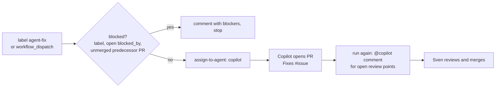

# Installable workflows

Markdown here is what other repositories install:

```bash
gh aw add svennijhuis/agentic-workflows/<file-stem>@v1.0.0
```

Each file **must** have an `on:` trigger. Kebab-case stem becomes the `gh aw add` id.

Block 1: catalog workflows are **`workflow_dispatch` only** until Sven enables more ([POL25](../policies/POL25.yml)). Each workflow sets cost caps, permissions, and network in frontmatter. Commit `.lock.yml` next to each `.md` (`make compile`). Each workflow has an agent card `<name>.card.yml` next to it: interface, harness, engine, tools, MCP transport and secret NAMES ([harness model](../docs/explanation/harness-model.md)).

| Workflow | Purpose |
| --- | --- |
| [pr-review.md](pr-review.md) | Report-only PR review (F01). `workflow_dispatch` only |

Shared fragments: [shared/](shared/). Authoring: [.github/instructions/aw.instructions.md](../.github/instructions/aw.instructions.md). Verify: `make verify`.

## issue-fix

[issue-fix.md](issue-fix.md) hands one unblocked issue to the **Copilot cloud agent**, which does the implementation. Simple version of [wayfinder-delivery](https://github.com/pascalvanderheiden/turbo-agent-skills-cli/blob/main/.github/workflows/wayfinder-delivery.md).



- Start: add the `agent-fix` label to an issue, or run it from the Actions tab with an issue number. No schedule.
- Blocked: the label `blocked`, an open `blocked_by` dependency, or a predecessor PR that is not merged. The agent only comments and stops. Clear the blockers and add `agent-fix` again.
- One active ticket at a time. Not blocked: the issue is assigned to `copilot` with instructions (this ticket only, smallest validation, a PR that closes the issue, ask on the issue when unsure).
- Follow-ups: run it again and open review points go back as one `@copilot` comment. Optional Copilot code review via `add-reviewer`.
- No `merge-pull-request`: Sven merges. Network closed.
- Requirements: the Copilot cloud agent must be enabled on the repo, and every assignment costs Copilot premium requests.
- Token: `GH_AW_AGENT_TOKEN` (Sven sets it as an Actions secret) is only needed for the optional `add-reviewer`.
- Not compiled yet: run `gh aw compile issue-fix` before it can run.

### Version lock

The gh-aw setup action is pinned in [.github/aw/actions-lock.json](../.github/aw/actions-lock.json): `github/gh-aw-actions/setup@v0.93.4` at commit `40fb427c047bb9f77324054adeb574e04c9481aa`. Compile uses that SHA, so every lock file gets the same setup action.

To update: pick the new tag, get its commit with `gh api repos/github/gh-aw-actions/git/ref/tags/<tag>` (for an annotated tag, follow `.object.sha` with `gh api repos/github/gh-aw-actions/git/tags/<sha>`), put version and sha in the file, then recompile.
