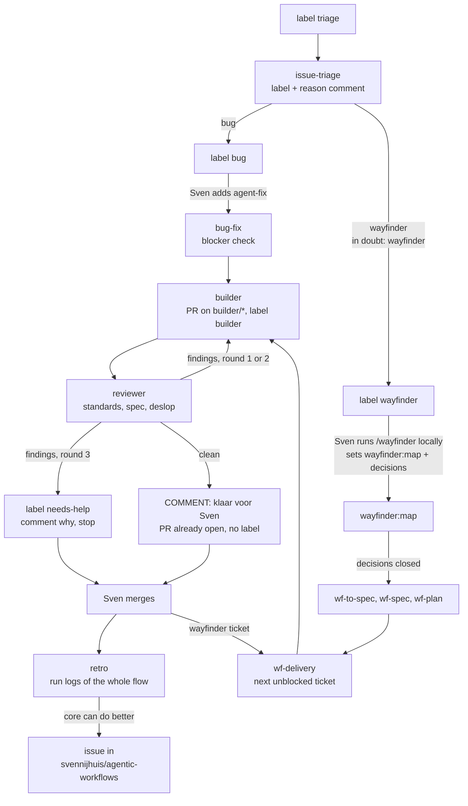
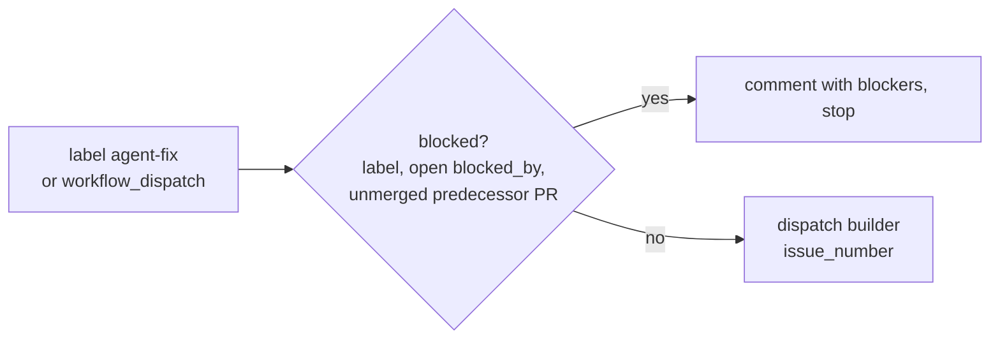
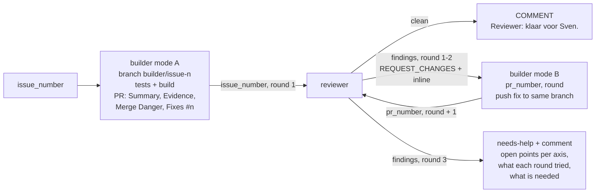
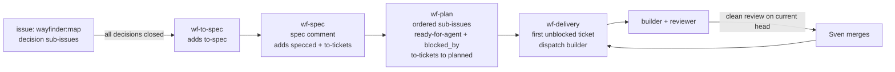
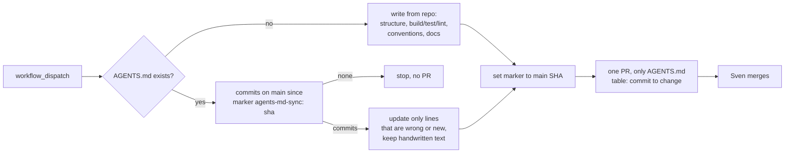

# Installable workflows

This folder is the library. Every workflow lives here, other repositories install from it. In the target repo:

```bash
gh aw add svennijhuis/agentic-workflows/workflows/<name>.md@<tag>
gh aw compile
git add .github/workflows
git commit -m "add <name>"
```

`gh aw add` also fetches the relative `imports:` (shared fragments and the skill copies under [shared/skills/](shared/skills/)) and every workflow named in `dispatch-workflow`, so `builder` brings `reviewer` and the other way round. Commit everything it writes under `.github/workflows/`, including `shared/`: imports are read at runtime from there.

Each file **must** have an `on:` trigger. Kebab-case stem becomes the `gh aw add` id. Each workflow sets cost caps, permissions, and network in frontmatter.

| Workflow | Purpose |
| --- | --- |
| [issue-triage.md](issue-triage.md) | Label `triage`: sets `bug` or `wayfinder` with one reason comment |
| [bug-fix.md](bug-fix.md) | Label `agent-fix`: blocker check, then start the builder |
| [builder.md](builder.md) | Build an issue into a PR on `builder/*`, or fix a PR in a review round. Starts the reviewer |
| [reviewer.md](reviewer.md) | Part of the build loop: reviews a builder PR on three axes. Clean, send back (max 2), or `needs-help`. Started by the builder, not by hand |
| [retro.md](retro.md) | After a builder PR is merged: read the run logs, open a core issue when the flow can do better |
| [wf-to-spec.md](wf-to-spec.md), [wf-spec.md](wf-spec.md), [wf-plan.md](wf-plan.md), [wf-delivery.md](wf-delivery.md) | Wayfinder chain: map to spec, tickets, builder per ticket |
| [agents-md-sync.md](agents-md-sync.md) | Write or update AGENTS.md from main commits |

Shared fragments: [shared/](shared/). Validate in the layout of a target repo: `gh aw compile --dir workflows` fails on `dispatch-workflow`, because the compiler looks for dispatch targets in `.github/workflows/`. See the root [README](../README.md#validate).

## The flow



Sven always merges. Nothing in this folder merges, approves, or assigns Copilot.

Auth and secrets, names only:

- Engine: built for an org. Every workflow sets `copilot-requests: write`, so Copilot runs on the Actions `GITHUB_TOKEN` and is billed to the org. Needs org Copilot policy "Allow use of Copilot CLI billed to the organization". `COPILOT_GITHUB_TOKEN` is then ignored for inference and not needed.
- `AW_CORE_ISSUES_TOKEN`: only for `retro`, a fine-grained token with Issues read and write on `svennijhuis/agentic-workflows`.

Labels: `triage`, `bug`, `wayfinder`, `agent-fix`, `blocked`, `wayfinder:map`, `to-spec`, `specced`, `to-tickets`, `planned`, `ready-for-agent`, plus `builder` (on every builder PR) and `needs-help` (set by the reviewer after round 3). Create `builder` and `needs-help` in the target repo once. There is no "ready for merge" label: a clean review is the comment `Reviewer: klaar voor Sven.` on the PR, and the PR already exists by then.

## issue-triage

[issue-triage.md](issue-triage.md) runs on the label `triage` (or manually with an issue number). It picks `bug` or `wayfinder`, sets that label and posts one comment with the reason. For a bug it asks for repro steps when they are missing. It starts nothing: no tokens spent until Sven adds the next label.

## bug-fix

[bug-fix.md](bug-fix.md) checks one issue for blockers and starts the builder.



- Blocked: the label `blocked`, an open `blocked_by` dependency, or a predecessor PR that is not merged. Clear the blockers and add `agent-fix` again.
- One active ticket at a time: stops when the issue already has an open `builder` PR, or another `agent-fix` issue has one.

## builder and reviewer

[builder.md](builder.md) writes the code, [reviewer.md](reviewer.md) reviews it. Both start only through `workflow_dispatch`: bug-fix, wf-delivery or the other one starts them.



Builder:

- Skills: `implement`, `tdd`, `pr` (imported from [shared/skills/](shared/skills/)).
- Mode A (issue number): smallest change, the repo's own tests and build, one non-draft PR on `builder/issue-<n>` with label `builder`. Body per the `pr` skill plus `Fixes #n`, and `Parent: #map` for wayfinder tickets. Asks one question on the issue instead of guessing.
- Mode B (PR number plus round): reads the open `REQUEST_CHANGES` review, pushes the fix to the same branch, posts a round comment.
- Always starts the reviewer at the end. The PR is emitted before the dispatch, and a failed PR cancels the dispatch.
- Network: gh-aw defaults. A target repo that installs packages adds its ecosystem (for example `node`) under `network.allowed` in its copy.

Reviewer:

- Three axes, each in its own inline sub-agent with a fresh context: **Standards** (`code-review` skill, repo rules plus smell baseline), **Spec** (`code-review` skill, does the diff do what the issue or ticket asks, not more), **Deslop** (`deslop` skill). Parallel when the engine allows, otherwise one after another in the same run.
- Rounds: 1 after the build, 2 and 3 after fix rounds. So the builder gets at most two send-backs: at most 3 builder runs and 3 reviewer runs per PR.
- No endless loop: an `if:` on both workflows lets the builder start only for a new build or fix round 1 or 2, and the reviewer only for round 1 to 3. On top, both count the reviewer's earlier `REQUEST_CHANGES` reviews instead of trusting the round input.
- A clean review supersedes earlier `REQUEST_CHANGES` reviews from this workflow (`supersede-older-reviews`).

PRs opened with `GITHUB_TOKEN` do not trigger `pull_request` workflows, which is why the builder starts the reviewer through dispatch.

## retro

[retro.md](retro.md) runs when Sven merges a PR with label `builder` (or manually with a PR number).

- Skills: `retro` and `writing-for-agents`.
- Input: the run logs (`agentic-workflows` tools `logs` and `audit`, `actions: read`) of the whole flow for that PR: triage, bug-fix or the wf-* chain, every builder and reviewer round, plus the PR timeline.
- Looks at navigation, automated checks, coding standards, tool use, missing information and AGENTS.md.
- Output: no comment on the merged PR. When the core can do better, one issue in `svennijhuis/agentic-workflows` with per finding what went wrong, the run link, the part to fix and a proposal. Otherwise `noop`.

## wayfinder chain

Four workflows copied from [pascalvanderheiden/turbo-agent-skills-cli](https://github.com/pascalvanderheiden/turbo-agent-skills-cli/tree/122b266d451eb8d06a8b96a0933c788c2fb0ac98/.github/workflows) at `122b266`, renamed to [wf-to-spec.md](wf-to-spec.md), [wf-spec.md](wf-spec.md), [wf-plan.md](wf-plan.md), [wf-delivery.md](wf-delivery.md). Labels are the contract between the four. Source per file (all at `122b266`, the workflow files carry no source header):

| File | Source in the upstream repo |
| --- | --- |
| [wf-to-spec.md](wf-to-spec.md) | `.github/workflows/wayfinder-to-spec.md` |
| [wf-spec.md](wf-spec.md) | `.github/workflows/wayfinder-spec.md` |
| [wf-plan.md](wf-plan.md) | `.github/workflows/wayfinder-plan.md` |
| [wf-delivery.md](wf-delivery.md) | `.github/workflows/wayfinder-delivery.md` |

That repo has no license; Sven confirmed copying is fine (2026-11-03).



Start: run `/wayfinder` locally. It creates the parent issue with label `wayfinder:map` and the decision sub-issues. Alternative: `to-spec` on an ordinary issue to skip the decision step. The workflows set the rest. Nobody opens the builder PR by hand; the builder does.

Changed from the source (house rules, applied to all four):

- Renamed to `wf-*`: file, concurrency group and markers (`wf-spec:v1`, `wf-plan:v1`).
- `schedule: every 30 minutes` removed from all four. Event triggers and `workflow_dispatch` stay.
- `wf-spec` and `wf-plan` import `to-spec` and `to-tickets` from [shared/skills/](shared/skills/).
- `wf-delivery`: starts the builder per ticket (`issue_number`, `parent_issue`). The gate for a ticket is a clean reviewer review (`Reviewer: klaar voor Sven.`) on the current head, then it waits for Sven's merge. A `needs-help` PR waits for Sven. The Copilot assignment, draft-to-ready, Copilot code review wait and merge text are gone.

### Version lock

The gh-aw setup action is pinned in [.github/aw/actions-lock.json](../.github/aw/actions-lock.json): `github/gh-aw-actions/setup@v0.93.4` at commit `40fb427c047bb9f77324054adeb574e04c9481aa`. Compile uses that SHA, so every lock file gets the same setup action.

To update: pick the new tag, get its commit with `gh api repos/github/gh-aw-actions/git/ref/tags/<tag>` (for an annotated tag, follow `.object.sha` with `gh api repos/github/gh-aw-actions/git/tags/<sha>`), put version and sha in the file, then recompile.

## agents-md-sync

[agents-md-sync.md](agents-md-sync.md) keeps `AGENTS.md` up to date. Start: manual (`workflow_dispatch`), no schedule.



- Marker: last line `<!-- agents-md-sync: <sha> -->`. No marker yet: the file counts as handwritten, the agent only adds what is missing.
- The PR may only change `AGENTS.md` (`allowed-files`). `AGENTS.md` is a protected file in gh-aw, so the PR gets a caution block and a request-changes review: expected, Sven reviews and merges.
- Nothing changed: no PR.
